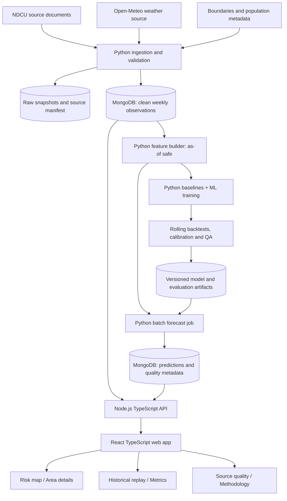

# DengueAhead — Implementation Master Plan (ModelX 2.0, Phase 2 submission)

> **Project:** DengueAhead — Early Warning for Emerging Dengue Hotspots in Sri Lanka  
> **Team:** EchoBinary | **Competition:** ModelX 2.0 | **Domain:** Health & Wellbeing (population-level, non-clinical)  
> **Implementation submission:** **5 November 2026** (team-provided revised deadline)  
> **Primary stack:** React + TypeScript, Node.js + TypeScript, MongoDB, Python ML  
> **Document purpose:** Agent-executable specification, delivery schedule, testing contract, and submission checklist.  
> **Naming note:** "Phase 2" in the title is the competition's implementation phase. "Phase 0–7" below are *internal* delivery phases. Detailed per-phase specs live in `plans/` (e.g. `plans/PHASE_0_IMPLEMENTATION_PLAN.md`).

## 0. Mission and immutable rules

Build a **working and honestly evaluated** decision-support application that helps Sri Lankan public-health planners identify **areas likely to become unusually high-risk for dengue 1–2 weeks ahead**. The distinctive feature is *emerging* hotspots, not a map of current cases. The application is **not** a clinical or official warning service; it does not diagnose, treat, or autonomously direct public-health interventions.

### Non-negotiable acceptance criteria

- [ ] Use **real, verifiable, properly attributed** dengue data, not AI-generated case numbers.
- [ ] Confirm the **actual temporal and geographic coverage** before selecting the forecast geography. Prefer MOH; fall back to **district** if MOH histories are insufficient; label granularity everywhere.
- [ ] Show source name, date of observation, date of retrieval, licence/permission status, extraction success/failure, and gaps.
- [ ] Predict *future* dengue burden/risk using only features available **as of** the forecast date; no look-ahead leakage.
- [ ] Compare against at least **last-observation, rolling-average and seasonal baselines**. Report failures and limitations plainly.
- [ ] Provide **out-of-time backtests** and practical metrics: top-K recall, precision, recall, lead time; add MAE/Brier/calibration when supported.
- [ ] Show genuine **uncertainty and freshness**. No made-up probabilities, confidence intervals, SHAP values, weather, dates, scores, or metrics.
- [ ] Implement a **forecast-withheld** state when minimum evidence/quality thresholds fail.
- [ ] Build complete landing, overview, map, area-detail, comparison, history/backtest, methodology, data-quality, and about/help screens.
- [ ] Produce a reproducible public Git repository, README, architecture/technical report, 2-page summary, and 3-minute real-data demo.
- [ ] Disclose AI tools used and their contributions; credit libraries/models/datasets. All competition-specific work must be the team's own.

**Do not claim** a component is complete unless its automated tests run, its integration test passes, and the required manual verification is recorded. Each phase must end with evidence in `docs/evidence/phase-N/`.

### Evidence and source checks (initial research, not proof of completed ingestion)

- NDCU official weekly report listing: https://www.dengue.health.gov.lk/weekly-report/ — live listing of downloadable weekly reports. Determine each document's format and whether it includes consistent district/MOH *case histories*; a weekly report listing alone does not establish extractable MOH counts.
- NDCU homepage: https://www.dengue.health.gov.lk/ — official dengue surveillance context.
- Open-Meteo historical archive: https://open-meteo.com/en/docs/historical-weather-api — `https://archive-api.open-meteo.com/v1/archive`, coordinates, `start_date`, `end_date`, `daily`, `timezone=Asia/Colombo`. **Historical reanalysis may incorporate information unavailable on the historic issuance date**; document this limitation. Prefer lagged observed/published weather only, and investigate archived historical forecasts if evaluating issuance-time conditions.
- Open-Meteo terms/licensing: https://open-meteo.com/ — attribution required; review rate limits and suitability of API tier.
- Sri Lanka Department of Census and Statistics: https://www.statistics.gov.lk/ — population denominators only when geographic/year alignment is verified.
- Optionally inspect https://github.com/nuuuwan/lk_dengue for historical data; verify provenance, actual licence, geographic/time coverage, and quality rather than assuming permission.

**Before ingestion:** verify site access, robots.txt/terms, actual response format, rights to reuse, and relevant attribution. Store evidence without redistributing files whose terms prohibit it. Do not scrape personal medical records.

---

## 1. Agent operating protocol

Place this file at repository root as `IMPLEMENTATION_PLAN.md`. Every coding agent must read it and `AGENTS.md` before making changes.

1. **Inspect, don't assume.** Read the existing code, open relevant documents, run existing tests, and identify actual dependencies before editing.
2. **One bounded task per branch/PR.** Assign issue IDs (`DATA-01`, `ML-02`, `API-03`, etc.). Avoid simultaneous edits to the same file. Record inputs, outputs, tests, and observed results.
3. **No simulated success.** Synthetic data may be used **only in test fixtures**, clearly labeled `synthetic`; never appear as real production forecasts. Never populate dashboards with unsourced sample values without an unmistakable DEMO/SAMPLE marker.
4. **Provenance is mandatory.** Every prediction references model version, data snapshot IDs, forecast issue timestamp, target week, geographic unit and quality status.
5. **Tests first where practical.** For each feature: add unit tests, implement, run integration tests, capture evidence, update docs.
6. **No unsupported claims.** If no calibrated probability exists, display forecast rank or baseline deviation, not a percentage. If no defensible interval exists, show “interval not available.” If SHAP is unavailable, show transparent feature summaries with explicit distinction from causal explanations.
7. **Security and permissions.** No secrets in git; no open ingestion/admin write endpoints; validate inputs; limit CORS and API payloads; protect MongoDB credentials; rate-limit expensive endpoints.
8. **Keep a working trunk.** Merges require `lint`, `typecheck`, `unit`, `integration`, and build passing (except explicitly documented blocked external-data tests).
9. **When blocked:** post the evidence, impact, fallback, and next experiment. Never silently swap geography, prediction target, model, or dataset.
10. **Final handoff:** report files modified, commands run, pass/fail counts, known limitations, screenshots, source/licence status, and remaining actions.

### Suggested parallel agent roles

| Role | Responsibility | Owns |
|---|---|---|
| Agent A — Data | Source audit, ingestion, normalization, provenance, freshness | `services/ml/src/ingestion`, `data/manifest*`, data tests |
| Agent B — ML | Feature/label design, baselines, model, backtesting/calibration | `services/ml/src/features`, `training`, `evaluation`, ML tests |
| Agent C — API | Node routes, Mongo schemas/indexes, service integration | `apps/api`, API tests |
| Agent D — UI | React screens, design system, charts/maps, Playwright | `apps/web`, UI tests |
| Integrator (human owner) | Schema decisions, QA gates, integration, release and submission | `packages/contracts`, CI, docs, final merge |

For a three-person team, combine responsibilities as needed; the human owner accepts each phase. **No agent may mark its own work accepted without independent verification.**

---

## 2. Scope and delivery order

### Must ship (P0)

- Ingest verified historical and at least one recent official dengue source; preserve raw source metadata.
- Select **one consistent prediction granularity** (district or MOH); publish coverage/missingness audit.
- Use real lagged case features; weather features only if geographically/temporally defensible.
- Historical out-of-time baseline + trained-model comparison; present actual metrics.
- Next-week forecast plus **emerging vs currently high** distinction; 2-week ahead only if validation supports it.
- Quality gates; freshness and uncertainty states; explicit “insufficient data” screen.
- Stable API, Mongo persistence, complete responsive UI, end-to-end scripted demo.
- Full required submission artifacts.

### Should ship (P1)

- Calibrated hotspot probabilities, interval estimates if empirically validated.
- Lagged weather features; area comparison; model explanations; downloadable validation report.
- Geographic boundaries/map at the verified level; historical replay/backtest interactive controls.

### Stretch only (P2)

- Adjacent-area features, SHAP explanations, richer automated refresh, multi-horizon forecasts, alert notifications, advanced animations, admin controls.

**Scope cut order:** animations → LLM/chat → spatial features → SHAP → two-week horizon → complex map interaction. **Never cut provenance, baseline comparison, quality checks, integration testing or reproducible demo.**

---

## 3. System architecture



**Architectural decision:** Python owns ingestion/feature generation/training/inference; Node.js owns HTTP API and reads published MongoDB collections; React consumes only Node.js APIs. For deadline reliability, use **batch inference** instead of an on-request Python model service. A manual/CI/scripted `predict` command creates a versioned prediction batch, which Node serves. No distributed message queue required.

### Repository layout

```text
DengueAhead/
├── IMPLEMENTATION_PLAN.md
├── AGENTS.md
├── README.md
├── .env.example
├── .github/workflows/ci.yml
├── docker-compose.yml
├── plans/                  # per-phase detailed specs
├── configs/                # sources.yaml, model.yaml (templates)
├── e2e/                    # Playwright browser tests
├── apps/
│   ├── web/                # Vite + React + TypeScript
│   │   └── src/{app,components,features,pages,styles,lib,test}/
│   └── api/                # Node.js + TypeScript + Express
│       └── src/{app,config,routes,controllers,services,repositories,schemas,middleware,test}/
├── services/
│   └── ml/
│       ├── pyproject.toml
│       ├── src/dengueahead/{ingestion,validation,features,training,evaluation,inference,cli}/
│       └── tests/{unit,integration,fixtures}/
├── packages/
│   └── contracts/          # JSON Schema / OpenAPI + shared TS types
├── data/
│   ├── manifests/          # source inventory and checksums
│   └── samples/            # small, legally shareable sanitized examples
├── artifacts/              # generated, versioned model metadata (large binaries ignored)
├── docs/
│   ├── architecture.md
│   ├── DATA_SOURCES.md
│   ├── DATA_DICTIONARY.md
│   ├── MODEL_CARD.md
│   ├── EVALUATION.md
│   ├── AI_DISCLOSURE.md
│   ├── LIMITATIONS.md
│   ├── TECHNICAL_REPORT.md
│   ├── TWO_PAGE_SUMMARY.md
│   ├── DEMO_SCRIPT.md
│   └── evidence/phase-0/ ... phase-7/
└── scripts/{dev,seed-test,run-ingestion,train,backtest,predict,smoke}/
```

### Data design — required MongoDB collections

| Collection | Purpose | Required fields | Index |
|---|---|---|---|
| `source_snapshots` | immutable source audit | `sourceId`, `sourceUrl`, `observedPeriod`, `retrievedAt`, `sha256`, `licenceStatus`, `parserVersion`, `status`, `error` | unique `(sourceId, sha256)` |
| `areas` | official geographic registry | `areaId`, `name`, `level`, `parentAreaId`, `centroid`, `geometryRef`, `population`, `populationYear` | unique `areaId`; geospatial only if actual geometry stored |
| `dengue_weekly` | normalized aggregate counts | `areaId`, `weekStart`, `weekEnd`, `cases`, `sourceSnapshotId`, `reportedAt`, `revision`, `qualityFlags` | unique `(areaId, weekStart, revision)`; query `(areaId, weekStart)` |
| `weather_weekly` | joined weather aggregates | `areaId`, `weekStart`, `rainMm`, `tempC`, `humidityPct`, `provider`, `availableAt`, `qualityFlags` | unique `(areaId, weekStart, provider)` |
| `feature_snapshots` | reproducible as-of features | `areaId`, `issueDate`, `targetWeek`, `featureSetVersion`, `features`, `sourceSnapshotIds` | `(areaId, issueDate, featureSetVersion)` |
| `model_runs` | training/evaluation evidence | `modelVersion`, `trainedAt`, `trainRange`, `testRange`, `targetDefinition`, `featureVersion`, `metrics`, `artifactSha256` | unique `modelVersion` |
| `predictions` | published forecasts | `areaId`, `issueDate`, `targetWeek`, `modelVersion`, `pointForecast`, `interval`, `riskProbability`, `status`, `confidenceStatus`, `qualityFlags`, `asOfDate` | unique `(areaId, targetWeek, modelVersion, issueDate)` |
| `pipeline_runs` | operations/monitoring | `runId`, `startedAt`, `endedAt`, `step`, `status`, `counts`, `errors` | unique `runId` |

**Contracts:** `areaId` is a stable code, not a human-readable name; dates use ISO-8601 and explicitly stored UTC instants plus Sri Lankan local reporting week; counts are nonnegative integers or `null` with reason; probabilities are `[0, 1]` **only** if calibrated; intervals require documented method and coverage; no numeric `0` to represent missing data.

### Forecast definition — decide before training

- Unit: chosen **district** or **MOH** area, never silently mixed on the same leaderboard.
- Issue time: publication-aware weekly cutoff; no features published after cutoff.
- Horizon: **next fully unseen reporting week**; optional week +2 only after validation.
- Regression label: `cases(area, target_week)`; optionally incidence per 100,000 if population denominator matches geography/time.
- Emerging-event label: a **pre-registered** area-specific threshold (e.g. surpassing a rolling seasonal percentile *estimated only on training history*) **and** current week not already above threshold. Freeze this definition in `docs/EVALUATION.md` before scoring.
- States: `EMERGING` (not currently high, expected to cross threshold), `PERSISTENT` (currently high, remains high), `COOLING` (currently high, predicted below threshold), `STABLE` (otherwise), `WITHHELD` (cannot make warranted forecast).
- Withheld rules: missing required lags, unreliable geography, unverified source, stale case reports beyond configured policy, unavailable model, failed schema validation, extreme out-of-distribution inputs with no documented safe handling.
- **Important:** do not interpret an arbitrary classifier score as a calibrated probability. Avoid causal or medical claims from SHAP correlations.

---

## 4. User experience and complete page specification

### Visual direction

**Brand:** DengueAhead — *See the next hotspot before it emerges.*  
**Style:** credible public-health intelligence product; modern editorial typography, clean airy grids, restrained scientific visualization, high contrast, clear attribution, professional rather than alarmist.  
**Palette:** deep navy `#0B1730` (text), ocean blue `#2563EB` (primary), teal `#0D9488` (positive/stable), amber `#D97706` (emerging), coral `#DC4754` (persistent/high), cool gray `#F5F7FB` (surface), white `#FFFFFF`. Use icons, labels and shapes **as well as color**.  
**Type:** Inter or another openly licensed sans-serif.  
**Layout:** desktop 12-column grid, max content width ~1440 px, 8-pt spacing system; 16 px body; clear typography scale; tablet/mobile responsive; skeleton states; empty/error/stale states for every data widget.  
**Components:** buttons, inputs, area selector, date/week selector, risk badge, source badge, metric cards, uncertainty chip, charts, map legend, filtering toolbar, collapsible methodology cards, drawers, data tables, tooltips, loading placeholders.

### Navigation and routes

| Route | Page | Required content | Automated/manual acceptance |
|---|---|---|---|
| `/` | **Landing** | Hero message + two CTAs (“Explore risk map”, “See how it works”), product problem, 3-step explanation, trustworthy sample preview **clearly labeled**, real data sources, safety caveat, team/footer | CTAs work; clear non-clinical disclaimer; no fake live metrics |
| `/app/overview` | **Overview dashboard** | Latest issuance/status, areas covered, emerging/persistent counts, top 5 emerging, current-vs-future comparison, source freshness | Filters keep counters/cards consistent; stale/empty states |
| `/app/map` | **Risk map** | Leaflet choropleth **only if validated boundaries**, fallback geocoded circle markers or sortable area list; zoom/filter/legend; hover/click selects area | Correct area join; color+text semantics; graceful missing geometry |
| `/app/areas/:areaId` | **Area detail** | Historical cases, next-week forecast and interval if validated, seasonal baseline, status, drivers, neighboring context if real, timestamps, warnings | One API-backed area only; chart has no made-up intervals |
| `/app/compare` | **Comparison** | Compare up to 3 areas with aligned weeks, incidence/case-scale caveat, trends, risk changes | Equal dates and units; direct-link/share state |
| `/app/history` | **Historical replay** | Choose historical issue week and view model forecast **as of that time**, reveal actual next week, baseline comparisons | Strict time cutoff; actual hidden until “Reveal outcome” |
| `/app/model` | **Model and evaluation** | Model version, training range, dataset size, target, MAE/recall/precision/top-K, baseline table, calibration and limits | All metrics match backend run artifacts |
| `/app/data-quality` | **Data quality** | Source registry, last observed/retrieved, missing weeks, parse errors, licence status, area coverage, refresh failures | Meaningful offline/failure views; no false “live” indicator |
| `/methodology` | **Public methodology** | What is forecast, how risk is defined, data sources, backtesting, limitations, non-clinical statement | Link from every forecast; readable on mobile |
| `/about` | **About/team/contact** | EchoBinary, project goals, data attribution, AI-assistance disclosure, GitHub link, limitations | No invented contact details; attribution visible |
| `*` | **404/error boundary** | Useful recovery links and retry | Test bad paths, API errors, no crash |

### Wireframe: landing

```text
┌─────────────────────────────────────────────────────────────────────┐
│ DengueAhead                 How it works   Data & trust   About  [Explore] │
├─────────────────────────────────────────────────────────────────────┤
│ UNDERSTAND TOMORROW'S RISK                                       │
│ See the next hotspot before it emerges.                          │
│ Evidence-driven dengue risk forecasting for public-health teams. │
│ [Explore risk map]  [Watch historical replay]                     │
│                                        [illustrative risk-map preview]
├─────────────────────────────────────────────────────────────────────┤
│ [01 Reported cases] → [02 Temporal & weather signals] → [03 Forecast] │
│ What makes it different  |  Data trust and limitations            │
├─────────────────────────────────────────────────────────────────────┤
│ NDCU / weather attribution   |  Educational decision support only  │
└─────────────────────────────────────────────────────────────────────┘
```

### Wireframe: application

```text
┌────────────┬────────────────────────────────────────────────────────┐
│ Logo       │ Forecast issue date  Geographic level  [Data status] │
│ Overview   ├────────────────────────────────────────────────────────┤
│ Risk map   │ [Areas monitored] [Emerging] [Persistent] [Withheld]  │
│ Compare    ├─────────────────────────────┬──────────────────────────┤
│ History    │ Risk map / fallback area list│ Top emerging areas       │
│ Model      │ zoom, legend, filters       │ risk, change, freshness  │
│ Data       ├─────────────────────────────┴──────────────────────────┤
│ Quality    │ Recent trends  |  Source freshness | Model limitations │
└────────────┴────────────────────────────────────────────────────────┘
```

### UI behavior and accessibility contract

- Responsive: verify widths **360, 768, 1024, 1440 px** without horizontal overflow.
- Keyboard navigation, focus states, semantic headings, labeled inputs, aria-live for refreshed status.
- Map must have equivalent **keyboard-accessible searchable list**; never rely on colored map alone.
- Display “retrieved at”, “observed for week”, and “forecast issued at” separately.
- Do not display “HIGH CONFIDENCE” unless validated reliability supports a specific documented rule.
- Charts must clearly distinguish observed, predicted, seasonal, and uncertainty; readable tooltips and data-table alternatives.
- All UI components have loading, empty, API-error, invalid-data and withheld variants.
- Use no stock patient photos or fear-driven imagery; prefer original vector/visual data treatment.

---

## 5. Backend API contract (Node + Express)

All responses include a version marker and timestamps; use Zod or JSON Schema for runtime validation; TS types generated or shared from contracts. Standard error: `{ "error": { "code": "...", "message": "...", "requestId": "..." } }`.

| Method/path | Purpose | Key fields / constraints |
|---|---|---|
| `GET /api/v1/health` | liveness | `status`, `apiVersion`, `timestamp` |
| `GET /api/v1/readiness` | DB/data readiness | component status; 503 if unavailable |
| `GET /api/v1/meta` | latest issue, geography, model | `level`, `issueDate`, `modelVersion`, `sourceStatus` |
| `GET /api/v1/areas?query=&level=` | area registry | paginated list + population/geometry availability |
| `GET /api/v1/overview?issueDate=` | national snapshot | count per status, top emerging, withheld count |
| `GET /api/v1/predictions?issueDate=&status=&limit=&cursor=` | ranked forecasts | filters/sort, quality flags, calibrated risk only if available |
| `GET /api/v1/areas/:areaId` | single area | name, geography, metadata |
| `GET /api/v1/areas/:areaId/series?from=&to=` | observed history | weekly count and source completeness |
| `GET /api/v1/areas/:areaId/forecast?issueDate=` | area forecast | point, interval nullable, status, explanation, provenance |
| `GET /api/v1/compare?areaIds=A,B,C&issueDate=` | consistent comparison | max 3, units, timeline |
| `GET /api/v1/backtests?modelVersion=&issueDate=` | historical predictions | predictions, optional actual after reveal action (UI only) |
| `GET /api/v1/evaluation?modelVersion=` | evaluation | actual baseline comparison and model metadata |
| `GET /api/v1/sources` | data audit | source and licence status, freshness, coverage, errors |
| `GET /api/v1/methodology` | methodology metadata | target, thresholds, known limitations |

**API requirements:** capped pagination, date validation, strict area ID matching, no Mongo query operator injection, structured error logging, correlation IDs, CORS allowlist, sensible read timeouts, rate limiting. Only read endpoints exposed publicly; Python jobs write to DB via an independently configured service credential. Disable arbitrary Python execution from HTTP.

Sample **shape only** (not a real forecast):

```json
{
  "areaId": "EXAMPLE_AREA_ID",
  "geographicLevel": "district",
  "issueDate": "2026-10-25",
  "targetWeek": "2026-10-26",
  "modelVersion": "model-example-v1",
  "status": "WITHHELD",
  "pointForecast": null,
  "interval": null,
  "riskProbability": null,
  "qualityFlags": ["INSUFFICIENT_SOURCE_COVERAGE"],
  "sourceSnapshotIds": [],
  "asOfDate": "2026-10-25"
}
```

---

## 6. Quality and test strategy

### Test layers and commands

| Layer | Recommended tools | Required checks |
|---|---|---|
| Python unit | `pytest`, `ruff`, `mypy` optional | parsers, normalization, lag functions, targets, leakage, quality |
| Python integration | `pytest` + fixture snapshots + test Mongo | extract → normalize → features → train → forecast → publish |
| Node unit/API | Vitest/Jest + Supertest + Zod | validation, service mapping, errors, pagination, query guards |
| Mongo integration | disposable Docker Mongo or Testcontainers | indexes, upsert idempotence, latest revision resolution |
| React unit | Vitest + Testing Library + axe checks | UI states, sorting, filters, badges, graph labels |
| Browser E2E | Playwright | landing → overview → map → area → history → quality; mobile |
| Full-system | Docker Compose + seeded verified fixture | Python publishes → Mongo → Node → React end to end |
| Reliability/security | failure injection + `npm audit`/`pip-audit` | disconnected sources, stale data, malformed API, no secrets |

Use a **small deterministic test fixture** (synthetic clearly marked as test-only) for CI; use a **small verified real-data snapshot** for a separate documented integration/demo run, subject to source licence. Do not require live networks for CI.

### Global test invariants

- [ ] No future-issued source enters an older prediction's feature vector.
- [ ] Training/validation/test split by **time**, not shuffled individual rows; avoid spatial cross-area leakage via aggregations.
- [ ] Seasonal averages/quantiles derived only from training history available at the cutoff.
- [ ] Forecasted area matches reported area geometry/name/version.
- [ ] All counts nonnegative, no duplicate `(area, week, version)` effective records.
- [ ] If denominator missing, display cases, **not** invented incidence per 100,000.
- [ ] If model or data quality is insufficient, `WITHHELD` carries `null` predictions; UI never turns it into zero.
- [ ] Every numerical metric displayed derives from `model_runs` or recorded evaluation artifact.
- [ ] Every published prediction can be traced to source snapshot and model version.
- [ ] Service failures return structured errors, not HTTP 200 empty success.
- [ ] P95 performance is measured with representative test data; avoid claiming particular SLAs without measurement.

### Cross-phase integration gate (mandatory every phase)

1. Start infrastructure using `docker compose up -d mongodb`; check health.
2. Run relevant Python ETL/ML command against test dataset and Mongo test DB.
3. Query Mongo to verify counts, unique keys and source attribution.
4. Launch Node API; validate `/health`, `/readiness`, and affected domain endpoints.
5. Launch React; run the affected Playwright workflow.
6. Induce at least one failure (offline source, missing document, stale dataset, malformed model field) and verify truthful behavior.
7. Record `date`, `git SHA`, commands, test results, screenshots/logs, and open defects in phase evidence.

---

## 7. Phase-by-phase work plan and acceptance gates

> **Timebox:** 29 Oct–5 Nov 2026. Dates are sequencing targets, not proof work has been completed. Parallelize frontend design and data ingestion; do **not** let visual progress hide data/model blockers.

### Phase 0 — Repo, architecture, contracts, CI (29 Oct, first block)

> Detailed specification: `plans/PHASE_0_IMPLEMENTATION_PLAN.md`.

**Agent tasks (automated):**
- [ ] Initialize monorepo, npm workspaces, Python project, `.editorconfig`, `.gitignore`, `.env.example`, Docker Compose Mongo.
- [ ] Set TypeScript strict mode and shared contract schemas.
- [ ] Scaffold Express `/health` + React shell + Python `--help` CLI.
- [ ] Set up ESLint, Prettier, Vitest, pytest, Ruff and Playwright; CI jobs with caching.
- [ ] Add `README.md`, `AGENTS.md`, issue board and phase evidence folders.

**Human/manual tasks:**
- [ ] Verify all team members can clone/run; decide code ownership and branch rules.
- [ ] Confirm revised Nov 5 deadline from organizers; verify current submission upload requirements.
- [ ] Create repository and set it public **by submission**, not necessarily immediately.

**Unit tests:** environment schema rejects missing DB URI; contract schema rejects malformed forecast; API health returns 200; React shell renders.

**Integration tests:** clean checkout → `docker compose up` → API connects → React calls `/health`; CI green on fresh runner.

**Gate:** fresh-install reproducibility from README; contracts and architecture frozen enough for parallel work.

### Phase 1 — Data acquisition, rights, provenance, geographic feasibility (29–30 Oct)

**Agent tasks (automated):**
- [ ] Inspect official NDCU downloadable reports and find actual downloadable case counts + time/geography coverage.
- [ ] Write a **machine-readable source manifest** (URL, owner, retrievedAt, observation period, licence, format, SHA-256, parser version).
- [ ] Implement document fetch with bounded retries, timeout, content-type validation and raw-snapshot storage.
- [ ] Implement parsers per confirmed format (HTML, CSV, PDF tables as appropriate); do not use brittle OCR unless unavoidable and manually audited.
- [ ] Normalize area names using explicit mapping with unmatched values logged; normalize reporting week.
- [ ] Audit number of unique areas/weeks, zero/missing values, gaps, apparent revisions.
- [ ] Query Open-Meteo sample for verified coordinates; aggregate daily weather into weekly lag features only after time-alignment check.
- [ ] Implement Mongo `source_snapshots`, `areas`, `dengue_weekly` and `weather_weekly` schema and idempotent upserts.

**Human/manual tasks:**
- [ ] Open at least 3 reports from different dates; verify parser numbers manually against original pages.
- [ ] Verify rights/terms/robots/attribution; record proof and restrictions.
- [ ] **Go/no-go:** choose MOH only if enough historical area-week records; otherwise choose district and document rationale.
- [ ] Verify reporting dates vs observed-week dates and identify reporting delay; sign off source audit.
- [ ] Inspect 10 randomly sampled area-week records for accuracy.

**Unit test cases:**
- `DATA-01` duplicated document hash is idempotent.
- `DATA-02` missing week remains missing, never becomes zero.
- `DATA-03` inconsistent area aliases resolve or get quarantined.
- `DATA-04` a changed report table format raises a parse error, not silently wrong cases.
- `DATA-05` invalid/negative counts rejected with traceable reason.
- `DATA-06` Open-Meteo missing daily values yield flagged weekly missingness.
- `DATA-07` original date/time and retrieval timestamp remain distinct.

**Integration tests:** verified source fixture → download/parser → Mongo → API `/sources` and `/areas`; run twice, confirm same effective case records; disconnect network and confirm cached snapshot labeled stale.

**Gate:** publish `docs/DATA_SOURCES.md`, `docs/DATA_DICTIONARY.md`, coverage table, manual spot-check log, geography decision. **STOP forecasting development if no real usable historical case series exists; re-scope honestly.**

### Phase 2 — Labels, features and baseline forecasts (30–31 Oct)

**Agent tasks (automated):**
- [ ] Define prediction issue cutoff, next-week label, high-risk threshold and emerging-state criteria.
- [ ] Construct area-wise lag 1–4 case counts, weekly growth, moving averages and seasonality.
- [ ] Build optional weather lag 1–3 weeks, using only historically available observations.
- [ ] Enforce minimum history, missingness and stale rules.
- [ ] Implement last-week, rolling-four-week and seasonal baseline predictions.
- [ ] Generate train/validation/test splits and rolling temporal folds, persist exact dates.

**Human/manual tasks:**
- [ ] Review one complete area's feature values by hand for two consecutive issue dates.
- [ ] Agree whether evaluation measures raw counts or per-capita incidence; freeze threshold definition.
- [ ] Check baseline forecast plausibility in high- and low-incidence areas.

**Unit test cases:**
- `FEAT-01` changing target-week cases cannot change current-week features.
- `FEAT-02` lags never use data after issue cutoff.
- `FEAT-03` moving average excludes target period.
- `FEAT-04` seasonal threshold never learns from test period.
- `FEAT-05` all missing lags trigger configured fallback/withheld.
- `FEAT-06` no division by zero in growth or incidence.
- `FEAT-07` classification consistent for stable/emerging/persistent/cooling.

**Integration tests:** Mongo clean weekly data → features → baselines → `model_runs` evaluation record; compare hand-calculated fixture against stored features; publish baseline to API `/evaluation`.

**Gate:** leakage tests green; baseline metrics recorded, target formalized, reproducible data split.

### Phase 3 — ML training, backtesting, explainability, uncertainty (31 Oct–1 Nov)

**Agent tasks (automated):**
- [ ] Train regularized logistic classifier (if risk target) and LightGBM/XGBoost (regression and/or classification) with fixed seeds/versioned configs.
- [ ] Tune on rolling validation only; reserve a later untouched test window.
- [ ] Evaluate MAE (case counts), future-hotspot recall, precision, top-K recall, lead time; Brier/reliability only for risk probability.
- [ ] Determine whether model improves baselines **materially**; retain baseline if not.
- [ ] Optionally calibrate class probabilities on a separate temporal calibration period; never calibrate on test.
- [ ] If defensible, produce empirical prediction intervals and report achieved test coverage; otherwise omit interval.
- [ ] Generate top feature contributions using supported methods; label association not causation.
- [ ] Persist `modelVersion`, feature set hash, dataset hash, split date ranges, metrics and serialized artifact hash.

**Human/manual tasks:**
- [ ] Inspect confusion cases: false alarm, missed hotspot, unusual region/week.
- [ ] Audit 3 replay examples and verify historical availability of every input.
- [ ] Decide honest model-selection outcome; approve metrics for presentation.

**Unit test cases:**
- `ML-01` same version/seed/data produces acceptably reproducible metrics.
- `ML-02` model cannot read target or future features during fitting/inference.
- `ML-03` probabilities in `[0,1]`; invalid/uncalibrated → `null` or flagged, never fake precision.
- `ML-04` no negative published count predictions (clip with documentation or proper target link).
- `ML-05` trained feature schema mismatch → fail safely.
- `ML-06` missing model artifact → withheld result.
- `ML-07` top-K uses only area scores at same issue date.

**Integration tests:** versioned features → train → evaluate → serialize → reload → infer → Mongo predictions → Node evaluation/forecast endpoints. Check stored metric equality against generated JSON file. Test missing/corrupt artifact.

**Gate:** real held-out backtest complete, comparison chart exists, model card written, no fabricated confidence.

### Phase 4 — Reliable forecast publishing and Node API (1–2 Nov)

**Agent tasks (automated):**
- [ ] Implement Python `predict` batch with required data-quality gating and idempotent versioned publish.
- [ ] Implement all `/api/v1` routes with controller/service/repository separation.
- [ ] Use Mongo indexes, projection, pagination and validated query params.
- [ ] Add source freshness and failure metadata to responses.
- [ ] Add structured logging, request IDs, error middleware and readiness behavior.
- [ ] Generate OpenAPI schema and contract fixtures for frontend.

**Human/manual tasks:**
- [ ] Examine actual example response for every endpoint; check reported numbers against Mongo and source snapshot.
- [ ] Confirm only public read endpoints accessible; review secret handling.
- [ ] Verify no stale forecast is labeled current.

**Unit test cases:**
- `API-01` nonexistent area → 404.
- `API-02` invalid date/status/limit → 400 with structured error.
- `API-03` Mongo downtime → 503, not empty success.
- `API-04` injection-shaped query parameters rejected/treated as strings.
- `API-05` withheld forecast serializes numeric fields as `null`.
- `API-06` latest forecast resolves correct `issueDate` + `modelVersion`.
- `API-07` area comparison rejects mixed units/levels.

**Integration tests:** Python publishes model run and predictions → Mongo → Node API `GET /overview`, `/predictions`, `/areas/:id/forecast`, `/evaluation`, `/sources`; verify exact schema and provenance. Run API tests against disposable Mongo, not mocks only.

**Gate:** API contract stable; browser can consume all required data without direct database access.

### Phase 5 — React design system, landing and full dashboard experience (2–3 Nov)

**Agent tasks (automated):**
- [ ] Scaffold React/Vite TypeScript, router, TanStack Query, chart library (Recharts), Leaflet, icons, accessible component primitives and CSS/Tailwind design tokens.
- [ ] Build landing with responsive hero, illustrative preview label, CTAs, methodology and attribution footer.
- [ ] Build app shell with side nav, mobile nav, date/granularity selector and global data-status chip.
- [ ] Build Overview, Risk Map/fallback list, Area Detail, Compare, History replay, Model/Evaluation, Data Quality, Methodology, About, error page.
- [ ] Implement actual API hooks, loading/error/empty/withheld states; URL-synced filters.
- [ ] Add charts with proper units; calibrated probability only if backend provides it; no unverified stats.
- [ ] Use real geometric files only if legally usable and mapping to area IDs is verified.

**Human/manual tasks:**
- [ ] Design review across desktop/tablet/mobile; contrast and keyboard check.
- [ ] Verify map colors and legend match status text; verify no map implies more spatial precision than source supports.
- [ ] Verify all wording is non-clinical and cautions that outputs aid, not replace, public-health judgement.
- [ ] Check 5 real area detail screens and source timestamps manually.

**Unit test cases:**
- `UI-01` landing CTAs navigate properly.
- `UI-02` empty data renders honest empty state.
- `UI-03` withheld result does not display numeric forecast.
- `UI-04` stale warning is visually obvious and accessible.
- `UI-05` changing issue date refetches correct data.
- `UI-06` comparison enforces max 3 areas and consistent units.
- `UI-07` charts visually/semantically differentiate observed vs predicted.
- `UI-08` map search/list works without pointer input.

**Integration/E2E tests:** Playwright: landing → overview → map/list → area detail → compare → history replay → data quality → methodology; mobile viewport; API 500/timeout/empty response; forbidden invalid area route. Assert no console errors and no horizontal overflow.

**Gate:** every specified route functional, sourced data displayed accurately, mobile usability and accessible alternatives verified.

### Phase 6 — System reliability, end-to-end validation and UX polish (3–4 Nov)

**Agent tasks (automated):**
- [ ] Add source/update status badges and explicit fail-safe messages.
- [ ] Run entire Compose system from scratch and real-data smoke test.
- [ ] Add Mongo index checks, dependency audit, secret scan, React error boundary, retry policies.
- [ ] Benchmark route response times with representative data; optimize excessive queries.
- [ ] Capture CI logs, browser screenshots, backtest plots and source evidence.
- [ ] Validate all final artifact outputs against code and dataset manifests.

**Human/manual tasks:**
- [ ] Verify 3 genuine predictions from original raw source → feature → score → API → UI.
- [ ] Perform demo rehearsal with network unavailable; identify fallback behavior.
- [ ] Ask teammate not involved in implementation to follow README on a clean machine.
- [ ] Review claims and disclaimers against actual evaluation; remove anything unsupported.

**Unit test cases:** feature flags; stale thresholds; fallback display; error boundary; source-link validation.

**Integration tests:** full real-data end-to-end run; stop Mongo then verify 503 + UI friendly failure; corrupt one source and verify quarantine; delete model artifact and verify withheld; compare actual UI metrics to evaluation JSON; run Playwright all routes and screenshot regressions.

**Gate:** all P0 green and evidenced; critical defects fixed; known limitations documented, no fake data on production routes.

### Phase 7 — Submission freeze and final delivery (4–5 Nov)

**Agent tasks (automated):**
- [ ] Generate test report, source coverage table, architecture diagram, model card, and evaluated metrics table from recorded artifacts.
- [ ] Write technical report: system architecture, stack/choice rationale, final dataset and its temporality/gaps, proposal-vs-built deviations, experiments, baselines, failures, ethical/privacy/licence notes.
- [ ] Write 2-page summary with actual user problem, prediction, data, method, performance, demo screenshots and limits.
- [ ] Write clean-room README with setup, data source access, env vars, ingestion, training, backtesting, prediction publishing, services and troubleshooting.
- [ ] Produce 3-minute video script and recording checklist; prepare screen recording using **real** data and working app.
- [ ] Final `lint`, typecheck, unit, integration, E2E, build, security and clean-install tests.

**Human/manual tasks:**
- [ ] Record real-data demo, narrate provenance and an emerging-hotspot insight; show baseline comparison and fail-safe behavior.
- [ ] Inspect public GitHub while logged out (repository, code, README, licence, runnable instructions).
- [ ] Remove credentials, tokens, personal data and unsupported copyrighted source files from commits/history.
- [ ] Verify organizer-required file formats, upload portal, timestamps and repository visibility; submit before **5 Nov** cutoff.
- [ ] Ensure AI assistance disclosure accurately lists tools and team review of outputs.
- [ ] Keep submission receipt/screenshots in `docs/evidence/phase-7`.

**Unit/doc tests:** all Markdown links, JSON Schema references, scripts and command examples are valid; no placeholders in final report except clearly labeled unavailable items.

**Integration tests:** independent fresh clone → install → start Mongo → process permitted real fixture/source → train/load → predict → API → dashboard → run E2E. Video matches this state exactly.

**Gate:** all four mandatory submission artifacts exist and are independently accessible; report accurately reflects repo/metrics; evidence archived.

---

## 8. Master test matrix — release blocker list

| ID | Scenario | Expected behavior | Owner |
|---|---|---|---|
| E2E-01 | Fresh clone + local startup | documented scripts run without hidden manual steps | Integrator |
| E2E-02 | Real dengue report ingested | totals match source sample and provenance stored | Data |
| E2E-03 | Duplicate source fetched | no duplicate effective weekly counts | Data |
| E2E-04 | Missing historic week | quality flag; no fake zero | Data |
| E2E-05 | Weather source unavailable | labeled stale/missing, no silent replacement | Data/API |
| E2E-06 | Historical replay | zero future observation leakage | ML |
| E2E-07 | Model worse than baseline | UI/report states failure; baselines shown | ML/UI |
| E2E-08 | Uncalibrated model | no percent probability presented as calibrated | ML/API/UI |
| E2E-09 | Incomplete current reporting | WITHHELD response and clear dashboard state | ML/API/UI |
| E2E-10 | Valid prediction | trace source → feature → model → Mongo → API → UI | All |
| E2E-11 | Changed target week | every KPI/chart/list synchronized | API/UI |
| E2E-12 | Area map mismatch | quarantined/fallback, never misleading polygon | Data/UI |
| E2E-13 | Mongo unreachable | readiness 503; frontend recovery state | API/UI |
| E2E-14 | 360 px mobile + keyboard | navigable without overflow/map dependency | UI |
| E2E-15 | Old model artifact missing | forecast withheld, no stale model as current | ML/API |
| E2E-16 | Public logged-out repo | clone works and no secret exposed | Integrator |
| E2E-17 | Demo replay | reproducible forecast/backtest and explicit limits | All |

**Release rule:** No unresolved P0 defects. Record any remaining P1/P2 limitation in `docs/LIMITATIONS.md` and final report.

---

## 9. CI/CD and local command contract

Agents may adapt implementation details, but ensure top-level scripts expose **these stable commands**:

```bash
# dependencies and local services
npm install
python -m pip install -e 'services/ml[dev]'
docker compose up -d mongodb

# verification
npm run lint
npm run typecheck
npm run test:unit
npm run test:integration
npm run test:e2e
npm run build
python -m pytest services/ml/tests

# data/model operations (implement CLI entrypoint named dengueahead)
dengueahead audit-sources --config configs/sources.yaml
dengueahead ingest --config configs/sources.yaml
dengueahead validate-data
dengueahead build-features --as-of YYYY-MM-DD
dengueahead train --config configs/model.yaml
dengueahead backtest --config configs/model.yaml
dengueahead predict --as-of YYYY-MM-DD --publish

# applications
npm run dev:api
npm run dev:web
```

**Commands above are target contracts; they must be created by agents and verified. They are not claims that the repository already implements them.** Include starter configuration templates in `configs/`. CI must run on pull requests, preserve test reports and never rely on a live external network for deterministic checks.

### Manual QA checklist (perform each day)

- [ ] Look at source registry and last ingestion logs; verify timestamps against actual source.
- [ ] Read one random source value and compare it with one dashboard value.
- [ ] Review one withheld/failed prediction; ensure failure explanation is accurate.
- [ ] Check browser console and network tab on all touched pages.
- [ ] Test keyboard and 360 px layout on modified routes.
- [ ] Check latest CI result, merge conflicts and open critical issues.
- [ ] Push incremental commits; update `docs/evidence` with observed results.

---

## 10. Judging alignment and evidence to show

| ModelX implementation scoring | Weight | Concrete proof to include |
|---|---:|---|
| **Data work** | **30%** | official source samples, extraction code, coverage/quality report, licensing, temporality, last refresh and failure handling |
| **Insight delivered** | **25%** | verified historical emerging-area example, risk-vs-current ranking, top-K or lead-time comparison |
| **Engineering quality** | **25%** | modular stack, contracts, clean build, CI, test results, commit history, transparent report |
| **Functionality demonstrated** | **20%** | 3-minute real-data run: ingestion/source → prediction → dashboard → historical replay → fail-safe |

**Video storyboard (180 seconds maximum):**

1. `0:00–0:20`: name user and decision; contrast current cases vs emerging risk.
2. `0:20–0:45`: show source registry, actual reporting period and data pipeline.
3. `0:45–1:25`: show next-week risk map/list and drill into one real area with real features.
4. `1:25–2:10`: historical as-of replay; reveal actual outcome and baseline comparison.
5. `2:10–2:35`: show evaluation metrics and one honest limitation.
6. `2:35–2:50`: inject missing/stale data and demonstrate **WITHHELD**.
7. `2:50–3:00`: show repo and summarize decision-support value.

**Do not script a false claim of correctly foreseeing an outbreak.** Select examples based on genuine documented backtests; show a failed forecast too if the model is weak.

---

## 11. Submission deliverables and acceptance criteria

### A. Technical report (reflects actual build, not aspirational proposal)

- [ ] Problem and named user.
- [ ] Implemented scope and **explicit deviations from Phase 1** (e.g., district instead of MOH).
- [ ] Architecture and technology rationale (React, Node, Mongo, Python).
- [ ] Data manifest: origin, extraction, observed and retrieved dates, number of areas/weeks, missingness, licence, limitations.
- [ ] Target definition, features, modelling choices and rejection of alternatives.
- [ ] Temporal evaluation protocol, results table vs baselines, calibration/uncertainty and failure analysis.
- [ ] Security, privacy, responsible-use boundaries and fail-safe logic.
- [ ] Screenshots of functioning real-data app and actual outputs.
- [ ] Reproducible steps plus environment/version info.

### B. Public Git repository

- [ ] Source code for front/backend/ML/ETL, no compiled-only artifact.
- [ ] `README.md` runs on a clean computer with stated prerequisites.
- [ ] `.env.example`; no secrets or forbidden private data.
- [ ] Sample legally redistributable fixture or instructions to reproduce source download.
- [ ] CI badges/logs, tests, meaningful commit history, citations/attribution, AI disclosure.

### C. Two-page summary

- [ ] One-page story: user, current expertise gap, new forecast insight and dashboard screenshot.
- [ ] One-page evidence: data, method, measured improvement or lack thereof, risks, source dates, impact and limitation.

### D. Three-minute video

- [ ] Show real app, real sourced data and actual model output (not Figma/mockups).
- [ ] Show historical backtesting and a baseline.
- [ ] Demonstrate source freshness + withheld behavior.
- [ ] Show concise end-to-end behavior and reproducible project link.

---

## 12. Prompt templates for autonomous coding agents

### Task assignment prompt

```text
You are implementing DengueAhead for ModelX 2.0. Read IMPLEMENTATION_PLAN.md and AGENTS.md completely before edits.
Your assigned phase is: <PHASE / ISSUE IDs>.
Inspect current repo first. Implement only the assigned scope, following real-data provenance and non-clinical rules.
Before coding, list proposed files and dependencies and create/confirm the relevant tests.
Implement production code plus unit tests, integration tests, and documentation/evidence.
Run all applicable commands; fix failures. Do not claim a test passed if not run.
Do not invent epidemiological data, model scores, dates, calibrated probabilities, shap values, boundaries, or source permissions.
Do not edit files owned by other agents without notifying the integrator.
At handoff provide changed files, exact run commands, test results, screenshots/evidence, limitations, and blocked items.
```

### Independent QA agent prompt

```text
Act as an independent QA reviewer of <PHASE>. Read IMPLEMENTATION_PLAN.md, inspect changed code and requirements.
Run unit and integration tests; perform a real-source trace for at least one output; inspect time leakage, provenance and stale-data rules.
Challenge every claim in the dashboard and report against stored artifacts.
Return PASS/FAIL per acceptance criterion with reproducible steps, evidence paths, and severity-ranked defects.
Do not modify production code unless explicitly assigned to fix defects.
```

### Integrator final review prompt

```text
Review DengueAhead as ModelX judges would: 30% data work, 25% insight, 25% engineering, 20% functionality.
Perform a clean install, run the complete test matrix, check data source licences, compare displayed metrics to actual evaluation artifacts, and verify all submission documents.
Identify all unsupported claims, missing tests, incomplete routes, misleading risk presentation and code/report inconsistencies.
Produce an evidence-based GO / NO-GO decision and exact blockers; never invent passing results.
```

---

## 13. Practical day-by-day priority board

| Date | Absolute priority | Completion evidence |
|---|---|---|
| **Thu 29 Oct** | scaffold + **verify actual dengue data** + decide geography | source manifest, sample extracted records, repo boot |
| **Fri 30 Oct** | ingestion/normalization and leakage-safe features | verified real data in Mongo, parser/feature tests |
| **Sat 31 Oct** | baseline and ML backtest | evaluation JSON, model card draft, leakage tests |
| **Sun 1 Nov** | inference publishing and complete API | prediction record + Node routes + integration tests |
| **Mon 2 Nov** | polished landing and core dashboards | overview/map/area detail with real API data |
| **Tue 3 Nov** | remaining routes, quality states, historical replay | all critical E2E flows pass |
| **Wed 4 Nov** | full-system QA, technical report, summary and video | test run, report artifacts, recorded demo |
| **Thu 5 Nov** | final fixes, independent verification and submission | public repo, submitted files and receipt |

### No-go triggers and emergency fallback

- **No reliable MOH data by 29–30 Oct:** choose district immediately; don't continue MOH mapping fiction.
- **Insufficient real history for statistically defensible forecasts:** present an honest historical anomaly/risk prioritisation prototype with baselines and explicitly state forecasting cannot be validated; do not call it a proven early-warning predictor.
- **No improvement over simple baseline:** deploy transparent best baseline plus comparison; treat research result as a limitation.
- **No reliable current data:** publish last observed period clearly as historical and withhold “current” predictions.
- **Map geometry unavailable:** deploy searchable ranked table + verified markers; no fake polygons.
- **Frontend time pressure:** prioritize Overview, Area Detail, Data Quality, Replay, then landing polish; all other routes may be simplified but cannot misleadingly pretend complete.

---

## 14. Final definition of done

**DengueAhead is done when:** a teammate can clone the repository, follow documented setup, trace a real officially sourced dengue observation into clean storage, reproduce a historical evaluation without future leakage, run the published model/baseline, open a working React dashboard served by Node using MongoDB data, inspect an emerging-risk signal and its limitations, demonstrate a withheld forecast for inadequate inputs, and verify the implementation report, two-page summary and 3-minute video accurately depict that exact build.

**Victory condition:** not a beautiful promise of AI. A measured, trustworthy, end-to-end piece of computational intelligence a public-health planner can question.
