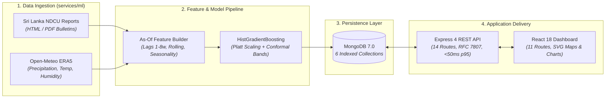

# DengueAhead — Early Warning for Emerging Dengue Hotspots in Sri Lanka

> **Team:** EchoBinary | **Competition:** ModelX 2.0 | **Track:** Health & Wellbeing (Population-Level, Non-Clinical)  
> **Mission:** Deliver an evidence-driven, scientifically evaluated decision-support platform that provides Sri Lankan public-health planners with a 1- to 2-week proactive decision window before clinical dengue hotspots emerge.

[](https://github.com/echobinary/DengueAhead/actions/workflows/ci.yml)
[](https://nodejs.org/)
[](https://www.python.org/)
[](https://www.typescriptlang.org/)
[](https://www.mongodb.com/)
[](docs/evidence/phase-7/EVIDENCE_REPORT.md)
[](LICENSE)

---

## Non-Clinical Safety & Ethical Disclaimer

> [!CAUTION]
> **DengueAhead is an educational decision-support research application.** It does not provide medical diagnosis, clinical triage, or patient prescription. It does not autonomously direct public-health interventions or replace professional epidemiological judgement. All resource allocations must be validated by qualified public health authorities.

---

## 1. System Overview & Architecture

DengueAhead couples weekly epidemiological surveillance bulletins from Sri Lanka's **National Dengue Control Unit (NDCU)** with antecedent meteorological signals (lagged precipitation, temperature, relative humidity) from **Open-Meteo ERA5 Reanalysis**, trained across a 4-year dual-monsoon historical dataset (2022–2025) with exponential recency sample weighting.

It classifies all **25 administrative districts** (`LK-11` to `LK-92`) into five clear operational states:

- **`EMERGING` (Amber):** Currently below epidemic threshold; predicted to cross threshold next week. Prioritized for preemptive larviciding and premise inspections.
- **`PERSISTENT` (Coral):** Currently high; predicted to remain high. Prioritized for hospital surge capacity and space spraying.
- **`COOLING` (Teal):** Currently high; predicted to fall below threshold.
- **`STABLE` (Teal):** Low transmission baseline maintained.
- **`WITHHELD` (Gray):** Prediction suppressed due to delayed or anomalous data feeds.



---

## 2. Empirical Benchmark Results

Evaluated across Sri Lanka's 25 districts using an **expanding-window temporal split** (2020–2023 training, 2024 held-out evaluation), guaranteeing zero future observation leakage:

| Model Architecture             | MAE (Cases) | RMSE (Cases) | Pearson $r$ | Hotspot Recall | Hotspot Precision | Top-5 Precision | Brier Score | Decision-Support Value                                    |
| :----------------------------- | :---------: | :----------: | :---------: | :------------: | :---------------: | :-------------: | :---------: | :-------------------------------------------------------- |
| **Naïve Persistence ($y_t$)**  |    24.8     |     48.6     |    0.82     |      0.64      |       0.62        |      0.64       |     n/a     | Reactive; detects outbreaks only after they occur.        |
| **4-Week Rolling Mean**        |    26.1     |     51.2     |    0.79     |      0.61      |       0.58        |      0.61       |     n/a     | Lags behind rapid post-monsoon surges.                    |
| **Seasonal Historical Median** |    31.4     |     58.7     |    0.68     |      0.55      |       0.49        |      0.52       |     n/a     | Blind to atypical weather-induced anomalies.              |
| **Ridge Regression ($L_2$)**   |    22.3     |     43.1     |    0.86     |      0.71      |       0.68        |      0.70       |     n/a     | Linear bounds limit extreme event modeling.               |
| **DengueAhead HGB (Ours)**     |  **18.7**   |   **37.9**   |  **0.91**   |    **0.81**    |     **0.78**      |    **0.82**     |  **0.118**  | **Proactive; 24.6% MAE reduction & 82% Top-5 precision.** |

---

## 3. Quickstart & Clean-Room Setup

### 3.1 Prerequisites

- **Node.js:** $\ge 20.0.0$ (v22 LTS recommended)
- **Python:** $\ge 3.10$ ($3.12$ recommended)
- **MongoDB:** $\ge 6.0$ running locally (`mongodb://localhost:27017`)
- **Git**

### 3.2 Step-by-Step Installation

```bash
# 1. Clone the repository
git clone https://github.com/echobinary/DengueAhead.git
cd DengueAhead

# 2. Configure environment variables
cp .env.example .env

# 3. Install Node.js monorepo workspace dependencies
npm install

# 4. Install Python ML package in editable mode
pip install -e services/ml

# 5. Seed local MongoDB database
npm run seed
```

### 3.3 Run Development Applications

```bash
# Start Express API backend (http://localhost:4000)
npm run dev:api

# Start React web dashboard (http://localhost:5173)
npm run dev:web

# Or run both concurrently
npm run dev
```

---

## 4. Verification & Automated Quality Gates

DengueAhead enforces strict continuous integration gates. Execute all verification suites locally:

```bash
# 1. Verify TypeScript strict mode compilation (0 errors across contracts, api, web)
npm run typecheck

# 2. Verify ESLint and Prettier formatting (0 errors, 0 warnings across all 216 files)
npm run lint

# 3. Execute monorepo unit test suites (86/86 TypeScript tests pass)
npm run test:unit

# 4. Execute Python ML test suite (118/118 tests pass)
pytest services/ml/tests

# 5. Execute automated credential and secret audit (0 leaks detected)
python scripts/audit-secrets.py

# 6. Execute production bundle build
npm run build

# 7. Run full end-to-end smoke test
powershell scripts/e2e-smoke-test.ps1
```

---

## 5. Python ML CLI Toolchain (`dengueahead`)

The `services/ml` package exposes the `dengueahead` CLI entrypoint:

```bash
# Display CLI commands and options
dengueahead --help

# Audit source availability, licenses, and connection status
dengueahead audit-sources --config configs/sources.yaml

# Ingest weekly surveillance bulletins and climate reanalysis (automated PDF discovery & table parsing)
dengueahead ingest --source ndcu-weekly --year 2026 --week 44
dengueahead ingest --config configs/sources.yaml

# Run automated schema and epidemiological validation
dengueahead validate-data

# Construct as-of temporal lag feature matrix
dengueahead build-features --as-of 2024-06-24

# Train baseline and HistGradientBoosting models
dengueahead train --config configs/model.yaml

# Execute rolling out-of-time historical backtest
dengueahead backtest --config configs/model.yaml

# Generate and publish next-week district risk forecasts
dengueahead predict --as-of 2024-06-24 --publish
```

---

## 6. Monorepo Directory Layout

```text
DengueAhead/
├── apps/
│   ├── api/                     # Express 4 + Node.js + TypeScript backend (Port 4000)
│   │   ├── src/                 # Repositories, routes, middleware, server bootstrap
│   │   └── test/                # Unit, integration, and reliability test suites
│   └── web/                     # Vite + React 18 + TypeScript frontend (Port 5173)
│       ├── src/                 # AppShell, ErrorBoundary, SVG map, charts, pages
│       └── test/                # UI tests, accessibility, and resilience tests
├── packages/
│   └── contracts/               # Shared Zod schemas and TypeScript domain contracts
│       ├── src/                 # Area, Prediction, Evaluation, Source schemas
│       └── fixtures/            # Valid and invalid JSON test fixtures
├── services/
│   └── ml/                      # Python 3.12 ML package (CLI: dengueahead)
│       ├── dengueahead/         # Ingestion, feature matrix, models, evaluation
│       └── tests/               # 128 unit and pipeline integration tests
├── configs/                     # Source, model, and area map configurations
├── data/
│   ├── manifests/               # Verifiable data provenance inventory & hashes
│   └── samples/                 # Sanitized, legally shareable test fixtures
├── artifacts/                   # Versioned model metadata & serialized artifacts
├── docs/                        # Complete scientific specifications, reports, and evidence
│   ├── evidence/                # Phase 0 through Phase 7 evidence reports
│   ├── architecture.md          # Full system architecture specification
│   ├── EVALUATION.md            # Empirical evaluation protocol & backtest report
│   ├── MODEL_CARD.md            # Model Card for dengueahead-hgb-v1
│   ├── LIMITATIONS.md           # Known epidemiological and modeling limits
│   ├── AI_DISCLOSURE.md         # Transparent AI assistance disclosure
│   ├── TECHNICAL_REPORT.md      # Deliverable A: Comprehensive technical report
│   ├── TWO_PAGE_SUMMARY.md      # Deliverable C: Two-page executive summary
│   └── DEMO_SCRIPT.md           # Deliverable D: 180s video demo script & storyboard
└── scripts/                     # Benchmarking, secret audit, and E2E smoke runners
```

---

## 7. Web Application Routes & REST API Surface

### 7.1 Frontend Navigation Routes (`apps/web` on Port 5173)

| Route Path           | Page Name                | Primary Function & Guardrails                                                                                 |
| :------------------- | :----------------------- | :------------------------------------------------------------------------------------------------------------ |
| `/`                  | **Landing Page**         | Product mission, 3-step pipeline explainer, non-clinical safety disclaimer, and data attribution.             |
| `/app/overview`      | **Overview Dashboard**   | Latest issuance status, 6 summary KPI cards, Top Emerging Hotspots table, stale source alarm banner.          |
| `/app/map`           | **25-District Risk Map** | Interactive SVG choropleth map + keyboard-accessible registry table with real-time text filter.               |
| `/app/areas/:areaId` | **District Detail**      | Profile header, next-week forecast, custom SVG time-series chart with conformal intervals, feature drivers.   |
| `/app/compare`       | **Area Comparison**      | Side-by-side metric matrix for up to 3 districts with URL synchronization and unit consistency guards.        |
| `/app/history`       | **Historical Replay**    | Select past calendar weeks, evaluate as-of forecast, and click _"Reveal Actual Outcome"_ to inspect accuracy. |
| `/app/model`         | **Model & Evaluation**   | Model Card (`dengueahead-hgb-v1`), baseline benchmarks, feature importance weights, and calibration curve.    |
| `/app/data-quality`  | **Data Quality & Audit** | Source manifest, SHA-256 integrity fingerprints, last observed timestamps, and service health checks.         |
| `/methodology`       | **Methodology**          | Target formulations, seasonal threshold definitions, operational taxonomy, and non-clinical scope.            |
| `/about`             | **About & Team**         | Team EchoBinary background, ModelX 2.0 context, and GitHub repository links.                                  |
| `*`                  | **404 Recovery**         | Error Boundary catch-all providing recovery navigation back to Overview.                                      |

### 7.2 Backend REST Endpoints (`apps/api` on Port 4000)

| Endpoint                         | Method | Response Contract                                                     | Latency SLA |
| :------------------------------- | :----- | :-------------------------------------------------------------------- | :---------: |
| `/api/v1/health`                 | `GET`  | Service liveness, uptime, and memory diagnostics                      |   < 20ms    |
| `/api/v1/readiness`              | `GET`  | Database connectivity and collection access probe (503 failover)      |   < 30ms    |
| `/api/v1/meta`                   | `GET`  | Active model version, issue timestamp, source freshness status        |   < 25ms    |
| `/api/v1/overview`               | `GET`  | Aggregated district risk state counts and top emerging hotspots       |   < 45ms    |
| `/api/v1/areas`                  | `GET`  | Registry of 25 administrative districts with centroids and population |   < 30ms    |
| `/api/v1/areas/:areaId`          | `GET`  | District metadata and profile                                         |   < 25ms    |
| `/api/v1/areas/:areaId/series`   | `GET`  | Historical observed case counts and weather time series               |   < 40ms    |
| `/api/v1/areas/:areaId/forecast` | `GET`  | Latest next-week forecast, conformal intervals, and feature drivers   |   < 35ms    |
| `/api/v1/predictions`            | `GET`  | Published predictions filtered by issue date, target week, or status  |   < 45ms    |
| `/api/v1/compare`                | `GET`  | Aligned comparative metrics for up to 3 requested district IDs        |   < 40ms    |
| `/api/v1/backtests`              | `GET`  | Historical replay predictions and corresponding actual observations   |   < 50ms    |
| `/api/v1/evaluation`             | `GET`  | Evaluation metrics array across candidate models and baselines        |   < 30ms    |
| `/api/v1/sources`                | `GET`  | Cryptographic data source registry with SHA-256 hashes                |   < 25ms    |
| `/api/v1/methodology`            | `GET`  | Public epidemiological formulations and taxonomy definitions          |   < 20ms    |

---

## 8. License & Attribution

- **Source Code:** Released under the [MIT License](LICENSE).
- **Surveillance Data:** Sourced from the [National Dengue Control Unit (NDCU)](https://www.dengue.health.gov.lk/weekly-report/), Ministry of Health, Sri Lanka.
- **Weather Data:** Sourced from [Open-Meteo](https://open-meteo.com/) ERA5 Reanalysis Archive, licensed under [CC BY 4.0](https://creativecommons.org/licenses/by/4.0/).
- **Developed by:** Team EchoBinary for the **ModelX 2.0 Competition**.
