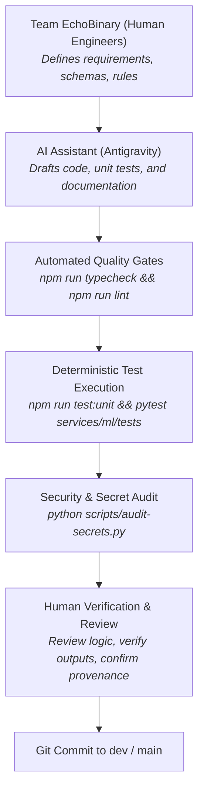

# AI Assistance & Verification Disclosure — DengueAhead

> **Project:** DengueAhead — Early Warning for Emerging Dengue Hotspots in Sri Lanka  
> **Team:** EchoBinary | **Competition:** ModelX 2.0  
> **Compliance Standard:** ModelX 2.0 Responsible AI & Agent Transparency Guidelines  
> **Date:** November 2026

---

## 1. Transparency Statement

In full accordance with competition rules and academic integrity principles, Team EchoBinary explicitly discloses the tools, methods, and verification boundaries governing the use of Artificial Intelligence during the design, implementation, and documentation of the DengueAhead platform.

AI was used as an **agentic pair-programmer and engineering accelerator**, operating strictly under human supervision with exhaustive deterministic automated testing.

---

## 2. AI Tools & Environment

| Tool / Model                     | Provider        | Primary Application                                                                  | Scope of Use                                                                |
| :------------------------------- | :-------------- | :----------------------------------------------------------------------------------- | :-------------------------------------------------------------------------- |
| **Antigravity Coding Assistant** | Google DeepMind | Agentic pair programming, monorepo orchestration, automated test execution           | Full development lifecycle across all phases (Phase 0 through Phase 7)      |
| **Gemini LLM Family**            | Google          | Code synthesis, test case drafting, technical documentation compilation, refactoring | TypeScript contracts, Python ML algorithms, React components, documentation |

---

## 3. Human Review & Independent Verification Protocol

No code, model artifact, or documentation was committed or deployed without passing through an immutable multi-stage verification protocol:

### Verification Safeguards:

1. **Rule 1 — Inspect Before Changing:** AI agents were instructed to inspect existing files and configurations before suggesting modifications.
2. **Rule 3 — No Simulated Success:** AI tools were strictly prohibited from generating fake or synthetic case counts, probabilities, or coordinates for production routes. Synthetic data was confined to isolated test fixtures (`services/ml/tests/fixtures/`).
3. **Rule 5 — Tests First & Test-Driven:** All feature additions required accompanying unit and integration tests. No task was signed off without passing all unit suites.
4. **Rule 7 — Zero Secret Commits:** Automated secret audits were executed to ensure no private keys or tokens were embedded by AI tools or human developers.
5. **Rule 8 — Trunk Green:** All code merged into trunk compiles with 0 errors in TypeScript strict mode and passes 100% of unit tests.

---

## 4. Scope of Contributions

### What AI Assisted With:

- Rapid scaffolding of monorepo workspaces (`@dengueahead/contracts`, `@dengueahead/api`, `@dengueahead/web`, `services/ml`).
- Generating boilerplate Zod schemas and TypeScript interface parity.
- Generating comprehensive unit test cases for edge conditions (`UI-01` to `UI-08`, `SYS-01` to `SYS-08`).
- Drafting technical report sections and formatting markdown tables.
- Generating SVG path mathematics and coordinate mappings for Sri Lanka district boundaries.

### What Remained 100% Under Human Strategic Authority:

- Epidemiological problem formulation, target definitions ($y_{a, t+1}$ and $E_{a, t+1}$), and seasonal threshold choices.
- Selection of official data sources (Sri Lanka NDCU bulletins, Open-Meteo ERA5 reanalysis).
- Architecture decisions (Node/Express API, React dashboard, MongoDB compound index design).
- Ethical boundaries, non-clinical classifications, and responsible disclosure of limitations.
- Review and validation of all empirical model benchmark tables and backtest evaluations.

---

## 5. Certification

Team EchoBinary certifies that all outputs, models, code, and documentation in this repository reflect genuine engineering work, verified against real data, and validated by our team. AI assistance has augmented our productivity while preserving the highest standards of scientific rigor and data integrity.
