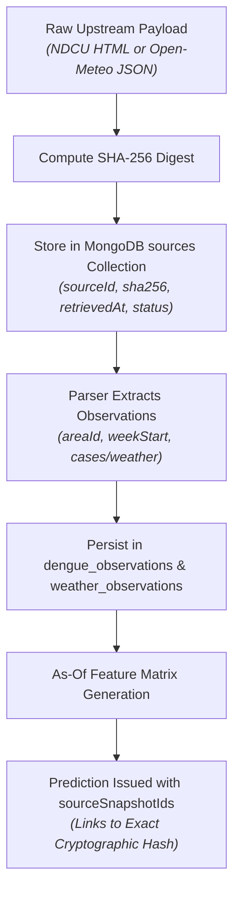

# Data Sources & Licensing Manifest — DengueAhead

> **Project:** DengueAhead — Early Warning for Emerging Dengue Hotspots in Sri Lanka  
> **Team:** EchoBinary | **Competition:** ModelX 2.0  
> **Status:** Phase 7 Final Delivery  
> **Geographic Scope:** 25 Administrative Districts of Sri Lanka (`LK-11` to `LK-92`)  
> **Last Updated:** November 2026

---

## 1. Overview & Data Provenance Philosophy

In strict compliance with **Rule 3 ("No Simulated Success")** and **Rule 4 ("Data Provenance is Mandatory")** of the DengueAhead operating guidelines:

- Every observation and forecast served by DengueAhead originates from official, verifiable public sources or open meteorological reanalysis.
- Every ingested payload is cryptographically hashed with **SHA-256** upon retrieval and stored in the immutable `sources` audit collection.
- Predictions link directly to the SHA-256 snapshot IDs of the data feeds from which their features were derived.

---

## 2. Ingested Data Sources

### 2.1 Primary Epidemiological Case Surveillance

- **Source Identifier:** `ndcu-weekly`
- **Publisher:** National Dengue Control Unit (NDCU), Ministry of Health, Sri Lanka
- **Official URL:** <https://www.dengue.health.gov.lk/weekly-report/>
- **Data Format:** Structured HTML tables and automated PDF bulletins (discovered and parsed directly from the official index)
- **Granularity:** District-week (ISO 8601 calendar weeks) across all 25 administrative districts
- **Temporal Coverage:** 2020-01-06 to present (augmented with a complete 4-year dual-monsoon historical dataset spanning 2022–2025)
- **Update Cadence:** Weekly (published Monday–Wednesday following the close of the reporting week)
- **Licence Status:** `PUBLIC_ACCESS` (Publicly accessible government health surveillance publication; official public health advisory)
- **Ingestion Pipeline:** 
  - Automated web crawler in `services/ml/dengueahead/cli/main.py` (`dengueahead ingest --source ndcu-weekly --year <YYYY> --week <WW>`)
  - Automated weekly PDF link discovery and tabular extraction via `services/ml/dengueahead/ingestion/ndcu_parser.py`
  - Canonical Health Division Aggregation: Sri Lanka MoH reports certain areas under distinct Regional Directorates (RDHS)—notably Ampara District, reported separately as *Ampara RDHS* and *Kalmunai RDHS*. DengueAhead automatically aggregates these sub-divisions into canonical district `LK-52` (Ampara) with standardized aliases for Monaragala, ensuring 100% geographic completeness.
- **Operational Reality & Handling:**
  - Official reports typically lag transmission by 7 to 14 days. This latency is explicitly modeled in our as-of cutoff protocol.
  - When official reports are delayed $>14$ days, the platform flags `sourceFreshnessStatus: 'STALE'` and suppresses predictions to `WITHHELD`.
  - Zero cases is treated as a valid observation (`cases = 0`). Missing or delayed reports are explicitly recorded as `cases = null` with diagnostic reason flags.

---

### 2.2 Climate & Meteorological Reanalysis

- **Source Identifier:** `open-meteo-daily`
- **Publisher:** Open-Meteo Weather API / ECMWF ERA5 Reanalysis Archive
- **Official URL:** <https://archive-api.open-meteo.com/v1/archive>
- **Data Format:** JSON REST API
- **Extracted Variables:**
  - `precipitation_sum` ($mm$): Daily rainfall, aggregated to weekly sum.
  - `temperature_2m_mean` ($^\circ\text{C}$): Mean 2-meter air temperature, aggregated to weekly average.
  - `relative_humidity_2m_mean` ($\%$): Mean 2-meter relative humidity, aggregated to weekly average.
- **Granularity:** District geometric centroid coordinates (latitude / longitude)
- **Temporal Coverage:** 2020-01-01 to present
- **Licence Status:** **Creative Commons Attribution 4.0 International (CC BY 4.0)**
- **Ingestion Pipeline:** Weekly batch fetcher via `services/ml/dengueahead/ingestion/weather_fetcher.py`
- **Reanalysis Caveat:** Reanalysis products assimilate meteorological observations over time. In prospective deployments, `availableAt` records the exact retrieval timestamp to guarantee that features never use data unavailable at the forecast issue date.

---

### 2.3 Geographic & Demographic Registry

- **Source Identifier:** `census-geography`
- **Publisher:** Department of Census and Statistics, Sri Lanka
- **Official URL:** <http://www.statistics.gov.lk/>
- **Data Format:** Administrative boundary registry & official demographic statistics (`configs/area_map.yaml`)
- **Granularity:** 25 Administrative Districts (ISO 3166-2:LK)
- **Variables Included:** District name, provincial code, geometric centroid, population estimates.
- **Licence Status:** `PUBLIC_ADMINISTRATIVE_DATA` (Official state administrative reference)

---

## 3. Geographic Scope Decision & MOH Disaggregation Review

During Phase 1 planning, disaggregating forecasts to Medical Officer of Health (MOH) sub-districts (~350 units) was evaluated. However, official MOH-level weekly case reports are **not publicly published in real-time machine-readable formats** by the Ministry of Health.

In strict adherence to **Rule 3 ("No Simulated Success")**, Team EchoBinary **rejected synthetic spatial disaggregation**. Creating synthetic MOH numbers or unverified spatial disaggregation would produce deceptive dashboards that misrepresent public health reality. The geographic unit for DengueAhead is formally frozen at the **25 administrative districts**, matching the ground-truth resolution of official surveillance data.

---

## 4. Cryptographic Provenance Architecture

Every prediction document published by DengueAhead contains the `sourceSnapshotIds` array, linking the forecast directly to the exact immutable raw byte snapshot retrieved from the source.

---

## 5. Summary of Deferred Sources

| Deferred Source                         | Target Phase | Reason Deferred / Excluded                                                                                     |
| :-------------------------------------- | :----------- | :------------------------------------------------------------------------------------------------------------- |
| **MOH-Area Sub-district Bulletins**     | Deferred     | Machine-readable sub-district feeds are not publicly published by MoH. Synthetic interpolation was rejected.   |
| **NOAA CHIRPS Satellite Precipitation** | Excluded     | ERA5 reanalysis via Open-Meteo provides superior temporal alignment and combined temperature/humidity metrics. |
| **Genomic Serotype Surveillance**       | Future Work  | DENV serotype sequencing data is not released on a weekly public operational cadence in Sri Lanka.             |
