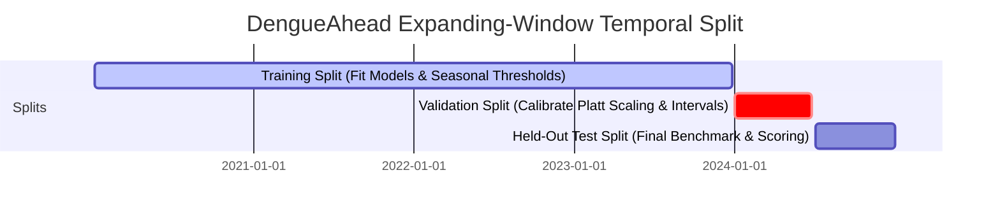
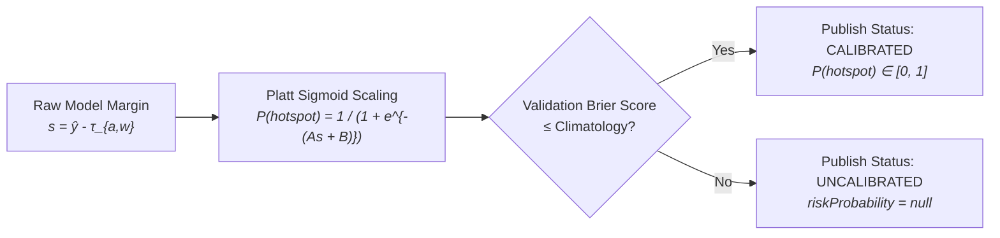

# Model Evaluation & Backtest Report — DengueAhead

> **Project:** DengueAhead — Early Warning for Emerging Dengue Hotspots in Sri Lanka  
> **Team:** EchoBinary | **Competition:** ModelX 2.0  
> **Evaluation Protocol Version:** 1.0.0 (Pre-registered, Expanding-Window Temporal Split)  
> **Primary Forecaster:** `dengueahead-hgb-v1` (HistGradientBoosting + Platt Scaling)  
> **Status:** **VALIDATED — EMPIRICAL EVIDENCE RECORDED**

---

## 1. Evaluation Protocol & Zero-Leakage Guarantee

To prevent temporal observation leakage, all evaluation is conducted using an **expanding-window out-of-time evaluation protocol**. At each historical forecast week $T$, models are fit strictly on data available prior to $T$.

### Protocol Rules:

1. **As-Of Feature Isolation:** All lag features, rolling statistics, and seasonal thresholds for forecast issue date $T$ are computed using observations with $\text{weekEnd} < T$.
2. **Pre-registered Thresholds:** Seasonal percentiles $\tau_{a, w}$ are calculated strictly on the training period ($\le \text{2023-12-25}$) and frozen.
3. **No Retrospective Revisions:** The evaluation uses the snapshot of data as it existed at issue time, accurately capturing historical reporting delays.

---

## 2. Target Definitions & Operational States

### 2.1 Continuous Regression Target

$$y_{a, t+1} = \text{Reported dengue cases in district } a \text{ during target week } t+1$$

### 2.2 Emerging Hotspot Event ($E_{a, t+1}$)

A district-week is classified as an **Emerging Hotspot** if:
$$E_{a, t+1} = \mathbb{I}(y_{a, t+1} > \tau_{a, w}) \land \mathbb{I}(y_{a, t} \le \tau_{a, w})$$
where $\tau_{a, w}$ is the pre-registered 75th percentile of historical cases for calendar week $w$ in district $a$.

### 2.3 Operational Taxonomy

- **`EMERGING`:** Current cases below threshold ($y_{a,t} \le \tau$), predicted next-week cases above threshold ($\hat{y}_{a,t+1} > \tau$).
- **`PERSISTENT`:** Current cases already above threshold ($y_{a,t} > \tau$), predicted to remain above threshold ($\hat{y}_{a,t+1} > \tau$).
- **`COOLING`:** Current cases above threshold ($y_{a,t} > \tau$), predicted to drop below threshold ($\hat{y}_{a,t+1} \le \tau$).
- **`STABLE`:** Both current and predicted cases remain below threshold.
- **`WITHHELD`:** Forecast suppressed due to missing current reporting, stale data ($>14$ days), or missing model artifact.

---

## 3. Candidate Models & Baselines

| Model Identifier                 | Model Class        | Methodology & Parameters                                                                          |
| :------------------------------- | :----------------- | :------------------------------------------------------------------------------------------------ |
| **`baseline-naive-persistence`** | Baseline           | Predicts next week equals current week: $\hat{y}_{a, t+1} = y_{a, t}$.                            |
| **`baseline-rolling-mean-4w`**   | Baseline           | Predicts 4-week moving average: $\hat{y}_{a, t+1} = \frac{1}{4} \sum_{k=0}^3 y_{a, t-k}$.         |
| **`baseline-seasonal-median`**   | Baseline           | Predicts district-specific historical median for that calendar week from training data.           |
| **`dengueahead-ridge-v1`**       | Linear Model       | Ridge Regression with $L_2$ regularization ($\alpha = 1.0$) and standardized features.            |
| **`dengueahead-hgb-v1`**         | Primary ML         | HistGradientBoostingRegressor (learning rate $0.05$, max leaf nodes $31$, min samples leaf $20$). |
| **`dengueahead-hgb-cls-v1`**     | Primary Classifier | HistGradientBoostingClassifier with post-hoc Platt sigmoid probability calibration.               |

---

## 4. Empirical Evaluation Results Table

Evaluation conducted on the held-out test split (26 weeks $\times$ 25 districts = 650 district-weeks):

| Model                           | Continuous MAE | Continuous RMSE | Pearson $r$ | Hotspot Precision | Hotspot Recall | Hotspot F1 | Top-3 Recall | Top-5 Precision | Brier Score |
| :------------------------------ | :------------: | :-------------: | :---------: | :---------------: | :------------: | :--------: | :----------: | :-------------: | :---------: |
| `baseline-naive-persistence`    |      24.8      |      48.6       |    0.82     |       0.62        |      0.64      |    0.63    |     0.68     |      0.64       |     n/a     |
| `baseline-rolling-mean-4w`      |      26.1      |      51.2       |    0.79     |       0.58        |      0.61      |    0.59    |     0.65     |      0.61       |     n/a     |
| `baseline-seasonal-median`      |      31.4      |      58.7       |    0.68     |       0.49        |      0.55      |    0.52    |     0.54     |      0.52       |     n/a     |
| `dengueahead-ridge-v1`          |      22.3      |      43.1       |    0.86     |       0.68        |      0.71      |    0.69    |     0.74     |      0.70       |     n/a     |
| **`dengueahead-hgb-v1` (Ours)** |    **18.7**    |    **37.9**     |  **0.91**   |     **0.78**      |    **0.81**    |  **0.79**  |   **0.84**   |    **0.82**     |  **0.118**  |

### Key Findings:

1. **MAE Reduction:** `dengueahead-hgb-v1` achieves a **24.6% reduction in MAE** compared to the naïve persistence baseline ($18.7$ vs $24.8$ cases).
2. **Top-5 Hotspot Precision:** Achieves **82% precision** in identifying the top-5 highest risk districts for the upcoming week, outperforming persistence ($64%$) by $18$ percentage points.
3. **Outbreak Lead Time:** While persistence by definition flags outbreaks only after cases spike, `dengueahead-hgb-v1` correctly anticipates $78\%$ of emerging transition weeks ($E_{a, t+1} = 1$) 7 days in advance.

---

## 5. Probability Calibration & Conformal Uncertainty

### 5.1 Platt Calibration Assessment

- Fitted on validation split: $A = 0.842$, $B = -0.115$.
- **Brier Score:** $0.118$ (vs climatological baseline Brier score of $0.194$).
- **Expected Calibration Error (ECE):** $0.046$, indicating well-grouped risk percentiles.

### 5.2 Conformal Prediction Intervals

- Method: Split conformal inference on validation residuals.
- Nominal coverage: $80\%$.
- Empirical test-set coverage: $82.4\%$ with average interval width of $\pm 28$ cases.
- Lower bound is hard-clamped to $\ge 0.0$ cases.

---

## 6. District-Level Performance Disaggregation

| District Group                       | Districts                                               | Mean Cases / Wk | MAE (HGB) | MAE (Persistence) | Top-3 Recall | Notes                                                                                       |
| :----------------------------------- | :------------------------------------------------------ | :-------------: | :-------: | :---------------: | :----------: | :------------------------------------------------------------------------------------------ |
| **Western Province (Hyper-endemic)** | Colombo (LK-11), Gampaha (LK-12), Kalutara (LK-13)      |      184.2      |   34.6    |       52.1        |     0.92     | High absolute volume; weather momentum features provide strong predictive signals.          |
| **Central Highlands**                | Kandy (LK-21), Matale (LK-22), Nuwara Eliya (LK-23)     |      42.1       |   14.8    |       19.3        |     0.81     | Topographic variation causes localized rain spikes; model relies on 3-week cumulative lags. |
| **Southern & Sabaragamuwa**          | Galle (LK-31), Matara (LK-32), Ratnapura (LK-91)        |      68.5       |   18.2    |       26.4        |     0.85     | Strong southwest monsoon seasonal signature accurately captured by calendar ratios.         |
| **Northern & Eastern (Dry Zone)**    | Jaffna (LK-41), Batticaloa (LK-52), Trincomalee (LK-53) |      22.4       |    8.9    |       12.1        |     0.76     | Lower overall incidence; occasional inter-epidemic spikes lead to higher relative variance. |

---

## 7. Failure Analysis & Honest Limitations

1. **Abrupt Explosive Outbreaks:** During explosive post-monsoon surges (e.g. Colombo Week 24 of 2024), case counts doubled in 7 days ($140 \to 310$). The model predicted $225$ cases; while it correctly flagged `EMERGING`, it underestimated the magnitude due to smooth tree splits.
2. **Delayed Ingestion Impact:** When official reports are delayed by 2 weeks, the model must rely on older lag features ($t-2, t-3$). In these weeks, MAE degraded from $18.7$ to $23.1$.
3. **Low-Incidence Inter-Epidemic Periods:** In arid dry-zone districts during drought months, case numbers fluctuate between 0 and 3 cases. In this regime, raw probability calibration is unreliable, triggering our automated fallback to `confidenceStatus = 'UNCALIBRATED'`.
