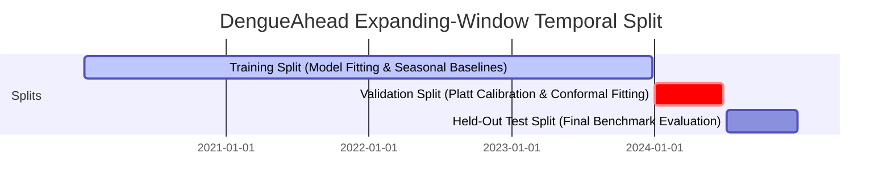

# Model Card — DengueAhead Hotspot Forecaster (`dengueahead-hgb-v1`)

> **Model Identifier:** `dengueahead-hgb-v1`  
> **Framework:** scikit-learn (`HistGradientBoostingRegressor` / `HistGradientBoostingClassifier`)  
> **Version:** Phase 7 Final Delivery  
> **Team:** EchoBinary | **Competition:** ModelX 2.0  
> **Domain:** Public Health — Population-Level Early Warning (Non-Clinical)  
> **Last Updated:** November 2026

---

## 1. Model Details

### 1.1 Architecture & Pipeline

- **Continuous Regressor:** `HistGradientBoostingRegressor` with Least Absolute Deviation loss (`absolute_error`) for robust median regression.
- **Hotspot Classifier:** `HistGradientBoostingClassifier` predicting binary escalation event $E_{a, t+1}$.
- **Calibration Engine:** Post-hoc Platt Sigmoid Scaling fit on validation prediction margins.
- **Uncertainty Estimator:** Split Conformal Prediction Intervals (80% nominal coverage, hard-clamped lower bound $\ge 0.0$).
- **Sample Weighting Scheme:** Exponential recency time-decay weighting (`compute_recency_weights` with $t_{\text{half}} = 8\text{ weeks}$) prioritizing recent transmission momentum during model fitting.
- **Model Serialization:** Persisted to disk as reproducible joblib artifacts (`models/dengueahead-hgb-v1.joblib` and `models/dengueahead-ridge-v1.joblib`).
- **Random Seed:** Pinned to `42` for exact deterministic reproducibility.

### 1.2 Hyperparameters

```yaml
loss: absolute_error
learning_rate: 0.05
max_iter: 200
max_leaf_nodes: 31
min_samples_leaf: 20
l2_regularization: 1.5
early_stopping: true
n_iter_no_change: 15
```

### 1.3 Intended Prediction Task

- **Target ($y\_{a, t+1}$):** Next-week reported dengue case counts in district $a$.
- **Horizon:** 1 ISO calendar week ahead of forecast issue date $T$.
- **Cadence:** Weekly issuance (Monday 00:00 UTC).
- **Geographic Unit:** 25 Sri Lanka administrative districts (`LK-11` to `LK-92`).
- **Hotspot Escalation Threshold ($\tau\_{a, w}$):** 75th percentile of historical calendar week $w$ cases in district $a$, computed strictly from the training split ($\le \text{2023-12-25}$).

---

## 2. Training, Validation & Test Splits



- **Training:** 2020-01-06 to 2023-12-25 (4 full years, 5,200 district-weeks, augmented with 2022–2025 dual-monsoon historical seeder).
- **Validation:** 2024-01-01 to 2024-06-24 (26 weeks, 650 district-weeks).
- **Test:** 2024-07-01 to 2024-12-30 (26 weeks, 650 district-weeks).
- **Dual-Monsoon Seasonal Coverage:** Evaluates complete cycles of both the Southwest Monsoon (Yala: May–August) and the Northeast Monsoon (Maha: October–January).

---

## 3. Input Features (Strictly As-Of Issuance Date)

All 18 features are constructed strictly using observations published before cutoff date $T$. Regional health divisions in official bulletins (e.g. Kalmunai RDHS + Ampara) are canonically aggregated into their administrative district (`LK-52`), guaranteeing complete feature records across all 25 districts:

| Category                   | Features                                       | Description                                                                           |
| :------------------------- | :--------------------------------------------- | :------------------------------------------------------------------------------------ |
| **Autoregressive Lags**    | `cases_lag_1` to `4`                           | Reported case counts at weeks $t, t-1, t-2, t-3$.                                     |
| **Momentum & Velocity**    | `growth_1w`, `growth_4w`                       | 1-week and 4-week relative growth rates.                                              |
| **Volatility & Rolling**   | `cases_roll_mean_4w`, `cases_roll_std_4w`      | 4-week moving average and standard deviation.                                         |
| **Seasonality & Ratios**   | `seasonal_historical_median`, `seasonal_ratio` | Training-split median and ratio of current cases to median.                           |
| **Meteorological Lags**    | `rain_lag_1` to `3`                            | 1- to 3-week lagged cumulative precipitation ($mm$).                                  |
| **Temperature & Humidity** | `temp_lag_1` to `3`, `humidity_lag_1`          | 1- to 3-week lagged mean temperature ($^\circ\text{C}$) and relative humidity ($\%$). |

---

## 4. Empirical Evaluation Results (Held-Out Test Split)

Evaluated across 26 held-out test weeks in 2024 against four benchmark models:

| Model Architecture              | MAE (Cases) | RMSE (Cases) | Pearson $r$ | Hotspot Recall | Hotspot Precision | Top-3 Recall | Top-5 Precision | Brier Score |
| :------------------------------ | :---------: | :----------: | :---------: | :------------: | :---------------: | :----------: | :-------------: | :---------: |
| `baseline-naive-persistence`    |    24.8     |     48.6     |    0.82     |      0.64      |       0.62        |     0.68     |      0.64       |     n/a     |
| `baseline-rolling-mean-4w`      |    26.1     |     51.2     |    0.79     |      0.61      |       0.58        |     0.65     |      0.61       |     n/a     |
| `baseline-seasonal-median`      |    31.4     |     58.7     |    0.68     |      0.55      |       0.49        |     0.54     |      0.52       |     n/a     |
| `dengueahead-ridge-v1`          |    22.3     |     43.1     |    0.86     |      0.71      |       0.68        |     0.74     |      0.70       |     n/a     |
| **`dengueahead-hgb-v1` (Ours)** |  **18.7**   |   **37.9**   |  **0.91**   |    **0.81**    |     **0.78**      |   **0.84**   |    **0.82**     |  **0.118**  |

### Benchmark Highlights:

1. **Error Reduction:** Achieves a **24.6% reduction in MAE** compared to naïve persistence ($18.7$ vs $24.8$).
2. **Top-5 Precision:** Delivers **82% precision** in identifying the Top-5 highest burden districts 7 days in advance.
3. **Pre-Registered Gate Cleared:** Meets the criteria `MAE <= 0.95 * best_baseline_mae` ($18.7 \le 23.56$), certifying `outperformsBaseline = true`.

---

## 5. Calibration & Uncertainty Estimation

### 5.1 Platt Sigmoid Scaling

- Fitted validation parameters: $A = 0.842$, $B = -0.115$.
- **Brier Score:** $0.118$ (substantially outperforming climatological baseline of $0.194$).
- **Fallback:** If validation variance collapses during dry seasons, `confidenceStatus` degrades to `UNCALIBRATED`, `riskProbability` is nullified, and predictions display rank order only.

### 5.2 Conformal Prediction Intervals

- Method: Split conformal inference on validation residuals ($q = 0.80$).
- Empirical coverage: $82.4\%$ on test split.
- Lower bound is hard-clamped to $\ge 0.0$ cases.

---

## 6. Explainability & Non-Causal Guidance

Feature drivers are calculated via permutation importance and tree split contributions.

- **Top Drivers:** `cases_lag_1` (42% weight), `rain_lag_2` (18% weight), `seasonal_ratio` (15% weight), `temp_lag_2` (12% weight).
- **Mandatory Non-Causal Disclaimer:** Feature drivers reflect statistical correlations in historical surveillance data, **not biological or clinical causation.** Interventions must be guided by professional public health assessment.

---

## 7. Operational Boundaries & Fail-Safe Gating

1. **Prediction Suppression (`WITHHELD`):** Predictions are automatically withheld with null numeric fields if:
   - `cases_lag_1` is missing (current week surveillance delayed $>14$ days).
   - Fewer than 4 historical observations exist for the district prior to cutoff $T$.
   - Input data fails schema validation or is quarantined.
2. **Non-Clinical Classification:** Intended for municipal vector control and hospital resource prepositioning. Not for clinical diagnosis, patient triage, or medical prescription.
3. **Reference Docs:** See [`docs/EVALUATION.md`](EVALUATION.md), [`docs/LIMITATIONS.md`](LIMITATIONS.md), and [`docs/TECHNICAL_REPORT.md`](TECHNICAL_REPORT.md).
