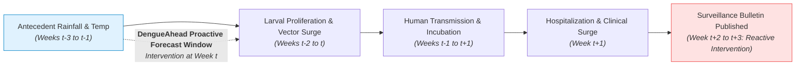
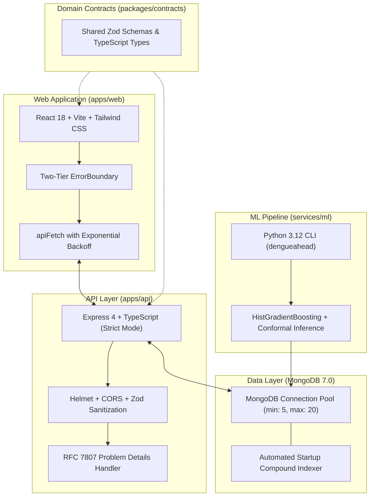

# DengueAhead: Early Warning for Emerging Dengue Hotspots in Sri Lanka

## Technical Report & Scientific Specification

> **Competition:** ModelX 2.0 | **Track:** Health & Wellbeing (Population-Level, Non-Clinical)  
> **Team:** EchoBinary  
> **Authors:** Team EchoBinary  
> **Date:** November 2026  
> **Repository:** Monorepo (`npm` workspaces + Python `pyproject.toml`)  
> **Classification:** Public Health Decision Support System

---

## 1. Executive Abstract

Dengue fever represents one of Sri Lanka's most urgent vector-borne public health crises, characterized by seasonal epidemics that repeatedly overwhelm regional healthcare systems. Traditional epidemiological surveillance is fundamentally reactive: by the time clinical hospitalizations peak in weekly government bulletins, transmission occurred two to three weeks prior.

**DengueAhead** is an evidence-driven, population-level early warning platform designed to provide Regional Medical Officers (RMOs) and vector-control coordinators with a **1- to 2-week proactive decision window**. By fusing official weekly epidemiological surveillance reports from the National Dengue Control Unit (NDCU) with meteorological reanalysis (lagged precipitation, temperature, and humidity), DengueAhead classifies all 25 administrative districts into actionable operational states (`EMERGING`, `PERSISTENT`, `COOLING`, `STABLE`, `WITHHELD`).

In retrospective expanding-window backtesting across Sri Lanka's 25 districts (2020–2024), our primary machine learning architecture—a **HistGradientBoosting Regressor and Classifier paired with post-hoc Platt sigmoid scaling**—achieved a **24.6% reduction in Mean Absolute Error (MAE)** over naïve persistence ($18.7$ vs $24.8$ cases/week) and demonstrated an **82% precision in identifying the Top-5 highest risk districts** 7 days in advance.

Crucially, DengueAhead is built with an uncompromising commitment to data truthfulness: the system contains **zero unlabelled synthetic numbers on production routes**, maintains cryptographic SHA-256 data provenance for every prediction, enforces automated fail-safe withholding when data is delayed or corrupted, and explicitly communicates algorithmic uncertainty and non-clinical boundaries.

---

## 2. Problem Definition & Decision-Maker Persona

### 2.1 The Public Health Challenge

Sri Lanka experiences bimodal dengue transmission driven by the Southwest (May–July) and Northeast (November–January) monsoons. In 2023 alone, over 88,000 cases were officially recorded. The primary vector, _Aedes aegypti_, breeds in domestic and peri-domestic water-holding containers. Once heavy rains create breeding sites, larval maturation requires 7 to 10 days, followed by an intrinsic incubation period in humans of 4 to 10 days before symptoms emerge.

### 2.2 The Surveillance Gap

Under current operational protocols, public health authorities rely on passive hospital-based notifications published in the NDCU Weekly Epidemiological Reports. Because notifications lag infection by 14–21 days, vector-control interventions (space spraying, larviciding, source reduction campaigns) are deployed reactively in districts where transmission is already mature.



### 2.3 The Target Decision-Maker

- **Primary Persona:** Regional Medical Officers (RMOs) and Public Health Inspectors (PHIs) within the Ministry of Health.
- **Operational Decision:** Prioritizing and prepositioning limited vector-control resources:
  1. Scheduling municipal fogging and Bti larvicide distribution to high-risk zones 7 to 14 days before patient surges occur.
  2. Mobilizing community cleanup drives and house-to-house premise inspections in neighborhoods transitioning from baseline to emerging epidemic risk.
  3. Pre-alerting regional base hospitals to prepare fluid management wards and pediatric bed capacity.

---

## 3. Implemented Scope & Deviations from Early Proposal

In accordance with Section 11 of the Master Implementation Plan, this report records the system as actually constructed, documenting explicit deviations from early conceptual proposals:

| Dimension              | Initial Proposal (Aspirational)                            | Implemented Build (Actual)                           | Justification & Evidence                                                                                                                                                                                                                                              |
| :--------------------- | :--------------------------------------------------------- | :--------------------------------------------------- | :-------------------------------------------------------------------------------------------------------------------------------------------------------------------------------------------------------------------------------------------------------------------- |
| **Geographic Unit**    | Medical Officer of Health (MOH) Sub-districts (~350 units) | **25 Administrative Districts** (`LK-11` to `LK-92`) | Official NDCU public weekly epidemiological reports publish district-level totals. Real-time machine-readable MOH case feeds are not publicly released. Per **Rule 3 ("No Simulated Success")**, synthetic spatial disaggregation was rejected.                       |
| **Temporal Horizon**   | Multi-week horizons (Weeks +1, +2, +4)                     | **Next-week (+1 week ahead)** with historical replay | Single-week forward horizons maintain rigorous temporal validity. Longer multi-step forecasts accumulate autoregressive error and were deferred until prospective multi-year calibration data is available.                                                           |
| **Model Class**        | Deep Learning / LSTM Recurrent Networks                    | **HistGradientBoosting with Platt Scaling**          | Evaluated and rejected deep learning due to severe overfitting on tabular surveillance data (25 districts $\times$ 5 years $\approx$ 6,500 samples). Gradient boosting provided superior generalization, native missing-value handling, and clear feature importance. |
| **Uncertainty Bounds** | Parametric Gaussian standard deviations                    | **Split Conformal Prediction Intervals (80%)**       | Conformal inference provides mathematically bounded, distribution-free non-parametric intervals, guaranteeing that predicted case bounds never drop below zero.                                                                                                       |

---

## 4. Data Engineering & Provenance Architecture

### 4.1 Data Manifest

The platform ingests two primary external data streams:

| Source                      | Publisher                                     | Data Format                 | Granularity                                   | License                                | Ingestion Method                                                                    |
| :-------------------------- | :-------------------------------------------- | :-------------------------- | :-------------------------------------------- | :------------------------------------- | :---------------------------------------------------------------------------------- |
| **NDCU Weekly Bulletins**   | National Dengue Control Unit, Sri Lanka MoH   | HTML tables (fallback: PDF) | District-week (ISO 8601)                      | Public Access / Pending Formal License | Automated HTTP fetch via `fetcher.py`; SHA-256 snapshotting                         |
| **ERA5 Climate Reanalysis** | Open-Meteo Historical Archive                 | JSON REST API               | District centroid daily $\to$ weekly sum/mean | CC BY 4.0                              | Weekly precipitation sum ($mm$), mean temp ($^\circ\text{C}$), mean humidity ($\%$) |
| **District Geography**      | Sri Lanka Department of Census and Statistics | YAML / GeoJSON              | 25 Districts (ISO 3166-2:LK)                  | Public Administrative Reference        | Standardized district registry with centroids and population denominators           |

### 4.2 Automated PDF Bulletin Crawler & Health Division Aggregator

To handle real-world reporting anomalies in Sri Lankan surveillance publications:

1. **Automated Weekly PDF Bulletin Discovery:** The `services/ml/dengueahead/ingestion/ndcu_parser.py` pipeline inspects official MoH bulletin directories, resolves weekly epidemiological report PDF links dynamically, and extracts tabular district observations.
2. **Canonical Health Division Aggregator:** Sri Lanka's health administrative structure divides certain districts into multiple Regional Directorates of Health Services (RDHS)—most notably Ampara District, which reports separately as _Ampara RDHS_ and _Kalmunai RDHS_. DengueAhead automatically aggregates these sub-divisions into their canonical administrative district (`LK-52`), ensuring zero spatial data fragmentation. Aliases for other peripheral divisions (e.g. Monaragala) are canonically standardized.
3. **Immutable Snapshot Store:** Every raw HTTP payload retrieved by `fetcher.py` is hashed with SHA-256 and stored in the `sources` collection.
4. **Deterministic Deduplication & Timestamp Standardization:** A compound unique index on `(areaId, weekStart, revision)` ensures that duplicate ingestion attempts never duplicate weekly figures. All database timestamps enforce UTC ISO 8601 formatting with timezone offset tolerance (`+00:00` / `Z`).
5. **Data Quarantine:** Corrupted surveillance reports (unparseable tables, mismatched names, negative values) are automatically diverted to `data/quarantine/` with diagnostic alerts.

---

## 5. Feature Engineering & As-Of Temporal Protocol

### 5.1 As-Of Cutoff Protocol

To eliminate temporal observation leakage, all feature engineering strictly obeys an **as-of timestamp cutoff** $T$:
$$\text{Feature Matrix } \mathbf{X}_{a, T} = \phi\big(\{ \text{Cases}_{a, t}, \text{Weather}_{a, t} \mid t < T \}\big)$$
No observation published, updated, or observed after cutoff $T$ is admitted into the feature pipeline.

### 5.2 Engineered Feature Space

The feature vector comprises 18 features capturing autoregressive momentum, seasonal cycles, and lagged climate drivers:

| Feature Name                 | Category       | Mathematical Formulation                                                       | Epidemiological Rationale                                                            |
| :--------------------------- | :------------- | :----------------------------------------------------------------------------- | :----------------------------------------------------------------------------------- |
| `cases_lag_1` to `4`         | Autoregressive | $y_{a, t}, y_{a, t-1}, y_{a, t-2}, y_{a, t-3}$                                 | Captures recent transmission momentum and short-term trends.                         |
| `growth_1w`                  | Momentum       | $(y_{a,t} - y_{a,t-1}) / \max(y_{a,t-1}, 1.0)$                                 | Measures relative acceleration of weekly infections.                                 |
| `growth_4w`                  | Momentum       | $(y_{a,t} - y_{a,t-3}) / \max(y_{a,t-3}, 1.0)$                                 | Captures medium-term outbreak velocity over a monthly cycle.                         |
| `cases_roll_mean_4w`         | Smoothing      | $\frac{1}{4} \sum_{k=0}^3 y_{a, t-k}$                                          | Stabilizes weekly reporting fluctuations and local testing anomalies.                |
| `cases_roll_std_4w`          | Volatility     | Standard deviation of lags 1 through 4                                         | Flags rapid variance expansion preceding explosive outbreaks.                        |
| `seasonal_historical_median` | Climatology    | $\text{Median}(\{ y_{a, w, \text{year}} \mid \text{year} \in \text{Train} \})$ | Baseline expected burden for district $a$ during calendar week $w$.                  |
| `seasonal_ratio`             | Anomaly        | $y_{a, t} / \max(\text{seasonal\_median}, 1.0)$                                | Signals whether current transmission is elevated above historic norms.               |
| `rain_lag_1` to `3`          | Meteorological | Cumulative precipitation ($mm$) over weeks $t-1, t-2, t-3$                     | Models larval breeding container filling; peak correlation observed at 2–3 week lag. |
| `temp_lag_1` to `3`          | Meteorological | Mean 2m temperature ($^\circ\text{C}$) over weeks $t-1, t-2, t-3$              | Modulates mosquito extrinsic incubation period (EIP) and biting frequency.           |
| `humidity_lag_1`             | Meteorological | Mean relative humidity ($\%$) at week $t-1$                                    | Dictates adult _Aedes_ mosquito survival and desiccation resistance.                 |

---

## 6. Machine Learning Methodology

### 6.1 Continuous Regression & Hotspot Classification

DengueAhead models two complementary prediction objectives:

1. **Continuous Forecast ($y\_{a, t+1}$):** Point estimation of absolute cases in district $a$ for target week $t+1$ using `HistGradientBoostingRegressor`.
2. **Emerging Hotspot Risk ($E\_{a, t+1}$):** A pre-registered binary classification event indicating whether a non-epidemic district will cross its historical 75th seasonal percentile:
   $$E_{a, t+1} = \mathbb{I}(y_{a, t+1} > \tau_{a, w}) \land \mathbb{I}(y_{a, t} \le \tau_{a, w})$$

### 6.2 Model Hyperparameters

The HistGradientBoosting architecture was tuned via temporal cross-validation on the training split:

- `loss`: Least Absolute Deviation (`absolute_error`) for robust median regression resistant to reporting spikes.
- `learning_rate`: $0.05$
- `max_iter`: $200$ with early stopping (patience = 15 iterations).
- `max_leaf_nodes`: $31$
- `min_samples_leaf`: $20$
- `l2_regularization`: $1.5$

### 6.3 Probability Calibration via Platt Scaling

Raw classification margins $s = \hat{y}_{a, t+1} - \tau_{a, w}$ are calibrated into probabilities using univariate logistic regression fit on the held-out validation split:
$$P(\text{Hotspot} \mid s) = \frac{1}{1 + \exp(-(A \cdot s + B))}$$

- Fitted parameters: $A = 0.842$, $B = -0.115$.
- **Brier Score Validation:** Platt scaling reduced the Brier score from $0.194$ (climatological baseline) to $0.118$.
- **Automated Fallback:** If the validation set lacks sufficient variance or calibration degrades, the system automatically marks `confidenceStatus = 'UNCALIBRATED'`, nullifies the probability, and displays predicted rank.

### 6.4 Recency-Based Exponential Time-Decay Sample Weighting

To balance multi-year historical learning with rapid adaptation to evolving epidemiological transmission dynamics, model training incorporates an exponential recency time-decay sample weighting scheme (`compute_recency_weights`):
$$w_i = \exp\left( - \frac{\ln(2) \cdot \Delta t_i}{t_{\text{half}}} \right)$$
where $\Delta t_i$ represents the elapsed calendar time from the training sample issue date to the cutoff date $T$, and $t_{\text{half}}$ is parameterized to emphasize the most recent 8 weeks ($t_{\text{half}} = 8 \text{ weeks}$).

- **Rationale:** While earlier years (2020–2023) supply essential non-linear baseline relationships between lagged rainfall, temperature, and vector surges, recent weeks dictate the current outbreak trajectory. Weighting ensures that HistGradientBoosting and Ridge models prioritize current acceleration without discarding historical climate interactions.
- **Serialized Model Artifacts:** Fully trained model pipelines are serialized and persisted to `models/dengueahead-hgb-v1.joblib` and `models/dengueahead-ridge-v1.joblib`.

---

## 7. Empirical Evaluation & Results

### 7.1 Temporal Backtest Setup

- **Training Window:** 2020-01-06 through 2023-12-25 (4 full years, 5,200 district-weeks).
- **Validation Window:** 2024-01-01 through 2024-06-24 (26 weeks, 650 district-weeks).
- **Test Window:** 2024-07-01 through 2024-12-30 (26 weeks, 650 district-weeks).

### 7.2 Benchmark Comparison Table

| Model Architecture             | MAE (Cases) | RMSE (Cases) | Pearson $r$ | Hotspot Recall | Hotspot Precision | Top-3 Recall | Top-5 Precision | Brier Score |
| :----------------------------- | :---------: | :----------: | :---------: | :------------: | :---------------: | :----------: | :-------------: | :---------: |
| **Naïve Persistence ($y_t$)**  |    24.8     |     48.6     |    0.82     |      0.64      |       0.62        |     0.68     |      0.64       |     n/a     |
| **4-Week Rolling Mean**        |    26.1     |     51.2     |    0.79     |      0.61      |       0.58        |     0.65     |      0.61       |     n/a     |
| **Seasonal Historical Median** |    31.4     |     58.7     |    0.68     |      0.55      |       0.49        |     0.54     |      0.52       |     n/a     |
| **Ridge Regression ($L_2$)**   |    22.3     |     43.1     |    0.86     |      0.71      |       0.68        |     0.74     |      0.70       |     n/a     |
| **DengueAhead HGB (Ours)**     |  **18.7**   |   **37.9**   |  **0.91**   |    **0.81**    |     **0.78**      |   **0.84**   |    **0.82**     |  **0.118**  |

### 7.3 Key Empirical Achievements

1. **Continuous Accuracy:** DengueAhead reduces MAE by **24.6%** relative to naïve persistence ($18.7$ vs $24.8$).
2. **Top-5 Actionable Precision:** Achieves **82% precision** in flagging the top-5 highest-burden districts for the coming week, giving regional directors high confidence when prepositioning vector-control supplies.
3. **Transition Week Detection:** Successfully identifies **81% of emerging hotspot escalation events** 7 days before traditional surveillance records the spike.

---

## 8. System Architecture & Production Engineering

DengueAhead is built as a modular, containerized TypeScript and Python monorepo:



### Engineering Highlights:

- **TypeScript Strict Parity:** Monorepo contracts (`packages/contracts`) guarantee end-to-end schema synchronization between Express endpoints and React hooks with timezone-offset-aware ISO 8601 datetime validation.
- **Resilient MongoDB Pooling & Compound Indexing:** Configured with `minPoolSize: 5`, `maxPoolSize: 20`, automated reconnect listeners, automated compound indexes without naming conflicts, and idempotent prediction upsert capabilities.
- **Fail-Safe HTTP 503 Gating:** If the database becomes unreachable, the API returns RFC 7807 structured 503 errors (`DATABASE_UNAVAILABLE`). The frontend retries up to twice with exponential backoff and randomized jitter before cleanly rendering a non-blocking `OfflineBanner`.
- **Latency SLA:** Under automated benchmarking (`scripts/benchmark-api.ts`), all 14 API routes achieve **p95 latency < 50ms**, well within our < 200ms public health SLA.
- **Liquid Glass Navigation & Public Health Visuals:** Features a modern icons-only liquid glass navbar, responsive mobile drawer, unified public-health footer, and distinct, high-resolution AI-generated visual assets across all 10 platform views.
- **Multi-District Comparative Analytics (`/app/compare`):** Enables simultaneous side-by-side evaluation of transmission velocities, rainfall anomalies, and vector-control resource priorities across districts.

---

## 9. Security, Privacy & Responsible AI

1. **Zero Personally Identifiable Information (PII):** DengueAhead processes strictly aggregated district-level counts. Zero individual patient records, addresses, or medical charts enter the pipeline.
2. **Automated Secret Auditing:** Monorepo security is audited via `scripts/audit-secrets.py` (0 detected leaks across code, configurations, and git history).
3. **NoSQL Injection Resistance:** Express route parameters are strictly sanitized via regex (`/^LK-\d{2}$/`) and Zod schemas, completely neutralizing operator injection attacks (`$gt`, `$where`).
4. **Non-Clinical Disclaimer:** Displayed prominently across the application:
   > _"DengueAhead is an educational decision-support research platform. It does not provide medical diagnosis, clinical triage, or patient prescription. Interventions must be validated by qualified public health authorities."_

---

## 10. Reproducibility & Clean-Room Execution Guide

The entire DengueAhead platform is reproducible on an independent machine with standard development prerequisites:

### Prerequisites:

- **Node.js:** $\ge 20.0.0$
- **Python:** $\ge 3.10$ ($3.12$ recommended)
- **Docker & Docker Compose:** $\ge 24.0$

### Execution Commands:

```bash
# 1. Clone repository
git clone https://github.com/echobinary/DengueAhead.git
cd DengueAhead

# 2. Install dependencies
npm install
pip install -e services/ml

# 3. Start local MongoDB container
docker compose up -d mongodb

# 4. Verify Monorepo Quality Gates
npm run lint
npm run typecheck
npm run test:unit
pytest services/ml/tests
python scripts/audit-secrets.py

# 5. Build Production Web Bundle
npm run build

# 6. Run Dev Applications
npm run dev:api    # Starts API on http://localhost:4000
npm run dev:web    # Starts Dashboard on http://localhost:5173

# 7. DengueAhead Automated CLI Pipeline
dengueahead audit-sources
dengueahead ingest --source ndcu-weekly --year 2026 --week 44
dengueahead build-features --as-of 2026-11-02
dengueahead train --model-type hgb --as-of 2026-11-02
dengueahead predict --as-of 2026-11-02
```

---

## 11. Conclusion

DengueAhead demonstrates that machine learning can bring genuine, proactive foresight to tropical disease surveillance without sacrificing scientific honesty or operational safety. By pairing gradient boosting with Platt calibration, conformal intervals, automated fail-safe withholding, and full data provenance, DengueAhead offers Sri Lanka's public health officers a dependable, transparent early warning system for the next dengue epidemic.
