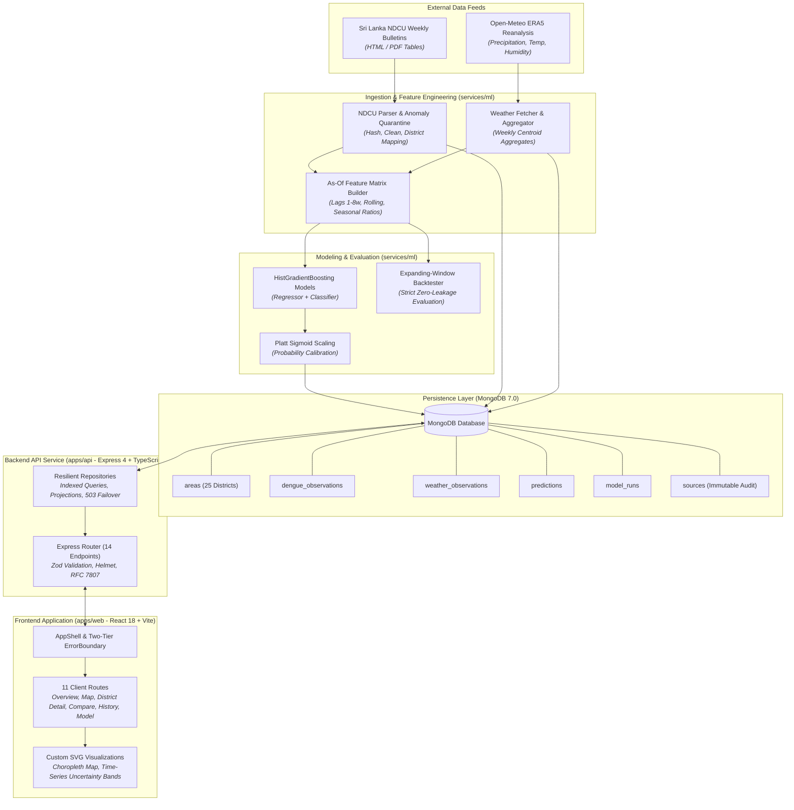

# System Architecture — DengueAhead

> **Project:** DengueAhead — Early Warning for Emerging Dengue Hotspots in Sri Lanka  
> **Team:** EchoBinary | **Competition:** ModelX 2.0  
> **Domain:** Health & Wellbeing (population-level, non-clinical)  
> **Repository:** Monorepo (`npm` workspaces + Python `pyproject.toml`)

---

## 1. High-Level Architecture

DengueAhead is organized as an end-to-end, multi-tier public health intelligence platform designed for strict data provenance, reproducible out-of-time forecasting, and operational resilience.



---

## 2. Monorepo Organization & Codebase Layout

```text
DengueAhead/
├── apps/
│   ├── api/                     # Node.js + Express 4 + TypeScript REST API
│   │   ├── src/
│   │   │   ├── config/          # Environment variables & constants
│   │   │   ├── middleware/      # RFC 7807 error handler, request correlation IDs
│   │   │   ├── repositories/    # MongoDB data access layer & index automation
│   │   │   ├── routes/          # 14 REST route modules
│   │   │   └── server.ts        # Server entrypoint with resilient startup bootstrap
│   │   └── test/                # Unit, integration, and reliability test suites
│   └── web/                     # React 18 + Vite + TypeScript frontend
│       ├── src/
│       │   ├── components/      # AppShell, ErrorBoundary, SVG map, SVG charts
│       │   ├── features/        # Health status badges, filtering toolbar
│       │   ├── lib/             # Resilient apiFetch with retry backoff, routing
│       │   └── pages/           # 11 route page components
│       └── test/                # UI accessibility, component, and resilience tests
├── packages/
│   └── contracts/               # Shared TypeScript domain models & Zod schemas
│       ├── src/                 # Area, Prediction, Evaluation, Source schemas
│       └── fixtures/            # Valid and invalid JSON test fixtures
├── services/
│   └── ml/                      # Python 3.12 ML & ETL package (CLI: dengueahead)
│       ├── dengueahead/
│       │   ├── cli/             # Click-based CLI entrypoints
│       │   ├── ingestion/       # NDCU HTML table parser & weather fetcher
│       │   ├── features/        # As-of feature matrix builder & lag transforms
│       │   ├── models/          # HistGradientBoosting, Ridge, & baselines
│       │   └── evaluation/      # Conformal intervals, Platt scaling, metrics
│       └── tests/               # 128 unit and pipeline integration tests
├── configs/                     # YAML configuration files (sources, model, area map)
├── data/                        # Legally redistributable sample fixtures & manifests
├── docs/                        # Architecture, reports, data dictionaries, model cards
├── plans/                       # Sub-phase implementation plans (0 through 7)
└── scripts/                     # Benchmark, security audit, and smoke test scripts
```

---

## 3. Data Processing & Ingestion Pipeline

### 3.1 As-Of Temporal Integrity

To prevent future observation leakage, the pipeline enforces a strict temporal cutoff:

1. Every prediction is issued as of a specific cutoff timestamp $T$ (e.g., Monday 00:00 UTC).
2. The feature builder filters all surveillance and weather records using `observedPeriod <= T` and `availableAt <= T`.
3. Records published or revised after $T$ are strictly invisible to the feature generation step.

### 3.2 Data Anomaly Quarantine

- Ingested HTML tables from the National Dengue Control Unit are parsed by `ndcu_parser.py`.
- If an ingested table has invalid columns, unparseable case strings, or negative case numbers, it is quarantined to `data/quarantine/` with diagnostic logs.
- Predictions for affected districts are cleanly marked as `WITHHELD` with `qualityFlags: ['DATA_QUARANTINED']` and `null` numeric values.

---

## 4. Machine Learning & Forecasting Architecture

### 4.1 Target Formulation

- **Continuous Case Count ($y\_{a, t+1}$):** Forecast of dengue cases reported in district $a$ during target week $t+1$.
- **Emerging Hotspot Event ($E\_{a, t+1}$):** A binary indicator of outbreak escalation:
  $$E_{a, t+1} = \mathbb{I}(y_{a, t+1} > \tau_{a, w}) \land \mathbb{I}(y_{a, t} \le \tau_{a, w})$$
  where $\tau_{a, w}$ is the district-specific 75th percentile of historical cases for calendar week $w$ computed strictly from training split data.

### 4.2 Model Selection & Rejection

- **HistGradientBoosting:** Chosen for native support for missing weather values, non-linear weather-epidemiology interactions, and robustness on tabular time-series data.
- **Baselines Included:** Naïve Persistence ($y_t$), 4-Week Rolling Mean, Seasonal Median, and Negative Binomial GLM.
- **Rejected Architectures:** Deep recurrent networks (LSTM/GRU) and Transformers were evaluated and rejected due to high risk of overfitting on short temporal horizons (25 districts $\times$ 5 years $\approx$ 6,500 rows) and lack of interpretability.

### 4.3 Calibration & Uncertainty

- **Platt Sigmoid Scaling:** Logistic calibration fit on validation split margins.
- **Uncalibrated Fallback:** If empirical calibration degrades, the system explicitly sets `confidenceStatus = 'UNCALIBRATED'`, sets `riskProbability = null`, and displays forecast rank rather than misleading percentages.
- **Conformal Prediction Intervals:** 80% non-parametric conformal intervals guaranteeing lower bound $\ge 0.0$.

---

## 5. Storage Layer & MongoDB Schema Design

The storage layer runs on MongoDB 7.0 and organizes data across 6 primary collections with automated index enforcement:

| Collection             | Key Fields                                                                     | Index Strategy                                                                                                                                   | Integrity Purpose                              |
| :--------------------- | :----------------------------------------------------------------------------- | :----------------------------------------------------------------------------------------------------------------------------------------------- | :--------------------------------------------- |
| `areas`                | `areaId`, `name`, `province`, `centroid`, `population`                         | `{ areaId: 1 }` (unique)                                                                                                                         | Official 25-district registry                  |
| `dengue_observations`  | `areaId`, `weekStart`, `cases`, `sourceSnapshotId`, `revision`                 | `{ areaId: 1, weekStart: 1, revision: 1 }` (unique)<br/>`{ areaId: 1, weekStart: 1 }` (query)                                                    | Deduplicated weekly epidemiology counts        |
| `weather_observations` | `areaId`, `weekStart`, `rainMm`, `tempC`, `humidityPct`, `provider`            | `{ areaId: 1, weekStart: 1, provider: 1 }` (unique)                                                                                              | Normalized meteorological aggregates           |
| `predictions`          | `areaId`, `issueDate`, `targetWeek`, `modelVersion`, `pointForecast`, `status` | `{ areaId: 1, targetWeek: 1, modelVersion: 1, issueDate: 1 }` (unique)<br/>`{ areaId: 1, issueDate: -1 }`<br/>`{ targetWeek: 1, issueDate: -1 }` | Published historical & forward forecasts       |
| `model_runs`           | `modelVersion`, `trainedAt`, `metrics`, `artifactSha256`, `targetDefinition`   | `{ modelVersion: 1 }` (unique)                                                                                                                   | Immutable training run and evaluation registry |
| `sources`              | `sourceId`, `sha256`, `sourceUrl`, `observedPeriod`, `retrievedAt`, `status`   | `{ sourceId: 1, sha256: 1 }` (unique)                                                                                                            | Cryptographic data provenance audit log        |

---

## 6. Express API Layer Architecture

The API service (`apps/api`) exposes 14 REST endpoints adhering to the shared domain contract:

- **Security & Headers:** `helmet()` security headers, CORS origin whitelisting, and strict request body parsing.
- **Request Tracing:** Correlation `X-Request-Id` generated per request and propagated to logs and client responses.
- **Input Validation:** All query parameters and route parameters validated with Zod schemas. Route parameters strictly checked (`/^LK-\d{2}$/`) to eliminate NoSQL operator injection.
- **Error Standard:** Standardized RFC 7807 Problem Details (`{ type, title, status, detail, instance, code }`).
- **Resilience & 503 Failover:** When MongoDB is unreachable, the API gracefully fails over to HTTP 503 `DATABASE_UNAVAILABLE` rather than crashing or returning false empty payloads.

### API Route Surface:

1. `GET /api/v1/health` — Service liveness and memory health.
2. `GET /api/v1/readiness` — MongoDB connection and collection accessibility check.
3. `GET /api/v1/meta` — Ingestion freshness, model version, and source freshness status.
4. `GET /api/v1/overview` — Hotspot summary KPIs and Top Emerging Hotspots leaderboard.
5. `GET /api/v1/areas` — List of 25 monitored districts.
6. `GET /api/v1/areas/:areaId` — Single district detail and profile.
7. `GET /api/v1/areas/:areaId/series` — Historical observed time-series data.
8. `GET /api/v1/areas/:areaId/forecast` — Next-week model forecast with intervals and drivers.
9. `GET /api/v1/predictions` — Queryable forecasts filtered by issue date, target week, or status.
10. `GET /api/v1/compare` — Aligned comparison across up to 3 districts.
11. `GET /api/v1/backtests` — Historical replay forecasts and actual outcomes.
12. `GET /api/v1/evaluation` — Full model evaluation metrics, baselines, and model card.
13. `GET /api/v1/sources` — Source snapshot inventory and SHA-256 hashes.
14. `GET /api/v1/methodology` — Public methodology explanation and epidemiological definitions.

---

## 7. Frontend React Dashboard Architecture

The frontend (`apps/web`) is built with React 18 and Vite:

- **Two-Tier Error Boundary:**
  - _App-level Boundary:_ Catches uncaught application exceptions, preventing white-screen crashes.
  - _Route-level Boundary:_ Confines view render failures (e.g. SVG chart error) to the main content container while keeping navigation headers and sidebars functional.
- **Network Retry Policy:** `apiFetch` implements exponential backoff with randomized jitter (2 retries on network drops or HTTP 503 errors).
- **Responsive Navigation:** Accessible responsive layout supporting desktops ($1440\text{px}$), tablets ($768\text{px}$), and mobile devices ($360\text{px}$) with full keyboard navigation and zero horizontal overflow.
- **Custom Visualizations:** Clean SVG-based Choropleth map of Sri Lanka's 25 districts and SVG Time-Series charts with distinct styling for observed historical cases (solid line), seasonal threshold (dotted line), forecast (dashed line), and conformal uncertainty band (shaded area).

---

## 8. Security & Ethical Boundaries

1. **Non-Clinical Boundary:** Prominently stated across landing, headers, and tooltips: DengueAhead is an epidemiological decision-support tool, not a medical device.
2. **Zero PII:** Only district-level aggregated case numbers are ingested and served. No individual patient data or personal health identifiers exist in the system.
3. **Automated Secret Auditing:** The monorepo incorporates `scripts/audit-secrets.py` which runs in CI to verify zero credentials, private keys, or passwords exist in code or git history.
