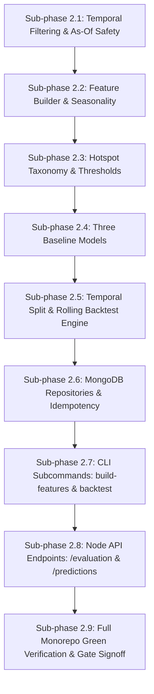

# Phase 2 Implementation Plan — DengueAhead

> **Document:** Phase 2 Implementation Specification  
> **Location:** `plans/PHASE_2_IMPLEMENTATION_PLAN.md`  
> **Project:** DengueAhead — Early Warning for Emerging Dengue Hotspots in Sri Lanka  
> **Team:** EchoBinary | **Competition:** ModelX 2.0 | **Domain:** Health & Wellbeing (population-level, non-clinical)  
> **Implementation window:** 30–31 October 2026  
> **Stack:** Python 3.12 (`dengueahead` CLI, click, pydantic, pymongo), MongoDB 7, Node.js API read layer (Express 5 + Zod)  
> **Precedence:** If this document and `IMPLEMENTATION_PLAN.md` (the master plan) disagree, the master plan wins; fix this document.  
> **Prerequisite:** Phase 1 gate must be fully passed and committed before Phase 2 execution begins.

---

## 1. Executive Summary & Objective

Phase 2 builds the core analytical engine of DengueAhead: formalizing the mathematical prediction target, creating strictly as-of safe feature extraction pipelines, establishing transparent statistical baselines, and setting up an out-of-time rolling backtest evaluation harness.

Before any gradient-boosted trees, neural architectures, or complex models are introduced (Phase 3), Phase 2 guarantees two fundamental scientific pillars:

1. **Zero Data Leakage:** Features calculated as of forecast issue date $T$ can **never** see or incorporate epidemiological or weather observations from $t \ge T+1$, nor can seasonal baselines peek into test evaluation splits.
2. **Defensible Baselines Before ML:** Three transparent, reproducible baselines (`naive_last_week`, `rolling_mean_4w`, and `seasonal_historical_median`) are implemented and evaluated across all 25 districts of Sri Lanka. Any complex model in Phase 3 must demonstrably outperform these baselines to be accepted.

### Non-negotiables (AGENTS.md & Master Plan Compliance)

1. **Strict As-Of Isolation (Rule 1 & 2):** Every query fetching observations for feature generation must include explicit cutoff filters (`weekStart <= issueDate` and `availableAt <= issueDate`).
2. **No Simulated Success (Rule 3):** Synthetic data is permitted **only** in test fixtures (prefixed `synthetic_`). Real feature pipelines run strictly on ingested data.
3. **Data Provenance is Mandatory (Rule 4):** Every feature vector and baseline prediction must reference the exact `sourceSnapshotIds` from which its inputs originated.
4. **No Unsupported Claims (Rule 6):** Baseline forecasts do not generate calibrated probabilities. `riskProbability` must be `None`, and `confidenceStatus` must be `"NOT_AVAILABLE"`. Predictions without minimum required history must be classified as `WITHHELD` with an explanatory quality flag.
5. **Division-by-Zero and NaN Invariants:** Rates of change, growth metrics, and per-capita incidence must enforce safe denominators ($\max(\text{denominator}, 1.0)$), ensuring zero `NaN` or `Inf` floats.
6. **Tests First / Test-Driven (Rule 5 & 8):** Unit test cases `FEAT-01` through `FEAT-07`, baseline tests, and API integration tests must pass before phase completion.

---

## 2. Resolved Technical Decisions

| Topic                                   | Decision                                                                        | Rationale                                                                                                                                             |
| :-------------------------------------- | :------------------------------------------------------------------------------ | :---------------------------------------------------------------------------------------------------------------------------------------------------- |
| **Geographic Unit**                     | 25 Official Districts (`LK-11` to `LK-92`)                                      | Resolved in Phase 1: national coverage, high reporting consistency, aligns with NDCU reporting standard.                                              |
| **Temporal Granularity**                | ISO 8601 Calendar Weeks (`YYYY-MM-DD` Monday start)                             | NDCU epidemiological weeks run Monday through Sunday; standardized across all collections.                                                            |
| **Forecast Horizon**                    | 1 week ahead ($t+1$)                                                            | Primary decision window for public health vector-control dispatch and early warning.                                                                  |
| **Forecast Issue Cutoff ($T$)**         | Monday 00:00 UTC following week $t$ close                                       | Simulates real-world operational forecast issuance once previous week's report is compiled.                                                           |
| **Hotspot Definition ($\tau\_{a, w}$)** | District-specific seasonal 75th percentile                                      | Captures localized excess burden over historical norm for that calendar week $w$; avoids static national thresholds that penalize populous districts. |
| **Status Taxonomy**                     | `EMERGING`, `PERSISTENT`, `COOLING`, `STABLE`, `WITHHELD`                       | Complies with `PredictionStatus` contract enum and public health action triggers.                                                                     |
| **Feature Extraction Engine**           | Pure Python 3.12 + Pydantic + PyMongo                                           | Lightweight, deterministic, no heavy dependencies, runs seamlessly in local and CI environments.                                                      |
| **Baseline Models**                     | 1. `naive_last_week`<br>2. `rolling_mean_4w`<br>3. `seasonal_historical_median` | Standard epidemiological benchmarks required by master plan §7 Phase 2.                                                                               |
| **Temporal Split Strategy**             | Rolling Temporal Cutoff (No Random K-Fold)                                      | Time-series cross-validation preserving arrow of time; Train: historical through 2023; Val: 2024-W01–W26; Test: 2024-W27–W52.                         |
| **Mongo Collections**                   | `feature_snapshots`, `model_runs`, `predictions`                                | Stores reproducible feature vectors, baseline evaluation metrics, and published forecasts for history replay.                                         |
| **API Endpoints**                       | `GET /api/v1/evaluation`<br>`GET /api/v1/predictions`                           | Express read layer exposing baseline performance and predictions to web UI.                                                                           |

---

## 3. Mathematical & Epidemiological Specifications

### 3.1 Target Definitions

For an area $a \in \mathcal{A}$ at forecast issue date $T$ (where $T$ represents the boundary after week $t$), we define:

1. **Continuous Target (Observed Count):**
   $$y_{a, t+1} \in \mathbb{N}_0 \cup \{\text{null}\}$$
   The actual reported dengue case count in area $a$ during week $t+1$.

2. **Localized Seasonal Hotspot Threshold ($\tau\_{a, w}$):**
   For calendar week $w = \text{iso\_week}(t+1) \in \{1, \dots, 53\}$:
   $$\tau_{a, w} = \text{Quantile}_{0.75}\left(\left\{ y_{a, k} \mid \text{iso\_week}(k) = w,\; k \in \mathcal{T}_{\text{train}} \right\}\right)$$
   Where $\mathcal{T}_{\text{train}}$ contains only observations strictly prior to the evaluation test split. If fewer than 2 historical data points exist for week $w$, fall back to the overall historical 75th percentile for area $a$.

3. **Binary Hotspot Ground Truth ($H\_{a, t+1}$):**
   $$ H_{a, t+1} = \begin{cases}
   1 & \text{if } y_{a, t+1} \ge \tau_{a, w} \\
   0 & \text{if } y_{a, t+1} < \tau_{a, w} \\
   \text{null} & \text{if } y_{a, t+1} \text{ is missing}
   \end{cases}$$
   $$

### 3.2 Status Transition Matrix

Given current observation $y_{a, t}$, threshold $\tau_{a, \text{curr}}$, point forecast $\hat{y}_{a, t+1}$, and next-week threshold $\tau_{a, \text{next}}$:

| Current State ($y_{a, t} \ge \tau_{\text{curr}}$) | Predicted State ($\hat{y}_{a, t+1} \ge \tau_{\text{next}}$) | Status Category | Public Health Action Trigger                                                |
| :-----------------------------------------------: | :---------------------------------------------------------: | :-------------: | :-------------------------------------------------------------------------- |
|                 **No** ($< \tau$)                 |                    **Yes** ($\ge \tau$)                     |   `EMERGING`    | **High Alert:** Early vector control intervention before clinical surge.    |
|               **Yes** ($\ge \tau$)                |                    **Yes** ($\ge \tau$)                     |  `PERSISTENT`   | **Ongoing Crisis:** Sustained hospital surge capacity and vector abatement. |
|               **Yes** ($\ge \tau$)                |                      **No** ($< \tau$)                      |    `COOLING`    | **De-escalation:** Monitoring residual transmission risk.                   |
|                 **No** ($< \tau$)                 |                      **No** ($< \tau$)                      |    `STABLE`     | **Baseline Surveillance:** Routine preventative monitoring.                 |
|                 _Any_ / _Missing_                 |               _Data Incomplete / Low History_               |   `WITHHELD`    | **Data Gap Alert:** Prediction suppressed; flag missing data.               |

---

## 4. Feature Extraction & As-Of Safe Formulation

### 4.1 Feature Vector Specification ($x_{a, T}$)

All features are extracted using **only** data where $\text{weekStart} \le T$.

```
┌──────────────────────────────────────────────────────────────────────────────────┐
│                                As-Of Cutoff: T                                   │
│                            (Monday 00:00 UTC)                                    │
│                                     │                                            │
│  ... [t-3] ─── [t-2] ─── [t-1] ─── [t]  │  [t+1] (TARGET WEEK — STRICTLY FORBIDDEN)│
│  ─────── HISTORICAL FEATURES ──────────►│◄────────── EVALUATION ONLY ───────────│
└──────────────────────────────────────────────────────────────────────────────────┘
```

The feature extractor produces the following named attributes for each area $a$:

#### 1. Case Lags

- `cases_lag_1` $= y_{a, t}$ (most recent completed week)
- `cases_lag_2` $= y_{a, t-1}$
- `cases_lag_3` $= y_{a, t-2}$
- `cases_lag_4` $= y_{a, t-3}$

#### 2. Growth Rates & Momentum

- `growth_1w` $= \frac{y_{a, t} - y_{a, t-1}}{\max(y_{a, t-1}, 1.0)}$ (1-week relative growth, clamped against zero)
- `growth_4w` $= \frac{y_{a, t} - y_{a, t-4}}{\max(y_{a, t-4}, 1.0)}$ (4-week trend momentum)
- `cases_diff_1w` $= y_{a, t} - y_{a, t-1}$ (absolute 1-week change)

#### 3. Rolling Moving Averages

- `cases_roll_mean_2w` $= \frac{1}{2}\sum_{i=0}^{1} y_{a, t-i}$
- `cases_roll_mean_4w` $= \frac{1}{4}\sum_{i=0}^{3} y_{a, t-i}$
- `cases_roll_mean_8w` $= \frac{1}{8}\sum_{i=0}^{7} y_{a, t-i}$
- `cases_roll_std_4w` $= \sqrt{\frac{1}{4}\sum_{i=0}^{3} (y_{a, t-i} - \text{cases\_roll\_mean\_4w})^2}$

#### 4. Seasonal & Calendar Signals

- `calendar_week` $= \text{iso\_week}(t+1)$ (target week number, $1 \dots 53$)
- `seasonal_historical_median` $= \tilde{y}_{a, \text{calendar\_week}}$ (computed strictly from historical training split)
- `seasonal_ratio` $= \frac{y_{a, t}}{\max(\text{seasonal\_historical\_median}, 1.0)}$

#### 5. Meteorological Lags (joined from `weather_weekly` where `availableAt <= T`)

- `rain_lag_1` $= \text{rainMm}_{a, t}$
- `rain_lag_2` $= \text{rainMm}_{a, t-1}$
- `rain_lag_3` $= \text{rainMm}_{a, t-2}$
- `rain_roll_4w` $= \frac{1}{4}\sum_{i=0}^{3} \text{rainMm}_{a, t-i}$
- `temp_lag_1` $= \text{tempC}_{a, t}$
- `temp_lag_2` $= \text{tempC}_{a, t-1}$
- `humidity_lag_1` $= \text{humidityPct}_{a, t}$

#### 6. Provenance & Quality Metadata

- `source_snapshot_ids`: list of unique raw document SHA-256 hashes backing these observations.
- `missing_lags_count`: number of missing case lags among lags 1–4.
- `weather_available`: boolean flag indicating if valid weather was joined.

### 4.2 Withholding & Minimum History Rules

A prediction for area $a$ at issue date $T$ must be marked `WITHHELD` if:

1. `cases_lag_1` is `null` (missing current observation).
2. The area has fewer than 8 total historical observations prior to $T$.
3. More than 2 of the 4 primary lags (`cases_lag_1` ... `cases_lag_4`) are missing.
4. Any observation in the window carries the quality flag `INVALID_VALUE` or `QUARANTINED`.

When `WITHHELD`:

- `pointForecast = None`
- `interval = None`
- `riskProbability = None`
- `qualityFlags` contains at least one flag (e.g. `["INSUFFICIENT_HISTORY"]` or `["MISSING_CURRENT_REPORT"]`).

---

## 5. Statistical Baseline Models

The master plan mandates three transparent, non-learned baseline models before training any complex machine learning algorithm:

### 5.1 Baseline 1: Naive Last Week (Persistence)

- **Hypothesis:** Case counts next week equal case counts in the current week.
- **Formula:** $\hat{y}_{a, t+1} = y_{a, t}$
- **Hotspot Classification:**
  $$\hat{H}_{a, t+1} = \begin{cases} 1 & \text{if } \hat{y}_{a, t+1} \ge \tau_{a, \text{next}} \\ 0 & \text{otherwise} \end{cases}$$
- **Model Version:** `baseline-naive-last-week-v1`

### 5.2 Baseline 2: 4-Week Rolling Mean

- **Hypothesis:** Case counts next week follow the recent short-term moving average, smoothing single-week reporting anomalies.
- **Formula:** $\hat{y}_{a, t+1} = \frac{1}{4} \sum_{i=0}^3 y_{a, t-i}$
- **Hotspot Classification:** $\hat{H}_{a, t+1} = \mathbb{I}(\hat{y}_{a, t+1} \ge \tau_{a, \text{next}})$
- **Model Version:** `baseline-rolling-mean-4w-v1`

### 5.3 Baseline 3: Seasonal Historical Median

- **Hypothesis:** Case counts next week follow the historical epidemiological seasonality for that calendar week across prior years.
- **Formula:** $\hat{y}_{a, t+1} = \text{median}\left(\left\{ y_{a, k} \mid \text{iso\_week}(k) = \text{iso\_week}(t+1),\; k \in \mathcal{T}_{\text{train}} \right\}\right)$
- **Hotspot Classification:** $\hat{H}_{a, t+1} = \mathbb{I}(\hat{y}_{a, t+1} \ge \tau_{a, \text{next}})$
- **Model Version:** `baseline-seasonal-median-v1`

---

## 6. Evaluation Framework & Rolling Backtest Harness

### 6.1 Temporal Split Partitioning

To avoid look-ahead bias and simulate real-world operations, data is divided into strict chronological windows:

```
┌───────────────────────────────────────┬───────────────────┬───────────────────┐
│              Train Set                │  Validation Set   │     Test Set      │
│      Historical through 2023          │   2024-W01–W26    │   2024-W27–W52    │
│  (Fits seasonal medians & thresholds) │ (Baseline tuning) │ (Out-of-Time Eval)│
└───────────────────────────────────────┴───────────────────┴───────────────────┘
```

### 6.2 Rolling Origin Backtest Protocol

For each evaluation week $t_{\text{eval}}$ in the test set:

1. Set issue cutoff $T = t_{\text{eval}}$.
2. Build feature vector $x_{a, T}$ using data strictly $\le T$.
3. Compute predictions $\hat{y}_{a, t_{\text{eval}}+1}$ for all active areas.
4. Compare against observed ground truth $y_{a, t_{\text{eval}}+1}$.
5. Accumulate evaluation instances.

### 6.3 Evaluation Metrics (Contracts Parity)

Evaluations must strictly conform to `EvaluationMetricsSchema` in `packages/contracts/src/evaluation.schema.ts`:

1. **Mean Absolute Error (MAE):**
   $$\text{MAE} = \frac{1}{N} \sum_{i=1}^N \left| y_i - \hat{y}_i \right|$$
2. **Hotspot Recall (Sensitivity):**
   $$\text{Recall} = \frac{\text{True Positives}}{\text{True Positives} + \text{False Negatives}}$$
3. **Hotspot Precision (Positive Predictive Value):**
   $$\text{Precision} = \frac{\text{True Positives}}{\text{True Positives} + \text{False Positives}}$$
4. **Top-3 Recall (Operational Resource Allocation Metric):**
   For each test week, identify the top 3 highest-incidence districts. Compute what fraction of those actual top 3 districts were ranked in the predicted top 3.
5. **Brier Score (Null for Baselines):**
   Always set to `None` / `null` for baselines since baselines do not output calibrated probabilities.

---

## 7. Architecture & Directory Layout (Phase 2 Additions)

```text
DengueAhead/
├── configs/
│   └── model.yaml                             # Configured with lags, windows, thresholds, split dates
├── packages/contracts/
│   └── src/
│       ├── evaluation.schema.ts               # Existing EvaluationMetricsSchema
│       └── prediction.schema.ts               # Existing PredictionSchema
├── services/ml/src/dengueahead/
│   ├── features/
│   │   ├── __init__.py
│   │   ├── as_of.py                           # Temporal cutoff filter and boundary validator
│   │   ├── builder.py                         # As-of safe feature extraction engine
│   │   ├── seasonality.py                     # Historical seasonal median and hotspot threshold
│   │   └── taxonomy.py                        # Status classifier (EMERGING/PERSISTENT/COOLING/STABLE)
│   ├── baselines/
│   │   ├── __init__.py
│   │   ├── naive.py                           # Naive last-week persistence forecaster
│   │   ├── rolling_mean.py                    # 4-week rolling mean forecaster
│   │   └── seasonal_median.py                 # Seasonal historical median forecaster
│   ├── evaluation/
│   │   ├── __init__.py
│   │   ├── metrics.py                         # MAE, RMSE, recall, precision, top-k recall
│   │   ├── split.py                           # Temporal split partitioning
│   │   └── backtest.py                        # Rolling temporal backtest harness
│   ├── repositories/
│   │   ├── feature_snapshots.py               # feature_snapshots Mongo collection
│   │   ├── model_runs.py                      # model_runs Mongo collection
│   │   └── predictions.py                     # predictions Mongo collection
│   └── cli/
│       └── main.py                            # Implement build-features and backtest subcommands
├── services/ml/tests/
│   ├── unit/
│   │   ├── test_as_of.py                      # FEAT-01, FEAT-02 (leakage prevention)
│   │   ├── test_feature_builder.py            # FEAT-03, FEAT-05, FEAT-06 (moving avg, missing, div-zero)
│   │   ├── test_seasonality.py                # FEAT-04 (seasonal isolation)
│   │   ├── test_taxonomy.py                   # FEAT-07 (classification matrix)
│   │   ├── test_baselines.py                  # Naive, Rolling Mean, Seasonal Median
│   │   └── test_metrics.py                    # Evaluation metric calculations
│   └── integration/
│       ├── test_feature_pipeline.py           # DB -> Features -> Idempotency
│       └── test_baseline_evaluation.py        # Features -> Baselines -> Backtest -> model_runs
├── apps/api/src/
│   ├── routes/
│   │   ├── evaluation.route.ts                # GET /api/v1/evaluation
│   │   └── predictions.route.ts               # GET /api/v1/predictions
│   └── test/
│       ├── evaluation.test.ts                 # Tests for GET /api/v1/evaluation
│       └── predictions.test.ts                # Tests for GET /api/v1/predictions
└── docs/evidence/phase-2/
    ├── .gitkeep
    └── EVIDENCE_REPORT.md                     # Completed at phase gate
```

---

## 8. Database Schema Specifications

### 8.1 Collection: `feature_snapshots`

Stores computed feature vectors for an area and issue date.

```typescript
{
  areaId: string;              // e.g. "LK-11"
  issueDate: string;           // "YYYY-MM-DD"
  targetWeek: string;          // "YYYY-MM-DD" (issueDate + 7 days)
  featureSetVersion: string;   // "v1.0.0"
  features: {
    cases_lag_1: number | null;
    cases_lag_2: number | null;
    cases_lag_3: number | null;
    cases_lag_4: number | null;
    growth_1w: number | null;
    growth_4w: number | null;
    cases_roll_mean_2w: number | null;
    cases_roll_mean_4w: number | null;
    cases_roll_mean_8w: number | null;
    seasonal_historical_median: number | null;
    seasonal_ratio: number | null;
    rain_lag_1: number | null;
    temp_lag_1: number | null;
    weather_available: boolean;
  };
  sourceSnapshotIds: string[]; // Provenance SHA-256 hashes
  createdAt: string;           // ISO 8601 UTC
}
```

**Index:** Unique compound index on `(areaId, issueDate, featureSetVersion)`.

### 8.2 Collection: `model_runs`

Stores evaluation run artifacts and baseline performance metrics. Conforms to `EvaluationMetricsSchema`.

```typescript
{
  modelVersion: string; // e.g. "baseline-naive-last-week-v1"
  modelName: string; // "Naive Last Week Baseline"
  trainedAt: string; // ISO 8601 UTC
  trainRange: {
    startWeek: string; // "2020-01-06"
    endWeek: string; // "2023-12-25"
  }
  testRange: {
    startWeek: string; // "2024-07-01"
    endWeek: string; // "2024-12-30"
  }
  totalEvaluatedInstances: number; // e.g. 650 (25 districts * 26 weeks)
  mae: number;
  topKRecall: number;
  precision: number;
  recall: number;
  brierScore: null; // null for baselines
  baselines: Array<{
    baselineName: string;
    mae: number;
    topKRecall: number;
    precision: number;
    recall: number;
  }>;
  outperformsBaseline: boolean; // false for baselines
  notes: string;
}
```

**Index:** Unique index on `modelVersion`.

### 8.3 Collection: `predictions`

Stores published baseline forecasts. Conforms to `PredictionSchema`.

```typescript
{
  areaId: string;              // "LK-11"
  geographicLevel: "district";
  issueDate: string;           // "2024-07-01"
  targetWeek: string;          // "2024-07-08"
  asOfDate: string;            // "2024-07-01"
  modelVersion: string;        // "baseline-naive-last-week-v1"
  status: "EMERGING" | "PERSISTENT" | "COOLING" | "STABLE" | "WITHHELD";
  confidenceStatus: "NOT_AVAILABLE"; // Baselines have no calibrated confidence
  pointForecast: number | null;
  interval: null;
  riskProbability: null;
  qualityFlags: string[];
  sourceSnapshotIds: string[];
}
```

**Index:** Unique compound index on `(areaId, targetWeek, modelVersion, issueDate)`.

---

## 9. Test Specifications (Test-Driven Development)

### 9.1 Unit Tests Matrix (`FEAT-01` to `FEAT-07` and Baselines)

| Test ID   | File                      | Test Description                                  | Success Assertion                                                                                       |
| :-------- | :------------------------ | :------------------------------------------------ | :------------------------------------------------------------------------------------------------------ |
| `FEAT-01` | `test_as_of.py`           | Modifying target week count ($t+1$) in data store | Extracted feature vector $x_{a, T}$ is **strictly byte-identical** before and after modification.       |
| `FEAT-02` | `test_as_of.py`           | Future records ($t > T$) present in input series  | Extractor ignores all future records; no lag contains future data.                                      |
| `FEAT-03` | `test_feature_builder.py` | Rolling moving averages calculation               | $\text{cases\_roll\_mean\_4w}$ excludes week $t+1$ and equals mean of $t, t-1, t-2, t-3$.               |
| `FEAT-04` | `test_seasonality.py`     | Seasonal threshold fitting                        | Thresholds computed using train split only; adding spikes in test split does not alter $\tau_{a, w}$.   |
| `FEAT-05` | `test_feature_builder.py` | All missing lags in history                       | Extractor returns `WITHHELD` status with `INSUFFICIENT_HISTORY` quality flag.                           |
| `FEAT-06` | `test_feature_builder.py` | Zero cases in denominator for growth rates        | Zero in $y_{a, t-1}$ does not raise ZeroDivisionError; `growth_1w` evaluates safely with floor of 1.0.  |
| `FEAT-07` | `test_taxonomy.py`        | Status classification taxonomy                    | Correctly maps all 4 state transitions (`EMERGING`, `PERSISTENT`, `COOLING`, `STABLE`) plus `WITHHELD`. |
| `BASE-01` | `test_baselines.py`       | Naive persistence forecaster                      | $\hat{y}_{t+1} == y_t$; confidenceStatus is `NOT_AVAILABLE`; riskProbability is `None`.                 |
| `BASE-02` | `test_baselines.py`       | Rolling 4-week mean forecaster                    | $\hat{y}_{t+1} == \text{mean}(y_t, \dots, y_{t-3})$; correctly rounded to 2 decimals.                   |
| `BASE-03` | `test_baselines.py`       | Seasonal median forecaster                        | $\hat{y}_{t+1} == \text{median}(\text{calendar week historical counts})$.                               |
| `BASE-04` | `test_baselines.py`       | Baseline invariant enforcement                    | Prediction passes Pydantic `Prediction.model_validate()` without invariant violations.                  |
| `EVAL-01` | `test_metrics.py`         | Metric computations                               | Hand-calculated fixture values for MAE, Precision, Recall, and Top-K Recall match exactly.              |

### 9.2 Node API Unit Tests Matrix

| Test ID       | File                  | Description                                   | Success Assertion                                                           |
| :------------ | :-------------------- | :-------------------------------------------- | :-------------------------------------------------------------------------- |
| `API-EVAL-01` | `evaluation.test.ts`  | `GET /api/v1/evaluation` with valid DB runs   | Returns HTTP 200, array of model runs matching `EvaluationMetricsSchema`.   |
| `API-EVAL-02` | `evaluation.test.ts`  | `GET /api/v1/evaluation` with no DB connected | Returns HTTP 503 Service Unavailable with structured error response.        |
| `API-PRED-01` | `predictions.test.ts` | `GET /api/v1/predictions?asOf=2024-07-01`     | Returns HTTP 200, list of district predictions matching `PredictionSchema`. |
| `API-PRED-02` | `predictions.test.ts` | `GET /api/v1/predictions?asOf=invalid-date`   | Returns HTTP 400 Bad Request with field validation error.                   |

---

## 10. Step-by-Step Implementation Roadmap



### Sub-phase 2.1: Temporal Filtering & As-Of Safety

- Implement `services/ml/src/dengueahead/features/as_of.py`.
- Enforce strict time boundaries on observation queries.
- Author unit tests `test_as_of.py` verifying `FEAT-01` and `FEAT-02`.

### Sub-phase 2.2: Feature Builder & Seasonality

- Implement `services/ml/src/dengueahead/features/seasonality.py` to calculate historical calendar-week medians and quantiles strictly on training splits.
- Implement `services/ml/src/dengueahead/features/builder.py` extracting case lags, growth rates, rolling moving averages, and weather lags.
- Author unit tests `test_feature_builder.py` and `test_seasonality.py` verifying `FEAT-03`, `FEAT-04`, `FEAT-05`, `FEAT-06`.

### Sub-phase 2.3: Hotspot Taxonomy & Thresholds

- Implement `services/ml/src/dengueahead/features/taxonomy.py` defining the status transitions (`EMERGING`, `PERSISTENT`, `COOLING`, `STABLE`, `WITHHELD`).
- Author unit test `test_taxonomy.py` verifying `FEAT-07`.

### Sub-phase 2.4: Three Baseline Models

- Implement `NaiveLastWeekForecaster` in `services/ml/src/dengueahead/baselines/naive.py`.
- Implement `RollingMean4wForecaster` in `services/ml/src/dengueahead/baselines/rolling_mean.py`.
- Implement `SeasonalMedianForecaster` in `services/ml/src/dengueahead/baselines/seasonal_median.py`.
- Ensure all baselines output valid `Prediction` Pydantic models with `confidenceStatus="NOT_AVAILABLE"` and `riskProbability=None`.
- Author unit test `test_baselines.py` (`BASE-01` through `BASE-04`).

### Sub-phase 2.5: Temporal Split & Rolling Backtest Engine

- Implement `services/ml/src/dengueahead/evaluation/split.py` to partition time series into Train, Validation, and Test windows.
- Implement `services/ml/src/dengueahead/evaluation/metrics.py` calculating MAE, RMSE, Recall, Precision, and Top-K Recall.
- Implement `services/ml/src/dengueahead/evaluation/backtest.py` executing rolling temporal evaluations across all baseline models.
- Author unit tests `test_metrics.py` and `test_backtest.py`.

### Sub-phase 2.6: MongoDB Repositories

- Implement `services/ml/src/dengueahead/repositories/feature_snapshots.py` (`upsert_feature_snapshot`, `get_features`).
- Implement `services/ml/src/dengueahead/repositories/model_runs.py` (`upsert_model_run`, `get_latest_runs`).
- Implement `services/ml/src/dengueahead/repositories/predictions.py` (`upsert_predictions_batch`, `query_predictions`).
- Ensure all repository operations are idempotent using compound unique keys.

### Sub-phase 2.7: CLI Subcommands Wiring

- Wire `build-features` command in `services/ml/src/dengueahead/cli/main.py` accepting `--as-of` and writing feature snapshots.
- Wire `backtest` command in `services/ml/src/dengueahead/cli/main.py` running baseline backtests and persisting `model_runs` and `predictions`.

### Sub-phase 2.8: Node API Endpoints

- Implement `apps/api/src/routes/evaluation.route.ts` (`GET /api/v1/evaluation`).
- Implement `apps/api/src/routes/predictions.route.ts` (`GET /api/v1/predictions`).
- Mount routes in `apps/api/src/app.ts`.
- Author Vitest unit tests in `apps/api/src/test/evaluation.test.ts` and `predictions.test.ts`.

### Sub-phase 2.9: Full Monorepo Green Verification & Gate Signoff

- Run `npm run lint` and `ruff check`.
- Run `npm run typecheck` across all TypeScript workspaces.
- Run `npm run test:unit`, `npm run test:integration`, and `pytest`.
- Run `npm run test:e2e` (Playwright smoke).
- Compile evidence into `docs/evidence/phase-2/EVIDENCE_REPORT.md`.
- Commit changes in granular logical git commits.

---

## 11. Acceptance Gate & Verification Evidence

Phase 2 is formally complete and ready for Phase 3 when all of the following exit criteria are met:

- [ ] **Leakage Proof:** Unit test `FEAT-01` and `FEAT-02` pass, confirming zero target or future observation leakage.
- [ ] **Division-by-Zero Safety:** `FEAT-06` passes, demonstrating robust denominator guards across all growth and rate features.
- [ ] **Contract Parity:** All generated `Prediction` and `EvaluationMetrics` instances validate cleanly against Pydantic models in Python and Zod schemas in TypeScript.
- [ ] **Three Baselines Evaluated:** `naive_last_week`, `rolling_mean_4w`, and `seasonal_historical_median` evaluated on the out-of-time test window and stored in MongoDB `model_runs`.
- [ ] **API Endpoints Live:** `GET /api/v1/evaluation` and `GET /api/v1/predictions` return 200 with validated schemas (and 503 when DB is offline).
- [ ] **Monorepo Green:** `npm run lint`, `npm run typecheck`, `npm run test:unit`, `pytest`, `npm run test:e2e`, and `npm run build` all pass with 0 errors.
- [ ] **Evidence Documented:** `docs/evidence/phase-2/EVIDENCE_REPORT.md` written recording test results, metric tables, and git SHAs.
