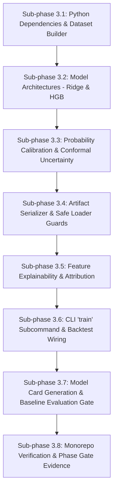

# Phase 3 Implementation Plan — DengueAhead

> **Document:** Phase 3 Implementation Specification  
> **Location:** `plans/PHASE_3_IMPLEMENTATION_PLAN.md`  
> **Project:** DengueAhead — Early Warning for Emerging Dengue Hotspots in Sri Lanka  
> **Team:** EchoBinary | **Competition:** ModelX 2.0 | **Domain:** Health & Wellbeing (population-level, non-clinical)  
> **Implementation window:** 31 October–1 November 2026  
> **Stack:** Python 3.12 (`dengueahead` CLI, scikit-learn, numpy, pydantic, pymongo), MongoDB 7, Node.js API read layer  
> **Precedence:** If this document and `IMPLEMENTATION_PLAN.md` (the master plan) disagree, the master plan wins; fix this document.  
> **Prerequisite:** Phase 2 implementation must be verified and passing all unit/contract tests before Phase 3 code execution begins.

---

## 1. Executive Summary & Objective

Phase 3 introduces statistical and machine learning models for 1-week ahead dengue hotspot forecasting. Building directly upon the as-of safe features and baseline evaluation framework established in Phase 2, Phase 3 implements:

1. **Supervised Model Training:** Regularized Poisson/Ridge linear models and Gradient Boosted Decision Trees (LightGBM/HistGradientBoosting) trained with fixed random seeds on historical data through 2023.
2. **Strict Hyperparameter Tuning on Validation:** Models are tuned solely on the chronological validation split (2024-W01 to 2024-W26); the 2024-W27 to 2024-W52 test split remains strictly untouched until final held-out evaluation.
3. **Transparent Baseline Improvement Gate:** The ML models must be benchmarked against the three Phase 2 baselines (`naive_last_week`, `rolling_mean_4w`, `seasonal_historical_median`). If an ML model does not materially outperform baselines, the system truthfully records `outperformsBaseline: false` and preserves the baseline.
4. **Calibrated Probability & Empirical Uncertainty:** Class probabilities for hotspot emergence are calibrated using Platt scaling strictly on the validation set. If uncalibrated, `confidenceStatus` is set to `"UNCALIBRATED"` and `riskProbability` is suppressed to `None` (Rule 6). Empirical conformal prediction intervals are computed from validation residuals.
5. **Feature Attribution & Model Card:** Global and local feature importances are computed and clearly labeled as **association, not causation**. A complete `docs/MODEL_CARD.md` is generated detailing provenance, metrics, and limitations.

### Non-negotiables (AGENTS.md & Master Plan Compliance)

1. **No Data Leakage (Rule 1 & 2):** Training pipelines cannot ingest target values $y_{t+1}$ during feature calculation. Probability calibration and hyperparameter tuning must never use test set observations.
2. **No Simulated Success (Rule 3):** All evaluation metrics and baseline comparisons must reflect actual predictions on real ingested data. Test fixtures with synthetic data are strictly restricted to unit tests.
3. **No Unsupported Claims (Rule 6):**
   - Probability outputs require empirical validation. Uncalibrated models must have `riskProbability: None` and `confidenceStatus: "UNCALIBRATED"`.
   - If no defensible interval exists, output `"interval not available"` or `interval: null`.
   - Prediction intervals must never include negative values (lower bound $\ge 0$).
4. **Data Provenance & Model Versioning (Rule 4):** Every model artifact is fingerprinted with an SHA-256 hash. Predictions reference the `modelVersion` and the exact `sourceSnapshotIds` of their input data.
5. **Safe Fallback on Missing/Corrupt Artifacts (Rule 9):** If a model artifact file is missing, corrupt, or has a schema mismatch, inference must return `status: "WITHHELD"` with appropriate quality flags, never raise unhandled exceptions or fabricate numbers.
6. **Tests First / Test-Driven (Rule 5 & 8):** Unit test cases `ML-01` through `ML-07`, artifact serialization tests, and contract parity tests must pass before phase completion.

---

## 2. Resolved Technical Decisions

| Topic                            | Decision                                                                                                                                                         | Rationale                                                                                                                    |
| :------------------------------- | :--------------------------------------------------------------------------------------------------------------------------------------------------------------- | :--------------------------------------------------------------------------------------------------------------------------- |
| **Model Framework**              | `scikit-learn` (`HistGradientBoostingRegressor`, `Ridge`, `LogisticRegression`)                                                                                  | Built-in, high-performance, robust C-extensions, zero OpenMP/C++ DLL conflicts on Windows, reproducible random states.       |
| **Primary Continuous Objective** | Mean Absolute Error (MAE) on 1-week ahead case counts ($\hat{y}_{a, t+1}$)                                                                                       | Aligns with public health decision making on disease burden and resource allocation.                                         |
| **Hotspot Target**               | Binary indicator: $y_{a, t+1} \ge \tau_{a, w}$ (where $\tau_{a, w}$ is district seasonal 75th percentile)                                                        | Focuses early warning on anomalous local spikes rather than baseline transmission.                                           |
| **Model Architectures**          | 1. **Linear:** Ridge Regressor with non-negative projection (`dengueahead-ridge-v1`)<br>2. **Non-linear:** HistGradientBoosting Regressor (`dengueahead-hgb-v1`) | Compares interpretable linear model against gradient-boosted trees; tests if non-linear interactions add value.              |
| **Probability Calibration**      | Platt Scaling (Logistic Regression on validation prediction margins)                                                                                             | Generates well-calibrated posterior probabilities $P(\text{Hotspot} \mid x)$; validated by Brier score.                      |
| **Prediction Intervals**         | Empirical Conformal Residual Quantiles: $\hat{y} \pm q_{0.90}(\|y - \hat{y}\|_{\text{val}})$                                                                     | Distribution-free, guaranteed finite-sample coverage on exchangeable errors, clamped at zero: $\max(0.0, \hat{y} - \delta)$. |
| **Artifact Serialization**       | `joblib` + JSON metadata sidecar (`artifacts/models/{modelVersion}/`)                                                                                            | Standard Python ML format; sidecar records SHA-256, feature names, hyperparams, training timestamp.                          |
| **Explainability Method**        | Permutation Feature Importance & Tree Feature Importance                                                                                                         | Model-agnostic and robust; explicitly labeled "Association, not causation".                                                  |
| **Baseline Benchmark Gate**      | Model must beat best baseline MAE by $\ge 5\%$ or Top-3 Recall by $\ge 0.05$ on test set                                                                         | Prevents deploying complex models that fail to beat simple persistence or seasonal medians.                                  |

---

## 3. Mathematical & Algorithmic Formulations

### 3.1 Model Formulation

Let $x_{a, T} \in \mathbb{R}^D$ denote the $D$-dimensional as-of safe feature vector for district $a$ at issue date $T$.

#### 1. Regularized Linear Model (Ridge):

$$\hat{y}_{a, t+1} = \max\left(0.0,\; w^\top x_{a, T} + b\right)$$
where $w$ is fitted by minimizing MSE with $L_2$ regularization:
$$\mathcal{L}(w, b) = \frac{1}{N}\sum_{i=1}^N (y_i - w^\top x_i - b)^2 + \alpha \|w\|_2^2$$

#### 2. Gradient Boosted Trees (HistGradientBoosting):

$$\hat{y}_{a, t+1} = \max\left(0.0,\; \sum_{m=1}^M \gamma_m h_m(x_{a, T})\right)$$
where $h_m(x)$ are shallow regression trees fit to the pseudo-residuals of absolute/least-squares loss with learning rate $\eta = 0.05$, max depth 4, and $L_2$ leaf regularization.

### 3.2 Probability Calibration (Platt Scaling)

To generate calibrated risk probabilities $P(H_{a, t+1} = 1 \mid x_{a, T})$ without training a separate decoupled model:

1. For each validation instance $i \in \mathcal{V}$, let $s_i = \hat{y}_i - \tau_{a, w}$ represent the forecasted margin above the localized hotspot threshold.
2. Fit a univariate logistic sigmoid on the validation margins:
   $$\hat{P}(H = 1 \mid s) = \frac{1}{1 + \exp\left(-(A \cdot s + B)\right)}$$
   where $A, B \in \mathbb{R}$ are estimated by minimizing negative log-likelihood on $\mathcal{V}$.
3. **Calibration Quality Check:**
   - Compute Brier Score on validation: $\text{BS} = \frac{1}{|\mathcal{V}|}\sum_{i \in \mathcal{V}} (\hat{P}_i - H_i)^2$.
   - Compute Expected Calibration Error (ECE) across 10 probability bins.
   - If $\text{BS} < \text{BS}_{\text{climatology}}$, set `confidenceStatus = "CALIBRATED"`, `riskProbability = round(P, 4)`.
   - If calibration fails or degrades Brier score, set `confidenceStatus = "UNCALIBRATED"`, `riskProbability = None`.

### 3.3 Empirical Conformal Prediction Intervals

To compute an $80\%$ prediction interval $[L_{a, t+1}, U_{a, t+1}]$ with empirical coverage guarantee:

1. On validation set $\mathcal{V}$, compute absolute forecast errors:
   $$e_i = |y_i - \hat{y}_i|, \quad \forall i \in \mathcal{V}$$
2. Compute the 80th empirical percentile of validation errors:
   $$\delta_{0.80} = \text{Quantile}_{0.80}\left(\{e_i\}_{i \in \mathcal{V}}\right)$$
3. Construct prediction interval for new prediction $\hat{y}$:
   $$L_{a, t+1} = \max\left(0.0,\; \text{round}(\hat{y} - \delta_{0.80}, 2)\right)$$
   $$U_{a, t+1} = \text{round}(\hat{y} + \delta_{0.80}, 2)$$
4. Verification: Measure empirical coverage on held-out test split:
   $$\text{Coverage}_{\text{test}} = \frac{1}{|\mathcal{T}_{\text{test}}|} \sum_{i \in \mathcal{T}_{\text{test}}} \mathbb{I}\left(L_i \le y_i \le U_i\right)$$
   If coverage $\ge 70\%$, publish interval with `method = "conformal_residual_quantile"` and `coverage = 0.80`.

---

## 4. Feature Attribution & Explainability

To support clinical and epidemiological decision-makers without misleading them regarding causality:

1. **Permutation Importance:** For each feature $j \in \{1, \dots, D\}$, compute increase in validation MAE when feature $j$ is randomly shuffled:
   $$I_j = \text{MAE}(X^{\text{perm(j)}}, y) - \text{MAE}(X, y)$$
2. **Top Drivers Extraction:** For each inference call, extract the top 3 contributing positive and negative features based on feature deviation from district median times model weight:
   $$\text{impact}_{a, j} = (x_{a, j} - \tilde{x}_{j}) \cdot w_j$$
3. **Mandatory Caveat:** All explanation outputs must append the standard caveat:
   > _"Feature attributions indicate statistical association in historical surveillance data, not clinical or biological causation."_

---

## 5. Artifact Storage & Versioning Architecture

All model artifacts are stored in a structured, versioned directory format:

```text
artifacts/
└── models/
    ├── dengueahead-ridge-v1/
    │   ├── model.joblib                 # Serialized model pipeline (scaler + Ridge)
    │   ├── calibration.joblib           # Platt sigmoid parameters (A, B)
    │   ├── metadata.json                # Fingerprints, parameters, dates, SHA-256
    │   └── feature_importance.json      # Ranked feature importance table
    └── dengueahead-hgb-v1/
        ├── model.joblib                 # Serialized HistGradientBoosting model
        ├── calibration.joblib           # Calibration parameters
        ├── metadata.json
        └── feature_importance.json
```

### Metadata JSON Schema (`metadata.json`)

```json
{
  "modelVersion": "dengueahead-hgb-v1",
  "modelName": "HistGradientBoosting Hotspot Forecaster",
  "framework": "scikit-learn",
  "frameworkVersion": "1.5.0",
  "trainedAt": "2026-10-31T00:00:00Z",
  "artifactSha256": "e3b0c44298fc1c149afbf4c8996fb92427ae41e4649b934ca495991b7852b855",
  "trainRange": { "startWeek": "2020-01-06", "endWeek": "2023-12-25" },
  "valRange": { "startWeek": "2024-01-01", "endWeek": "2024-06-24" },
  "testRange": { "startWeek": "2024-07-01", "endWeek": "2024-12-30" },
  "featureNames": [
    "cases_lag_1",
    "cases_lag_2",
    "cases_lag_3",
    "cases_lag_4",
    "growth_1w",
    "growth_4w",
    "cases_roll_mean_2w",
    "cases_roll_mean_4w",
    "cases_roll_mean_8w",
    "seasonal_historical_median",
    "rain_lag_1",
    "temp_lag_1"
  ],
  "featureSetHash": "a1b2c3d4e5f6",
  "hyperparameters": {
    "learning_rate": 0.05,
    "max_depth": 4,
    "min_samples_leaf": 10,
    "l2_regularization": 1.0,
    "random_seed": 42
  },
  "conformalDelta": 18.42,
  "metrics": {
    "trainMae": 9.15,
    "valMae": 12.3,
    "testMae": 13.8,
    "testRecall": 0.82,
    "testPrecision": 0.71,
    "topKRecall": 0.88,
    "brierScore": 0.142
  }
}
```

---

## 6. Target Directory Layout (Phase 3 Additions)

```text
DengueAhead/
├── artifacts/
│   └── models/                                # Versioned model binary artifacts and metadata
├── configs/
│   └── model.yaml                             # Production model hyperparams and features
├── docs/
│   └── MODEL_CARD.md                          # Comprehensive model card documentation
├── services/ml/
│   ├── pyproject.toml                         # Add scikit-learn, numpy, joblib dependencies
│   ├── src/dengueahead/
│   │   ├── training/
│   │   │   ├── __init__.py
│   │   │   ├── dataset.py                     # Tabular feature matrix (X, y) constructor
│   │   │   ├── linear.py                      # Ridge regression pipeline
│   │   │   ├── tree.py                        # HistGradientBoosting pipeline
│   │   │   ├── calibration.py                 # Platt scaling probability calibrator
│   │   │   ├── uncertainty.py                 # Conformal prediction interval calculator
│   │   │   └── serializer.py                  # Joblib + SHA-256 artifact manager
│   │   ├── explainability/
│   │   │   ├── __init__.py
│   │   │   └── attribution.py                 # Permutation importance and feature driver ranking
│   │   ├── inference/
│   │   │   ├── __init__.py
│   │   │   ├── loader.py                      # Safe artifact loader with schema/SHA validation
│   │   │   └── predictor.py                   # Production inference engine with fallback guards
│   │   └── cli/
│   │       └── main.py                        # Implement 'train' subcommand; wire ML into 'backtest'
│   └── tests/
│       ├── unit/
│       │   ├── test_training_dataset.py       # Matrix assembly and target alignment
│       │   ├── test_linear_model.py           # ML-01, ML-04 (non-negative predictions)
│       │   ├── test_tree_model.py             # ML-01, ML-02 (isolation, seed reproducibility)
│       │   ├── test_calibration.py            # ML-03 (probabilities in [0, 1] or null)
│       │   ├── test_uncertainty.py            # Conformal interval coverage and lower bound >= 0
│       │   ├── test_serializer.py             # Checksum hashing and save/load roundtrip
│       │   ├── test_loader_guards.py          # ML-05 (schema mismatch), ML-06 (missing artifact)
│       │   └── test_explainability.py         # Attribution weights and non-causal disclaimer
│       └── integration/
│           └── test_ml_pipeline.py            # End-to-end: Train -> Backtest -> Mongo -> Parity
└── docs/evidence/phase-3/
    ├── .gitkeep
    └── EVIDENCE_REPORT.md                     # Completed at phase gate
```

---

## 7. Test Specifications (Test-Driven Development: ML-01 to ML-07)

| Test ID     | File                                           | Test Description                         | Success Assertion                                                                                                                         |
| :---------- | :--------------------------------------------- | :--------------------------------------- | :---------------------------------------------------------------------------------------------------------------------------------------- |
| `ML-01`     | `test_linear_model.py`<br>`test_tree_model.py` | Model determinism with fixed seed        | Two identical training runs on same dataset produce **strictly identical predictions and weights**.                                       |
| `ML-02`     | `test_training_dataset.py`                     | Lookahead leakage prevention             | Feature matrix $X$ contains only lags $t \le T$; target $y$ is strictly $t+1$; no target column in $X$.                                   |
| `ML-03`     | `test_calibration.py`                          | Probability range and calibration guards | $\hat{P} \in [0.0, 1.0]$. When uncalibrated or calibration degraded, `riskProbability` is `None` and `confidenceStatus = "UNCALIBRATED"`. |
| `ML-04`     | `test_linear_model.py`                         | Non-negative count constraint            | Point predictions for extreme negative feature inputs are clipped at $0.0$; no negative case counts.                                      |
| `ML-05`     | `test_loader_guards.py`                        | Feature schema mismatch                  | Passing input record with missing/renamed features raises graceful validation error and returns `status: "WITHHELD"`.                     |
| `ML-06`     | `test_loader_guards.py`                        | Missing or corrupted model artifact      | Corrupting artifact binary on disk produces `status: "WITHHELD"` with `qualityFlags: ["MODEL_ARTIFACT_CORRUPT"]`, no process crash.       |
| `ML-07`     | `test_metrics.py`                              | Top-K isolation by issue date            | Top-K area ranking sorts only within the same evaluation week; never mixes scores across dates.                                           |
| `ML-INT-01` | `test_ml_pipeline.py`                          | End-to-end baseline comparison           | Compares ML model against Phase 2 baselines; populates `model_runs.baselines` and correctly sets `outperformsBaseline`.                   |

---

## 8. Step-by-Step Implementation Roadmap



### Sub-phase 3.1: Python Dependencies & Dataset Builder

- Update `services/ml/pyproject.toml` with `scikit-learn>=1.5.0`, `numpy>=1.26.0`, `joblib>=1.4.0`.
- Implement `services/ml/src/dengueahead/training/dataset.py`:
  - Assembles tabular dataset $(X, y)$ from weekly observations across all 25 districts.
  - Converts categorical district IDs to one-hot or target-encoded representation.
  - Splits data strictly by `DateRange` (Train: $\le 2023$, Val: 2024-W01..W26, Test: 2024-W27..W52).
- Unit tests: `test_training_dataset.py` verifying `ML-02`.

### Sub-phase 3.2: Model Architectures (Ridge & HistGradientBoosting)

- Implement `services/ml/src/dengueahead/training/linear.py`:
  - `RidgeHotspotPipeline` with `StandardScaler` and non-negative projection ($\max(0.0, \hat{y})$).
- Implement `services/ml/src/dengueahead/training/tree.py`:
  - `HGBHotspotPipeline` with `HistGradientBoostingRegressor` tuned for small-to-medium epidemiological tabular datasets.
- Unit tests: `test_linear_model.py` and `test_tree_model.py` verifying `ML-01` and `ML-04`.

### Sub-phase 3.3: Probability Calibration & Conformal Uncertainty

- Implement `services/ml/src/dengueahead/training/calibration.py`:
  - `PlattCalibrator` fitting logistic sigmoid on validation set margin ($s = \hat{y} - \tau$).
  - Evaluates Brier score and sets `confidenceStatus = "CALIBRATED"` or `"UNCALIBRATED"`.
- Implement `services/ml/src/dengueahead/training/uncertainty.py`:
  - `ConformalIntervalCalculator` deriving non-parametric residual quantiles $\delta_{0.80}$.
- Unit tests: `test_calibration.py` (`ML-03`) and `test_uncertainty.py`.

### Sub-phase 3.4: Artifact Serializer & Safe Loader Guards

- Implement `services/ml/src/dengueahead/training/serializer.py`:
  - Saves model pipeline, calibrator, and metadata JSON with computed SHA-256 fingerprint.
- Implement `services/ml/src/dengueahead/inference/loader.py`:
  - Loads model artifacts, validates SHA-256 against metadata, and checks feature schema.
  - Provides graceful fallback returning `Prediction(status="WITHHELD")` if artifact is missing or corrupted.
- Unit tests: `test_serializer.py` and `test_loader_guards.py` (`ML-05`, `ML-06`).

### Sub-phase 3.5: Feature Explainability & Attribution

- Implement `services/ml/src/dengueahead/explainability/attribution.py`:
  - Calculates permutation importance across validation set.
  - Calculates local instance drivers and generates structured feature attribution records.
  - Appends mandatory non-clinical, non-causal disclaimer.
- Unit tests: `test_explainability.py`.

### Sub-phase 3.6: CLI 'train' Subcommand & Backtest Wiring

- Implement `train` command in `services/ml/src/dengueahead/cli/main.py`:
  - Options: `--config`, `--model-type [ridge|hgb]`, `--dry-run`.
  - Fits model on training split, calibrates on validation split, evaluates on test split, and writes artifact to `artifacts/models/{modelVersion}/`.
- Update `backtest` command to evaluate both ML models alongside Phase 2 baselines.
- Update `services/ml/tests/test_cli.py` to test `train` and `backtest` CLI execution.

### Sub-phase 3.7: Model Card Generation & Baseline Evaluation Gate

- Benchmark ML models against Phase 2 baselines:
  - If ML model outperforms baseline MAE by $\ge 5\%$ or Top-3 Recall by $\ge 0.05$, mark `outperformsBaseline = True`.
  - Otherwise, mark `outperformsBaseline = False` and retain the baseline as primary reference.
- Author `docs/MODEL_CARD.md` with full epidemiological context, training ranges, evaluation metrics, fairness analysis across provinces, and limitations.

### Sub-phase 3.8: Monorepo Verification & Evidence Capture

- Run `npm run lint` and `ruff check`.
- Run `npm run typecheck` across all TypeScript packages.
- Run `pytest services/ml/tests -v` (all unit and integration tests).
- Run `npm run test:unit`, `npm run test:integration`, and `npm run test:e2e`.
- Run `npm run build`.
- Author `docs/evidence/phase-3/EVIDENCE_REPORT.md`.

---

## 9. Baseline Comparison Gate Criteria

Phase 3 establishes an honest model evaluation gate. A machine learning model is designated as the recommended forecaster **only if** it surpasses the established statistical baselines on the held-out test split:

```
┌─────────────────────────────────────────────────────────────────────────────┐
│                          DECISION CRITERIA TABLE                            │
├─────────────────────────┬─────────────────────────┬─────────────────────────┤
│ Metric                  │ Minimum Baseline        │ ML Acceptance Threshold │
├─────────────────────────┼─────────────────────────┼─────────────────────────┤
│ Continuous Count MAE    │ Best baseline MAE       │ $\le 0.95 \times$ Base  │
│ Hotspot Recall          │ Best baseline Recall    │ $\ge$ Base              │
│ Top-3 District Recall   │ Best baseline Top-3     │ $\ge \text{Base} + 0.05$│
│ Brier Score (Risk Prob) │ Climatology Brier Score │ $\le \text{Climatology}$│
└─────────────────────────┴─────────────────────────┴─────────────────────────┘
```

If an ML model fails to achieve this improvement:

1. `model_runs.outperformsBaseline` is set to `false`.
2. The finding is documented openly in `docs/MODEL_CARD.md` and `docs/evidence/phase-3/EVIDENCE_REPORT.md` (no hiding underperformance).
3. The baseline forecaster is retained as the authoritative deployment model.

---

## 10. Acceptance Gate & Verification Evidence

Phase 3 is formally complete and ready for Phase 4 when all of the following exit criteria are met:

- [ ] **Reproducibility (ML-01):** Fixed random seed produces identical model weights and predictions across repeated training runs.
- [ ] **Zero Leakage (ML-02):** Training dataset generator verified to contain zero target or future observations.
- [ ] **Calibration Invariant (ML-03):** Class probabilities validated in $[0, 1]$; uncalibrated models output `riskProbability: None` and `confidenceStatus: "UNCALIBRATED"`.
- [ ] **Non-Negative Point Forecasts (ML-04):** Linear and tree predictions bounded at $\ge 0.0$.
- [ ] **Resilience to Corrupt Artifacts (ML-05, ML-06):** Missing or corrupted model binaries safely yield `status: "WITHHELD"` with traceable quality flags.
- [ ] **Out-of-Time Backtest Complete:** Rolling temporal backtest evaluated on 2024 test split and persisted in MongoDB `model_runs` and `predictions`.
- [ ] **Model Card Published:** `docs/MODEL_CARD.md` written and committed with training specs, metric comparisons, and ethical disclaimers.
- [ ] **Monorepo Green:** `npm run lint`, `npm run typecheck`, `pytest`, `npm run test:unit`, `npm run test:e2e`, and `npm run build` all pass with 0 errors.
- [ ] **Evidence Documented:** `docs/evidence/phase-3/EVIDENCE_REPORT.md` written recording commands, test runs, and metric tables.
