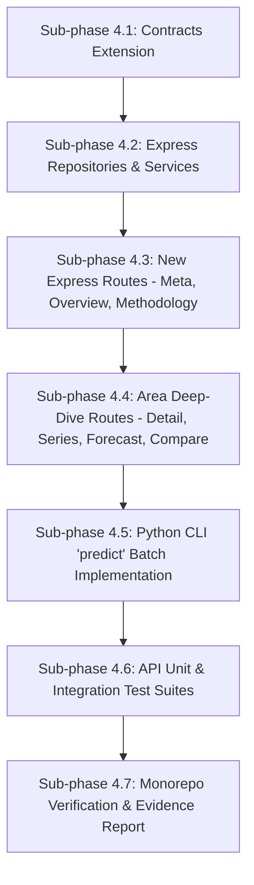

# Phase 4 Implementation Plan — DengueAhead

> **Document:** Phase 4 Implementation Specification  
> **Location:** `plans/PHASE_4_IMPLEMENTATION_PLAN.md`  
> **Project:** DengueAhead — Early Warning for Emerging Dengue Hotspots in Sri Lanka  
> **Team:** EchoBinary | **Competition:** ModelX 2.0 | **Domain:** Health & Wellbeing (population-level, non-clinical)  
> **Implementation window:** 1–2 November 2026  
> **Stack:** Python 3.12 (`dengueahead` CLI, scikit-learn, joblib, pydantic, pymongo), Node.js (Express 5, TypeScript strict, Zod, Vitest, Supertest), MongoDB 7  
> **Precedence:** If this document and `IMPLEMENTATION_PLAN.md` (the master plan) disagree, the master plan wins; fix this document.  
> **Prerequisite:** Phase 3 implementation verified, tested (115 Python tests + 51 TS tests passing), and committed before Phase 4 execution begins.

---

## 1. Executive Summary & Objective

Phase 4 bridges the analytical machine learning engine established in Phases 2 and 3 with the operational service tier. It implements two core deliverables:

1. **Production Batch Prediction CLI (`dengueahead predict`):**
   - Replaces the Phase 4 stub in `services/ml/src/dengueahead/cli/main.py`.
   - Ingests latest observations, verifies minimum temporal coverage, constructs as-of safe features for the upcoming week ($t+1$), loads the active versioned model artifact (`artifacts/models/dengueahead-hgb-v1/` or linear fallback), computes calibrated risk probabilities and conformal intervals, validates against Pydantic/Zod `Prediction` contracts, and idempotently publishes to MongoDB `predictions`.
2. **Complete, Production-Grade Read API (`apps/api`):**
   - Implements the complete set of 14 `/api/v1` routes specified in Master Plan §5 and §7.
   - Enforces clean architecture: separation of concerns between Route Handlers, Controllers/Services, and Repositories.
   - Strictly enforces runtime validation with Zod schemas from `packages/contracts`, preventing MongoDB query injection and ensuring schema fidelity.
   - Provides structured error logging with correlation IDs, HTTP 503 database unavailability handling, and CORS/helmet security guards.

### Non-negotiables (AGENTS.md & Master Plan Compliance)

1. **Zero Lookahead Leakage (Rule 1 & 2):** Predictions issued for target week $t+1$ as-of cutoff date $T$ can **never** incorporate data observed after $T$.
2. **No Simulated Success (Rule 3):** Operational endpoints never return unlabelled synthetic data. Test fixtures use synthetic data strictly marked `synthetic_`.
3. **Data Provenance is Mandatory (Rule 4):** Every published prediction document references `modelVersion`, `sourceSnapshotIds`, `issueDate`, `asOfDate`, and `targetWeek`.
4. **No Unsupported Claims (Rule 6):** Uncalibrated probabilities fallback to `riskProbability: null` and `confidenceStatus: "UNCALIBRATED"`. Withheld predictions strictly carry `null` for numeric point forecasts and intervals.
5. **Read-Only API Protection (Rule 7):** All write operations to MongoDB originate strictly from authenticated offline Python CLI commands. The Node API permits only read methods (`GET`, `HEAD`, `OPTIONS`) and enforces strict query sanitization.
6. **Keep Trunk Green (Rule 8):** All new TypeScript endpoints and Python CLI commands must pass unit and integration tests (`API-01` to `API-07`, `PRED-01` to `PRED-04`) with zero lint or typecheck regressions.
7. **Transparent Blockers & Fallbacks (Rule 9):** If MongoDB is offline, endpoints return HTTP 503 Service Unavailable, never false empty arrays (`{ data: [], count: 0 }`). If an artifact is corrupt, predictions are safely marked `WITHHELD` with `qualityFlags: ["MODEL_ARTIFACT_CORRUPT"]`.

---

## 2. Resolved Technical Decisions

| Topic                                | Decision                                                   | Rationale                                                                                                                                                                  |
| :----------------------------------- | :--------------------------------------------------------- | :------------------------------------------------------------------------------------------------------------------------------------------------------------------------- |
| **Prediction Delivery Architecture** | Offline Batch Inference (`predict --publish` into MongoDB) | Decouples Python ML inference from HTTP request-response cycle; eliminates heavy Python runtime overhead in web API; guarantees zero inference latency for frontend users. |
| **API Framework & Runtime**          | Express 5 + Node.js 24 + TypeScript (strict mode)          | Established stack in `apps/api`; rapid JSON streaming, robust middleware ecosystem, lightweight.                                                                           |
| **Contract Validation**              | Shared Zod Schemas (`packages/contracts`)                  | Single source of truth for runtime validation; shared between API validation, TypeScript typings, and frontend query hooks.                                                |
| **API Error Handling**               | Standardized RFC 7807-style JSON error envelope            | `{ error: { code: string, message: string, requestId?: string, details?: any } }` across all status codes (400, 404, 405, 500, 503).                                       |
| **Pagination Strategy**              | Capped offset/limit with cursor fallback                   | Default limit 50, max 500; prevents memory exhaustion from unbounded queries while serving all 25 districts in a single page.                                              |
| **Idempotent Storage**               | MongoDB `$setOnInsert` on unique compound index            | Unique index on `(areaId, targetWeek, modelVersion, issueDate)` ensures batch re-runs update metadata without duplicating records.                                         |
| **Database Failure Handling**        | HTTP 503 `DATABASE_UNAVAILABLE`                            | Explicitly distinguishes between "no records match query" (200 with empty array) and "database connection failed" (503).                                                   |

---

## 3. Complete Backend API Route Specifications (`apps/api`)

The API exposes the following 14 endpoints under the `/api/v1` prefix:

```
┌──────────────────────────────────────────────────────────────────────────────────────────────┐
│                                 DENGUEAHEAD API ENDPOINTS                                    │
├─────────┬───────────────────────────────────┬────────────────────────────────────────────────┤
│ Method  │ Route                             │ Description                                    │
├─────────┼───────────────────────────────────┼────────────────────────────────────────────────┤
│ GET     │ /health                           │ Service liveness, uptime, API version          │
│ GET     │ /readiness                        │ DB connectivity probe (returns 503 if down)    │
│ GET     │ /meta                             │ Active model, latest issue date, freshness     │
│ GET     │ /overview                         │ National metrics, hotspot counts, top emerging │
│ GET     │ /areas                            │ List all 25 districts with metadata            │
│ GET     │ /areas/:areaId                    │ Single district profile & coordinates          │
│ GET     │ /areas/:areaId/series             │ Historical weekly observed cases               │
│ GET     │ /areas/:areaId/forecast           │ Latest/as-of forecast, intervals, drivers      │
│ GET     │ /predictions                      │ Filtered & sorted predictions list             │
│ GET     │ /compare                          │ Side-by-side comparison (up to 3 districts)    │
│ GET     │ /backtests                        │ Historical evaluation runs and out-of-time log │
│ GET     │ /evaluation                       │ Model performance vs baseline benchmarks       │
│ GET     │ /sources                          │ Data audit manifest, freshness, licenses       │
│ GET     │ /methodology                      │ Model taxonomy, target specs, limitations      │
└─────────┴───────────────────────────────────┴────────────────────────────────────────────────┘
```

### Detailed Endpoint Contracts

#### 1. `GET /api/v1/meta`

- **Query Params:** None
- **Success (200 OK):** `MetaResponseSchema`
  ```json
  {
    "geographicLevel": "district",
    "latestIssueDate": "2024-12-30",
    "latestTargetWeek": "2025-01-06",
    "activeModelVersion": "dengueahead-hgb-v1",
    "lastUpdated": "2026-10-31T12:00:00Z",
    "sourceFreshnessStatus": "CURRENT"
  }
  ```
- **Error (503):** Database unavailable.

#### 2. `GET /api/v1/overview`

- **Query Params:** `issueDate` (optional, YYYY-MM-DD; defaults to latest available)
- **Success (200 OK):** `OverviewSummarySchema`
  ```json
  {
    "issueDate": "2024-12-30",
    "targetWeek": "2025-01-06",
    "monitoredAreasCount": 25,
    "emergingHotspotsCount": 4,
    "persistentHotspotsCount": 7,
    "stableAreasCount": 11,
    "coolingAreasCount": 2,
    "withheldCount": 1,
    "topEmergingAreas": [
      {
        "area": { "areaId": "LK-11", "name": "Colombo", "level": "district" },
        "prediction": { "status": "EMERGING", "pointForecast": 142.5, "riskProbability": 0.84 }
      }
    ]
  }
  ```

#### 3. `GET /api/v1/areas`

- **Query Params:** `query` (optional string), `level` (optional, default: `district`), `limit` (int, default: 50, max: 100), `offset` (int, default: 0)
- **Success (200 OK):**
  ```json
  {
    "data": [
      {
        "areaId": "LK-11",
        "name": "Colombo",
        "level": "district",
        "parentAreaId": "LK-1",
        "centroid": [6.9271, 79.8612],
        "population": 2326000,
        "populationYear": 2021
      }
    ],
    "count": 25,
    "total": 25
  }
  ```

#### 4. `GET /api/v1/areas/:areaId`

- **Path Params:** `areaId` (e.g. `LK-11`)
- **Success (200 OK):** `AreaSchema` document.
- **Error (404):** `AREA_NOT_FOUND` if `areaId` does not exist in registry.

#### 5. `GET /api/v1/areas/:areaId/series`

- **Path Params:** `areaId`
- **Query Params:** `from` (optional YYYY-MM-DD), `to` (optional YYYY-MM-DD), `limit` (default: 104, max: 520)
- **Success (200 OK):**
  ```json
  {
    "areaId": "LK-11",
    "data": [
      {
        "weekStart": "2024-06-17",
        "weekEnd": "2024-06-23",
        "cases": 112,
        "reportedAt": "2024-06-25T00:00:00Z",
        "qualityFlags": []
      }
    ],
    "count": 52
  }
  ```

#### 6. `GET /api/v1/areas/:areaId/forecast`

- **Path Params:** `areaId`
- **Query Params:** `issueDate` (optional YYYY-MM-DD), `modelVersion` (optional)
- **Success (200 OK):**
  ```json
  {
    "areaId": "LK-11",
    "areaName": "Colombo",
    "prediction": { ...PredictionSchema... },
    "historicalBaseline": {
      "seasonalMedian": 95.0,
      "hotspotThreshold": 120.0
    },
    "featureDrivers": [
      { "feature": "cases_lag_1", "impact": 18.4, "direction": "positive" }
    ],
    "nonCausalDisclaimer": "Feature attributions indicate statistical association in historical surveillance data, not clinical or biological causation."
  }
  ```

#### 7. `GET /api/v1/predictions`

- **Query Params:** `issueDate` (optional YYYY-MM-DD), `status` (optional `PredictionStatus`), `modelVersion` (optional), `limit` (default: 50, max: 500), `offset` (default: 0)
- **Success (200 OK):** `{ "data": Prediction[], "count": number, "total": number }`

#### 8. `GET /api/v1/compare`

- **Query Params:** `areaIds` (comma-separated, min 1, max 3, e.g. `LK-11,LK-12,LK-21`), `issueDate` (optional YYYY-MM-DD)
- **Validation:** Must belong to same geographic level (`district`). Reject $>3$ areas with HTTP 400 (`TOO_MANY_AREAS`).
- **Success (200 OK):**
  ```json
  {
    "issueDate": "2024-12-30",
    "targetWeek": "2025-01-06",
    "comparisons": [
      {
        "area": { "areaId": "LK-11", "name": "Colombo" },
        "prediction": { ...PredictionSchema... },
        "recentTrend": [ { "weekStart": "2024-12-23", "cases": 125 } ]
      }
    ]
  }
  ```

#### 9. `GET /api/v1/backtests`

- **Query Params:** `modelVersion` (optional), `from` (optional), `to` (optional)
- **Success (200 OK):** List of historical evaluations, model run parameters, and test ranges from `model_runs` collection.

#### 10. `GET /api/v1/evaluation`

- **Query Params:** `modelVersion` (optional; defaults to recommended active model)
- **Success (200 OK):** Full `EvaluationMetricsSchema` document comparing ML model to Phase 2 baselines (`naive_last_week`, `rolling_mean_4w`, `seasonal_historical_median`).

#### 11. `GET /api/v1/sources`

- **Query Params:** None
- **Success (200 OK):** List of data sources, license statuses, last audited timestamp, and snapshot hashes.

#### 12. `GET /api/v1/methodology`

- **Query Params:** None
- **Success (200 OK):**
  ```json
  {
    "targetDefinition": "Continuous 1-week ahead case count (y_{t+1}) and binary hotspot threshold crossing (y_{t+1} >= tau_{a, w})",
    "hotspotThresholdRule": "District-specific seasonal 75th percentile estimated strictly on historical training split (<= 2023)",
    "statusTaxonomy": {
      "EMERGING": "Current cases < threshold and forecasted cases >= threshold",
      "PERSISTENT": "Current cases >= threshold and forecasted cases >= threshold",
      "COOLING": "Current cases >= threshold and forecasted cases < threshold",
      "STABLE": "Current cases < threshold and forecasted cases < threshold",
      "WITHHELD": "Forecast suppressed due to insufficient history or data quality issues"
    },
    "nonClinicalDisclaimer": "DengueAhead is a population-level decision support tool for public health resource planning. It does not provide medical diagnoses or clinical advice."
  }
  ```

---

## 4. Operational Batch Prediction CLI (`dengueahead predict`)

The `predict` command in `services/ml/src/dengueahead/cli/main.py` is fully wired to execute batch forecasting.

### 4.1 Execution Flow

```mermaid
flowchart TD
    CLI[dengueahead predict --as-of 2024-12-30 --publish] --> LOAD[Load Area Map & Latest Observations]
    LOAD --> CUT[Apply as-of temporal cutoff T]
    CUT --> FEAT[Extract 21 As-Of Safe Features for all 25 Districts]
    FEAT --> ART[Load Model Artifact: dengueahead-hgb-v1]
    ART --> VAL{Artifact Intact & SHA-256 Valid?}
    VAL -- No --> WH[Generate Prediction status=WITHHELD qualityFlags=MODEL_ARTIFACT_CORRUPT]
    VAL -- Yes --> INF[Run MLHotspotPredictor Inference]
    INF --> CALIB[Evaluate Platt Sigmoid -> riskProbability or null]
    INF --> CONF[Evaluate Conformal Quantile -> [lower, upper] >= 0.0]
    INF --> TAX[Classify Emerging / Persistent / Cooling / Stable]
    WH --> COMBINE[Combine Validated Predictions]
    CALIB --> COMBINE
    CONF --> COMBINE
    TAX --> COMBINE
    COMBINE --> PUB{--publish Flag Set?}
    PUB -- Yes --> MONGO[(Idempotent Upsert into MongoDB predictions)]
    PUB -- No --> OUT[Output JSON / Summary Table to Console]
```

### 4.2 CLI Command Signature & Options

```bash
dengueahead predict [OPTIONS]

Options:
  --as-of TEXT           Forecast issue date (YYYY-MM-DD). Defaults to latest Monday.
  --model-version TEXT   Model version to load (default: dengueahead-hgb-v1).
  --fallback-baseline    Fallback to baseline if ML artifact unavailable.
  --area-map PATH        Path to area map YAML (default: configs/area_map.yaml).
  --publish              Publish predictions batch to MongoDB.
  --output PATH          Path to write predictions JSON file.
  --help                 Show this message and exit.
```

### 4.3 Fallback Matrix

| Issue                                                | Quality Flag             | Point Forecast | Interval | Risk Probability | Status                   |
| :--------------------------------------------------- | :----------------------- | :------------- | :------- | :--------------- | :----------------------- |
| Missing model artifact binary                        | `MODEL_ARTIFACT_MISSING` | `null`         | `null`   | `null`           | `WITHHELD`               |
| Corrupt artifact (SHA mismatch)                      | `MODEL_ARTIFACT_CORRUPT` | `null`         | `null`   | `null`           | `WITHHELD`               |
| Fewer than 4 historical weeks                        | `INSUFFICIENT_HISTORY`   | `null`         | `null`   | `null`           | `WITHHELD`               |
| Missing lag-1 observation ($y_t$)                    | `MISSING_CURRENT_REPORT` | `null`         | `null`   | `null`           | `WITHHELD`               |
| Uncalibrated probability ($BS \ge BS_{\text{base}}$) | None (valid forecast)    | $\hat{y}$      | $[L, U]$ | `null`           | `EMERGING` / `STABLE`... |

---

## 5. Security, Validation & Reliability Architecture

1. **MongoDB Injection Protection:**
   - Express route parameters and query arguments are parsed through strict Zod schemas (`QuerySchema`, `ParamSchema`).
   - Area IDs are validated against regex `^[A-Z]{2}-\d{1,2}$`.
   - Dates are validated against regex `^\d{4}-\d{2}-\d{2}$`.
   - Query filters never pass raw user objects to MongoDB filter dictionaries.
2. **Read-Only Protection:**
   - Global middleware rejects any HTTP request whose method is not `GET`, `HEAD`, or `OPTIONS` with HTTP 405 Method Not Allowed.
3. **Database Downtime Resilience:**
   - When MongoDB is unreachable, repositories catch connection timeouts and return typed errors resulting in HTTP 503 `DATABASE_UNAVAILABLE`.
   - Never returns false empty responses (`{ data: [], count: 0 }`) during outages.
4. **Structured Error Logging:**
   - Every request is tagged with an `x-request-id` header (generated or preserved).
   - Errors are formatted with standard envelope `{ error: { code, message, requestId } }`.

---

## 6. Target Directory Layout (Phase 4 Updates)

```text
DengueAhead/
├── apps/api/
│   └── src/
│       ├── config/
│       │   └── env.ts                         # Validated environment configs
│       ├── middleware/
│       │   ├── error-handler.ts               # RFC 7807 error formatter
│       │   └── request-id.ts                  # Request correlation ID
│       ├── repositories/
│       │   ├── mongo.ts                       # Mongo client & connection pooling
│       │   ├── areas.repository.ts            # Area registry queries
│       │   ├── dengue.repository.ts           # Weekly observed series queries
│       │   ├── predictions.repository.ts      # Forecast queries & filters
│       │   ├── model-runs.repository.ts       # Evaluation & model run queries
│       │   └── sources.repository.ts          # Snapshot manifests & audits
│       ├── routes/
│       │   ├── health.route.ts                # /health & /readiness
│       │   ├── meta.route.ts                  # /meta
│       │   ├── overview.route.ts              # /overview
│       │   ├── areas.route.ts                 # /areas, /areas/:id, /areas/:id/series, /areas/:id/forecast
│       │   ├── predictions.route.ts           # /predictions
│       │   ├── compare.route.ts               # /compare
│       │   ├── backtests.route.ts             # /backtests
│       │   ├── evaluation.route.ts            # /evaluation
│       │   ├── sources.route.ts               # /sources
│       │   └── methodology.route.ts           # /methodology
│       ├── test/
│       │   ├── meta.test.ts                   # Unit tests for /meta
│       │   ├── overview.test.ts               # Unit tests for /overview
│       │   ├── areas.test.ts                  # Unit tests for /areas and subroutes
│       │   ├── compare.test.ts                # Unit tests for /compare
│       │   ├── backtests.test.ts              # Unit tests for /backtests
│       │   ├── methodology.test.ts            # Unit tests for /methodology
│       │   ├── predictions.test.ts            # Enhanced tests for /predictions
│       │   ├── evaluation.test.ts             # Evaluation endpoint tests
│       │   ├── sources.test.ts                # Sources endpoint tests
│       │   └── health.test.ts                 # Health & readiness tests
│       └── app.ts                             # Express application assembly
├── packages/contracts/
│   └── src/
│       ├── api.schema.ts                      # Added compare, series, forecast, methodology schemas
│       └── index.ts                           # Re-export all schemas
├── services/ml/
│   ├── src/dengueahead/cli/
│   │   └── main.py                            # Fully implemented 'predict' subcommand
│   └── tests/
│       ├── test_cli.py                        # Updated predict CLI tests
│       └── integration/
│           └── test_predict_publish.py        # Python predict batch & MongoDB publish integration
└── docs/evidence/phase-4/
    └── EVIDENCE_REPORT.md                     # Completed at phase gate
```

---

## 7. Test Specifications (API-01 to API-07 & PRED-01 to PRED-04)

| Test ID       | File                                       | Test Description                                           | Success Assertion                                                                            |
| :------------ | :----------------------------------------- | :--------------------------------------------------------- | :------------------------------------------------------------------------------------------- |
| **`API-01`**  | `areas.test.ts`                            | Nonexistent `areaId` requested on `/areas/:id`             | Returns HTTP 404 with error code `AREA_NOT_FOUND`.                                           |
| **`API-02`**  | `predictions.test.ts`<br>`compare.test.ts` | Invalid query format (malformed date, invalid status enum) | Returns HTTP 400 with structured validation issues.                                          |
| **`API-03`**  | `health.test.ts`<br>`overview.test.ts`     | MongoDB disconnected / query failure                       | Returns HTTP 503 `DATABASE_UNAVAILABLE` or `DATABASE_ERROR`.                                 |
| **`API-04`**  | `areas.test.ts`<br>`predictions.test.ts`   | Mongo operator injection (`{"$gt": ""}`) in query params   | Parameter rejected by Zod schema or treated strictly as literal string.                      |
| **`API-05`**  | `predictions.test.ts`                      | Withheld prediction serialization                          | Returns numeric fields (`pointForecast`, `interval`, `riskProbability`) as `null`.           |
| **`API-06`**  | `meta.test.ts`                             | Latest forecast issue date resolution                      | Correctly returns latest valid `issueDate` and active `modelVersion`.                        |
| **`API-07`**  | `compare.test.ts`                          | Area comparison with $>3$ districts or invalid IDs         | Returns HTTP 400 `TOO_MANY_AREAS` or `INVALID_AREA_ID`.                                      |
| **`PRED-01`** | `test_cli.py`                              | `dengueahead predict --dry-run`                            | Executes batch forecast across districts and outputs valid Prediction contracts.             |
| **`PRED-02`** | `test_predict_publish.py`                  | Corrupted/missing artifact during `predict`                | Safely marks predictions `status="WITHHELD"` with `qualityFlags=["MODEL_ARTIFACT_CORRUPT"]`. |
| **`PRED-03`** | `test_predict_publish.py`                  | Zero leakage in `predict` batch                            | As-of cutoff strictly filters observations; no target week cases used.                       |
| **`PRED-04`** | `test_predict_publish.py`                  | Idempotent publishing to MongoDB                           | Re-running `predict --publish` does not produce duplicate prediction records.                |

---

## 8. Step-by-Step Implementation Roadmap



### Sub-phase 4.1: Contracts Extension (`packages/contracts`)

- Add schemas in `packages/contracts/src/api.schema.ts`:
  - `AreaSeriesResponseSchema`: List of weekly historical observations for an area.
  - `AreaForecastResponseSchema`: Single area forecast with baseline context and feature drivers.
  - `CompareResponseSchema`: Aligned multi-area comparison.
  - `MethodologyResponseSchema`: Static methodology metadata.
  - `BacktestsResponseSchema`: List of evaluation runs and metadata.
- Compile contracts with `npm run build:contracts` and verify parity.

### Sub-phase 4.2: Express Repositories & Services (`apps/api`)

- Implement dedicated repository modules:
  - `areas.repository.ts`: District queries, single area lookup.
  - `dengue.repository.ts`: Weekly time-series queries with date bounds.
  - `predictions.repository.ts`: Forecast lookups, overview counts aggregation, top emerging areas query.
  - `model-runs.repository.ts`: Backtest runs and evaluation metrics query.
- Add robust query parameter sanitization.

### Sub-phase 4.3: New Express Routes (Meta, Overview, Methodology)

- Create `apps/api/src/routes/meta.route.ts` (`GET /api/v1/meta`).
- Create `apps/api/src/routes/overview.route.ts` (`GET /api/v1/overview`).
- Create `apps/api/src/routes/methodology.route.ts` (`GET /api/v1/methodology`).
- Mount in `apps/api/src/app.ts`.

### Sub-phase 4.4: Area Deep-Dive Routes (Detail, Series, Forecast, Compare)

- Expand `apps/api/src/routes/areas.route.ts`:
  - `GET /api/v1/areas/:areaId`
  - `GET /api/v1/areas/:areaId/series`
  - `GET /api/v1/areas/:areaId/forecast`
- Create `apps/api/src/routes/compare.route.ts` (`GET /api/v1/compare`).
- Create `apps/api/src/routes/backtests.route.ts` (`GET /api/v1/backtests`).

### Sub-phase 4.5: Python CLI 'predict' Batch Implementation

- Replace stub in `services/ml/src/dengueahead/cli/main.py`:
  - Add `predict` command options (`--as-of`, `--model-version`, `--area-map`, `--publish`, `--output`).
  - Wire dataset feature extraction, artifact loading, inference, calibration, conformal intervals, and taxonomy classification.
  - Implement MongoDB batch publishing with `$setOnInsert` idempotency.

### Sub-phase 4.6: API Unit & Integration Test Suites

- Create unit tests in `apps/api/src/test/`:
  - `meta.test.ts`
  - `overview.test.ts`
  - `areas.test.ts` (covers `API-01`, `API-04`)
  - `compare.test.ts` (covers `API-07`)
  - `methodology.test.ts`
  - `backtests.test.ts`
- Create Python integration tests in `services/ml/tests/integration/test_predict_publish.py` (`PRED-01` to `PRED-04`).

### Sub-phase 4.7: Monorepo Verification & Evidence Capture

- Run full quality gate:
  - `npm run lint` and `ruff check`
  - `npm run typecheck`
  - `python -m pytest services/ml/tests -v`
  - `npm run test:unit`
  - `npm run build`
- Author `docs/evidence/phase-4/EVIDENCE_REPORT.md`.

---

## 9. Acceptance Gate & Verification Evidence

Phase 4 is complete when all of the following exit criteria are met:

- [ ] **All 14 `/api/v1` Routes Operational:** Every endpoint responds with 200 OK for valid inputs and matches contracts.
- [ ] **Error Envelope Parity (API-01, API-02):** Nonexistent areas return 404, invalid query inputs return 400 with structured validation details.
- [ ] **Offline Resilience (API-03):** Database disconnection safely produces HTTP 503 Service Unavailable across all data endpoints.
- [ ] **Injection Safety (API-04):** MongoDB query operators are rejected or escaped.
- [ ] **Contract Invariants (API-05):** Withheld forecasts strictly serialize point forecast, interval, and risk probability as `null`.
- [ ] **Python Predict Batch Operational (PRED-01 to PRED-04):** `dengueahead predict` executes cleanly, respects as-of safety, handles missing/corrupt artifacts, and idempotently upserts to MongoDB.
- [ ] **Monorepo Green:** `npm run lint`, `npm run typecheck`, `pytest`, `npm run test:unit`, and `npm run build` pass with 0 errors.
- [ ] **Evidence Documented:** `docs/evidence/phase-4/EVIDENCE_REPORT.md` published recording all test logs and verification evidence.
