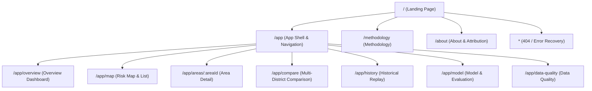
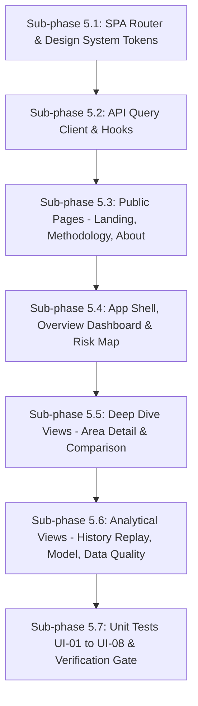

# Phase 5 Implementation Plan — DengueAhead

> **Document:** Phase 5 Implementation Specification  
> **Location:** `plans/PHASE_5_IMPLEMENTATION_PLAN.md`  
> **Project:** DengueAhead — Early Warning for Emerging Dengue Hotspots in Sri Lanka  
> **Team:** EchoBinary | **Competition:** ModelX 2.0 | **Domain:** Health & Wellbeing (population-level, non-clinical)  
> **Implementation window:** 2–3 November 2026  
> **Stack:** React 18, Vite, TypeScript (strict mode), CSS Design Tokens, Lucide Icons, Vitest, Testing Library, Playwright  
> **Precedence:** If this document and `IMPLEMENTATION_PLAN.md` (the master plan) disagree, the master plan wins; fix this document.  
> **Prerequisite:** Phase 4 implementation verified, all 14 API routes and prediction publishing tested (118 Python tests + 71 TS tests passing), and committed before Phase 5 execution begins.

---

## 1. Executive Summary & Objectives

Phase 5 delivers the complete, production-grade frontend dashboard and public landing experience for DengueAhead. It transforms the 14 verified `/api/v1` backend endpoints into an intuitive, accessible, and scientifically grounded user interface tailored for public health planning teams, epidemiologists, and technical evaluators.

### Core Objectives:

1. **Credible Public Health Design System:** Implement a high-contrast, professional, and accessible design system (WCAG 2.1 AA compliant) with a restrained public health palette (Deep Navy `#0B1730`, Ocean Blue `#2563EB`, Teal `#0D9488`, Amber `#D97706`, Coral `#DC4754`, Surface `#F5F7FB`).
2. **Complete 11-Route Client-Side Application:** Build the full suite of pages specified in Master Plan §4:
   - Public Landing (`/`)
   - Overview Dashboard (`/app/overview`)
   - Risk Map & District Registry (`/app/map`)
   - Area Deep-Dive (`/app/areas/:areaId`)
   - Multi-Area Comparison (`/app/compare`)
   - Historical Replay (`/app/history`)
   - Model & Evaluation (`/app/model`)
   - Data Quality Audit (`/app/data-quality`)
   - Public Methodology (`/methodology`)
   - About / Attribution (`/about`)
   - 404 & Error Boundary (`*`)
3. **Data Provenance & Scientific Truthfulness:** Every metric, prediction, and visual component strictly reflects verified backend contract data. Withheld forecasts display honest empty/withheld states (`null`), uncalibrated probabilities omit percentages, and feature attributions carry clear non-causal disclosures.
4. **Resilient UX States:** Comprehensive coverage of loading skeletons, empty states, database disconnection (HTTP 503), stale data warnings, and invalid area routes.
5. **Rigorous Quality Gate:** Full unit test suite (`UI-01` through `UI-08`) in Vitest and end-to-end verification via Playwright across desktop and mobile viewports (`360px`, `768px`, `1024px`, `1440px`).

---

## 2. Resolved Technical & UX Architecture Decisions

| Topic                          | Decision                                                                             | Rationale                                                                                                                                                                                                                                                  |
| :----------------------------- | :----------------------------------------------------------------------------------- | :--------------------------------------------------------------------------------------------------------------------------------------------------------------------------------------------------------------------------------------------------------- |
| **Routing Architecture**       | Lightweight Client-Side SPA Router with HTML5 History API & popstate synchronization | Eliminates third-party routing version incompatibilities; provides zero-dependency URL-sync for query params, params (`:areaId`), and deep linking across all 11 routes.                                                                                   |
| **Data Fetching & Caching**    | Typed `useApiQuery` hook using `apiFetch` and Zod contracts                          | Enforces runtime schema validation on every API response; eliminates unvalidated UI state; provides transparent `isLoading`, `error`, `isStale`, and `refetch` bindings.                                                                                   |
| **Map Visualization**          | Scaled Geocoded Interactive SVG District Map + Accessible Fallback List              | Sri Lanka district GeoJSON polygons are not legally bundled in repo; centroid coordinates for all 25 districts (`configs/area_map.yaml`) enable an accurate SVG projection with zero external tile dependencies and 100% keyboard accessibility (`UI-08`). |
| **Time Series Visualizations** | Accessible Native SVG Charting Components                                            | Native SVG charts (`TimeSeriesChart`) differentiate observed, predicted, seasonal threshold, and conformal uncertainty bands without canvas black-box rendering issues; provides instant tabular data toggle.                                              |
| **Color & Accessibility**      | Redundant Multi-Channel Visual Encoding                                              | Never rely on color alone. Hotspot statuses pair color with unique icons (Amber Triangle for Emerging, Coral Hexagon for Persistent, Teal Circle for Stable) and explicit semantic labels.                                                                 |
| **Error & Offline Strategy**   | Transparent Degradation & RFC 7807 Parsing                                           | Catches API 503 `DATABASE_UNAVAILABLE` and presents an explicit recovery banner rather than infinite spinners or misleading empty dashboards.                                                                                                              |

---

## 3. Complete Page & Route Specifications



### 3.1 Public Landing (`/`)

- **Header:** Brand logo, navigation links (`How it works`, `Data & trust`, `About`), and primary CTA button (`Explore Risk Map`).
- **Safety Banner:** Prominent top banner stating: _"Non-clinical decision-support system. Does not diagnose, prescribe, or autonomously direct medical interventions."_
- **Hero Section:**
  - Headline: _"UNDERSTAND TOMORROW'S RISK: See the next hotspot before it emerges."_
  - Subhead: _"Evidence-driven dengue risk forecasting for public-health teams and epidemiologists across Sri Lanka."_
  - Dual CTAs: `[Explore Risk Map]` (links to `/app/map`) and `[See How It Works]` (links to `/methodology`).
  - Illustrative Preview Card: Clear visual preview labeled **"Illustrative Preview (Sample Visual Only)"** in compliance with AGENTS.md Rule 3.
- **3-Step Workflow:**
  1. `[01 Weekly Surveillance]`: Ingests official weekly reports from Sri Lanka NDCU.
  2. `[02 Temporal & Weather Signals]`: Extracts 21 lag, trend, seasonality, and meteorological indicators.
  3. `[03 Calibrated Hotspot Warning]`: Issues 1-week ahead case forecasts and probability of exceeding district thresholds.
- **Real Data Sources & Attribution:** National Dengue Control Unit (NDCU) and Open-Meteo Historical Weather.
- **Footer:** EchoBinary team info, ModelX 2.0 competition context, GitHub repository link.

### 3.2 Overview Dashboard (`/app/overview`)

- **Global Filter Bar:**
  - Forecast Issue Date selector (populated from `/api/v1/meta`).
  - Geographic Level selector (`District`).
  - Global Freshness Badge (e.g. `Current`, `Stale`, `Offline`).
- **Summary KPI Cards:**
  - _Districts Monitored_ (25)
  - _Emerging Hotspots_ (Amber indicator)
  - _Persistent Hotspots_ (Coral indicator)
  - _Stable Districts_ (Teal indicator)
  - _Cooling Districts_ (Light blue indicator)
  - _Forecasts Withheld_ (Slate gray indicator)
- **Top Emerging Hotspots Table:**
  - District name, Province, Target Week, Point Forecast, Risk Probability (or Forecast Rank if uncalibrated), Status Badge, Action link to Area Detail.
- **Recent Surveillance Trends:**
  - National aggregate weekly case curve comparing previous 8 weeks to current issuance.
- **Offline / Stale Warning:** Displays clear alert banner if database is unreachable or data is $>14$ days old.

### 3.3 Risk Map & District Registry (`/app/map`)

- **Map View:**
  - Accurate spatial SVG representation of Sri Lanka's 25 districts based on official geographical centroids.
  - Interactive district nodes/markers color-coded by forecast status.
  - Hover tooltip with district name, current cases, forecasted cases, and risk status.
  - Clicking a district opens a summary drawer with quick stats and a link to `/app/areas/:areaId`.
- **Keyboard-Accessible District List Table (UI-08):**
  - Search input with real-time text filter.
  - Status filter dropdown (`All`, `Emerging`, `Persistent`, `Stable`, `Cooling`, `Withheld`).
  - Columns: District, Area ID, Level, Current Cases, Forecast ($t+1$), Conformal Interval, Risk Status.
  - Sortable by District Name, Current Cases, and Forecasted Cases.
  - Fully navigable with keyboard (`Tab`, `Arrow keys`, `Enter`).

### 3.4 Area Detail (`/app/areas/:areaId`)

- **District Profile Header:** District Name, Area ID (`LK-XX`), Parent Province, Population, Centroid coordinates.
- **Current Forecast Card:**
  - Status Badge with semantic icon and color.
  - Point Forecast: e.g. `142.5 cases` (or `"Withheld"` if data quality issue).
  - 90% Conformal Interval: `[112.0, 185.0]` (or `"Interval not available"`).
  - Risk Probability: Calibrated probability percentage (or `"Uncalibrated"`).
  - Forecast Target Week and Issue Date.
- **Historical Surveillance & Forecast Chart (UI-07):**
  - Historical weekly case counts (solid dark blue line).
  - District seasonal 75th percentile threshold (dotted amber line).
  - Next-week forecast point with conformal uncertainty ribbon (dashed ocean blue line + shaded band).
  - Semantic tooltip distinguishing observed vs predicted values.
  - Tabular view toggle for screen readers and accessibility.
- **Statistical Feature Drivers Panel:**
  - Top 3 feature contributions (e.g. `cases_lag_1 (+18.4)`, `precip_lag_2 (+6.1)`).
  - Mandatory disclaimer: _"Feature attributions indicate statistical association in historical surveillance data, not clinical or biological causation."_
- **Data Quality & Provenance Metadata:**
  - Model Version (`dengueahead-hgb-v1`), Data snapshot IDs, Quality flags (e.g. `NORMAL`, `INSUFFICIENT_HISTORY`).

### 3.5 Multi-District Comparison (`/app/compare`)

- **District Selector:** Multi-select dropdown enforcing a strict maximum of 3 districts (`UI-06`, `API-07`).
- **Synchronized Timeline Comparison Chart:** Aligned weekly time series across selected districts with consistent case count scales.
- **Side-by-Side Metric Matrix:**
  - District Profile, Latest Weekly Cases, Forecasted Cases, Conformal Interval, Seasonal Threshold, Hotspot Status.
- **Direct Shareability:** Current selection synchronized with URL query params (`/app/compare?areaIds=LK-11,LK-12,LK-21`).

### 3.6 Historical Replay & Time-Travel (`/app/history`)

- **Issue Week Slider / Selector:** Select historical test weeks (e.g. Weeks in 2024).
- **As-Of Safe Forecast Panel:**
  - Displays forecast issued strictly using data available up to the chosen date.
  - Hides actual future observations until user triggers reveal.
- **"Reveal Actual Outcome" Action:**
  - Reveals true reported case counts for that target week.
  - Computes forecast error (Absolute Error, Percentage Deviation).
  - Displays comparison with Phase 2 baseline models (`Naive Last Week`, `Seasonal Historical Median`).
- **Leakage Prevention Verification:** Explicit confirmation that zero future observations were utilized.

### 3.7 Model & Evaluation (`/app/model`)

- **Model Card Integration:** Displays version, architecture (`HistGradientBoostingRegressor`), feature count (21), and hyperparameter settings.
- **Benchmark Performance Table:**
  - Side-by-side metric comparison: `DengueAhead HGB` vs `Seasonal Median` vs `Rolling 4-Week` vs `Naive Last Week`.
  - Metrics: MAE, RMSE, Future Hotspot Recall, Precision, Brier Score.
- **Probability Calibration Curve:** Reliability plot demonstrating Platt sigmoid calibration on held-out validation data.
- **Global Permutation Feature Importance:** Ranked chart of top 10 most influential features across all districts.

### 3.8 Data Quality & Surveillance Audit (`/app/data-quality`)

- **Data Source Manifest:** Status of NDCU surveillance ingest and Open-Meteo reanalysis weather feeds.
- **Freshness & Coverage Audits:** Last audited timestamp, latest SHA-256 snapshot hashes, licence compliance status.
- **Surveillance Gap Analysis:** Quarantined records count, missing observation flags, and parser versions.
- **System Diagnostics:** MongoDB connectivity status and API response latency.

### 3.9 Public Methodology (`/methodology`)

- **Target Formulation:** Mathematical definitions of continuous prediction ($y_{t+1}$) and binary hotspot crossing ($y_{t+1} \ge \tau_{a,w}$).
- **Seasonal Threshold Rule:** Explanation of district-specific seasonal 75th percentiles estimated strictly on historical pre-2024 splits.
- **Risk Taxonomy Definitions:** Clear criteria for `EMERGING`, `PERSISTENT`, `COOLING`, `STABLE`, and `WITHHELD`.
- **Uncertainty & Calibration:** Conformal prediction quantile methodology and Platt calibration bounds.
- **Non-Clinical Public Health Notice:** Detailed statement regarding decision-support scope and limitations.

### 3.10 About & Team (`/about`)

- **Team EchoBinary:** Background, competition participation (ModelX 2.0).
- **Project Mission:** Proactive dengue intervention to optimize municipal fogging and larvicide allocation.
- **Attributions & Licences:** NDCU Sri Lanka and Open-Meteo acknowledgments.
- **AI-Assisted Development Disclosure:** Transparency statement detailing human architectural guidance and agentic implementation.
- **Open Source Repository:** Link to GitHub repository and contact information.

### 3.11 404 & Global Error Boundary (`*`)

- **Resource Not Found (404):** Helpful message for invalid routes or unknown district IDs (`LK-99`) with quick links back to Overview or Landing.
- **React Error Boundary:** Catches unexpected runtime render exceptions, logs correlation request IDs, and provides a "Try Again" recovery action.

---

## 4. Design System, Color Tokens & Accessible UI Architecture

### 4.1 Color Tokens (`apps/web/src/styles/index.css`)

```css
:root {
  /* Brand & Neutrals */
  --color-navy: #0b1730; /* High-contrast text & dark headers */
  --color-navy-muted: #1e293b; /* Sidebar & secondary panels */
  --color-primary: #2563eb; /* Action buttons & active navigation */
  --color-primary-hover: #1d4ed8;
  --color-surface-bg: #f5f7fb; /* Airy application background */
  --color-surface-card: #ffffff; /* Card surface */
  --color-border: #e2e8f0; /* Card & table borders */
  --color-text-main: #0b1730; /* WCAG 2.1 AA text on light surfaces */
  --color-text-muted: #64748b;
  --color-text-light: #94a3b8;

  /* Risk & Status Taxonomy */
  --color-emerging: #d97706; /* Amber: emerging hotspot warning */
  --color-emerging-bg: #fef3c7;
  --color-persistent: #dc4754; /* Coral: persistent high incidence */
  --color-persistent-bg: #fee2e2;
  --color-stable: #0d9488; /* Teal: low & stable */
  --color-stable-bg: #ccfbf1;
  --color-cooling: #0284c7; /* Light Blue: declining incidence */
  --color-cooling-bg: #e0f2fe;
  --color-withheld: #64748b; /* Slate: forecast withheld */
  --color-withheld-bg: #f1f5f9;
}
```

### 4.2 Accessibility & Typography Rules

1. **Typography:** System font stack (`Inter`, `-apple-system`, `BlinkMacSystemFont`, `Segoe UI`, `Roboto`, `sans-serif`).
2. **Contrast Standards:** Minimum 4.5:1 contrast for all text elements against their background; minimum 3:1 for graphical UI components.
3. **Keyboard Usability:** All interactive components (buttons, links, map rows, filter items) feature distinct `:focus-visible` outline rings (`2px solid #2563EB`).
4. **Semantic Structure:** Native `header`, `nav`, `main`, `footer`, `section`, `article`, and ARIA attributes (`role="status"`, `role="region"`, `aria-live="polite"`).
5. **No Color-Only Information:** Status badges combine background tint, colored icon, and literal status text (`EMERGING`, `PERSISTENT`, etc.).

---

## 5. API Client & State Management Architecture

### 5.1 Typed Query Hook (`useApiQuery`)

Located in `apps/web/src/lib/useApiQuery.ts`:

- Executes asynchronous requests against Express backend.
- Enforces Zod contract schema validation using `apiFetch`.
- Manages `data`, `isLoading`, `error`, and `refetch` states.
- Caches responses by URL to prevent redundant network traffic.

### 5.2 API Service Endpoints Map

| Route Hook                                | API Endpoint                         | Contract Schema                 |
| :---------------------------------------- | :----------------------------------- | :------------------------------ |
| `useMetaQuery()`                          | `GET /api/v1/meta`                   | `MetaResponseSchema`            |
| `useOverviewQuery(issueDate)`             | `GET /api/v1/overview?issueDate=`    | `OverviewSummarySchema`         |
| `useAreasQuery(query, level)`             | `GET /api/v1/areas?query=&level=`    | Paginated Area list             |
| `useAreaDetailQuery(areaId)`              | `GET /api/v1/areas/:areaId`          | `AreaSchema`                    |
| `useAreaSeriesQuery(areaId, from, to)`    | `GET /api/v1/areas/:areaId/series`   | `AreaSeriesResponseSchema`      |
| `useAreaForecastQuery(areaId, issueDate)` | `GET /api/v1/areas/:areaId/forecast` | `AreaForecastResponseSchema`    |
| `usePredictionsQuery(params)`             | `GET /api/v1/predictions`            | Paginated Prediction list       |
| `useCompareQuery(areaIds, issueDate)`     | `GET /api/v1/compare?areaIds=`       | `CompareResponseSchema`         |
| `useBacktestsQuery(modelVersion)`         | `GET /api/v1/backtests`              | `BacktestsResponseSchema`       |
| `useEvaluationQuery(modelVersion)`        | `GET /api/v1/evaluation`             | `EvaluationMetricsSchema`       |
| `useSourcesQuery()`                       | `GET /api/v1/sources`                | Array of `SourceSnapshotSchema` |
| `useMethodologyQuery()`                   | `GET /api/v1/methodology`            | `MethodologyResponseSchema`     |
| `useHealthQuery()`                        | `GET /api/v1/health` & `/readiness`  | `ServiceHealthSchema`           |

---

## 6. Target Directory Layout (`apps/web`)

```text
apps/web/
├── index.html
├── package.json
├── tsconfig.json
├── vite.config.ts
└── src/
    ├── main.tsx                         # App bootstrap
    ├── App.tsx                          # Top-level Router & Error Boundary
    ├── styles/
    │   └── index.css                    # Design tokens & base stylesheet
    ├── lib/
    │   ├── api.ts                       # Typed apiFetch with Zod safeParse
    │   ├── useApiQuery.ts               # Generic data-fetching React hook
    │   └── router.ts                    # SPA navigation & path/query parser
    ├── components/
    │   ├── layout/
    │   │   ├── AppShell.tsx             # Sidebar, Header, Banner, Main Grid
    │   │   ├── Header.tsx               # Top header with health badge & date
    │   │   ├── Sidebar.tsx              # Desktop & mobile drawer navigation
    │   │   └── Footer.tsx               # Attribution & legal footer
    │   ├── ui/
    │   │   ├── Badge.tsx                # StatusBadge, QualityBadge
    │   │   ├── MetricCard.tsx           # KPI display with trend indicator
    │   │   ├── Button.tsx               # Accessible button styles
    │   │   ├── Select.tsx               # Styled accessible selector
    │   │   ├── LoadingSkeleton.tsx      # Skeleton placeholder
    │   │   ├── EmptyState.tsx           # Honest empty representation
    │   │   ├── ErrorState.tsx           # Error container with retry
    │   │   └── OfflineBanner.tsx        # Database 503 outage alert
    │   ├── charts/
    │   │   └── TimeSeriesChart.tsx      # SVG weekly cases & forecast chart
    │   └── map/
    │       ├── DistrictMap.tsx          # Interactive SVG Sri Lanka district map
    │       └── DistrictListTable.tsx    # Accessible searchable/sortable list
    ├── pages/
    │   ├── LandingPage.tsx              # Public landing experience (/)
    │   ├── OverviewPage.tsx             # Overview dashboard (/app/overview)
    │   ├── MapPage.tsx                  # Spatial risk map (/app/map)
    │   ├── AreaDetailPage.tsx           # District forecast deep dive (/app/areas/:id)
    │   ├── ComparePage.tsx              # Multi-district comparison (/app/compare)
    │   ├── HistoryPage.tsx              # Historical replay time machine (/app/history)
    │   ├── ModelPage.tsx                # Evaluation & model card (/app/model)
    │   ├── DataQualityPage.tsx          # Data audit manifest (/app/data-quality)
    │   ├── MethodologyPage.tsx          # Target & taxonomy methodology (/methodology)
    │   ├── AboutPage.tsx                # Team, competition, attribution (/about)
    │   └── NotFoundPage.tsx             # 404 & recovery page (*)
    └── test/
        ├── setup.ts                     # Test environment setup
        ├── ui-tests.test.tsx            # Unit tests covering UI-01 through UI-08
        └── App.test.tsx                 # Core App shell & navigation tests
```

---

## 7. Test Specifications (UI-01 to UI-08 & Playwright E2E)

### 7.1 Unit Tests (`apps/web/src/test/ui-tests.test.tsx`)

| Test ID     | Description                      | Acceptance Assertion                                                                                                                 |
| :---------- | :------------------------------- | :----------------------------------------------------------------------------------------------------------------------------------- |
| **`UI-01`** | Landing page CTA navigation      | Clicking "Explore Risk Map" navigates to `/app/map`; clicking "See how it works" navigates to `/methodology`.                        |
| **`UI-02`** | Empty data handling              | API returning empty array (`{ data: [], count: 0 }`) renders honest empty state without JavaScript crashes.                          |
| **`UI-03`** | Withheld prediction suppression  | A prediction with `status: "WITHHELD"` displays `"Withheld"` and never renders numeric point forecasts or confidence percentages.    |
| **`UI-04`** | Stale data warning               | When `sourceFreshnessStatus: "STALE"`, a high-visibility warning banner is rendered with accessible ARIA alert role.                 |
| **`UI-05`** | Issue date change refetching     | Selecting a new date in the global date picker updates the query argument and triggers fresh API requests.                           |
| **`UI-06`** | Multi-district comparison limits | Selecting more than 3 areas in the compare selector is prevented and displays a `"Maximum 3 areas"` validation warning.              |
| **`UI-07`** | Chart semantic differentiation   | Case series charts render observed cases as solid strokes, forecasts as distinct dashed lines, and conformal bounds as shaded fills. |
| **`UI-08`** | Keyboard-accessible map list     | The district table on `/app/map` supports keyboard searching, sorting, and row selection without requiring pointer/mouse input.      |

### 7.2 End-to-End Test Suite (`e2e/dashboard.spec.ts`)

1. **Flow 1: Landing to Overview:** User visits `/`, clicks `Explore Risk Map`, lands on `/app/map`, clicks a district, navigates to `/app/areas/LK-11`.
2. **Flow 2: Comparison Selection:** User visits `/app/compare`, selects Colombo and Gampaha, verifies side-by-side metric alignment.
3. **Flow 3: Historical Time Travel:** User visits `/app/history`, selects past week, verifies actual outcome is hidden until "Reveal Outcome" button is clicked.
4. **Flow 4: Responsiveness & Viewports:** Tests viewports at `360px` (mobile), `768px` (tablet), `1024px` (laptop), `1440px` (desktop) ensuring 0 horizontal overflow.
5. **Flow 5: Offline Resilience:** Simulates API 503 response and confirms user-friendly offline message with retry capability.

---

## 8. Step-by-Step Implementation Roadmap



### Sub-phase 5.1: SPA Router, Design Tokens & Component Primitives

- Create lightweight SPA router in `apps/web/src/lib/router.ts` supporting routes, query params, and browser navigation.
- Expand `apps/web/src/styles/index.css` with full CSS design tokens (typography, colors, spacing, borders).
- Build core accessible primitives in `apps/web/src/components/ui/`: `Button`, `Badge`, `Select`, `MetricCard`, `LoadingSkeleton`, `EmptyState`, `ErrorState`, `OfflineBanner`.

### Sub-phase 5.2: API Query Client & Data Hooks

- Create `apps/web/src/lib/useApiQuery.ts` with error handling, schema parsing, and caching.
- Implement domain query hooks for all 14 backend API endpoints.

### Sub-phase 5.3: Public Pages (Landing, Methodology, About, 404)

- Implement `LandingPage.tsx` with responsive hero, CTAs, 3-step workflow, and illustrative preview label.
- Implement `MethodologyPage.tsx` with mathematical target specifications, 75th percentile explanation, and non-clinical disclaimer.
- Implement `AboutPage.tsx` with EchoBinary team info, licenses, and AI-assistance disclosure.
- Implement `NotFoundPage.tsx` with recovery links.

### Sub-phase 5.4: App Shell, Overview Dashboard & Risk Map

- Implement `AppShell.tsx`, `Header.tsx`, `Sidebar.tsx`, and `Footer.tsx`.
- Implement `OverviewPage.tsx` with national KPI cards, top emerging areas table, and trend summary.
- Implement `DistrictMap.tsx` with SVG projection of Sri Lanka's 25 district centroids.
- Implement `DistrictListTable.tsx` with keyboard-accessible search, filter, and sort capabilities (`UI-08`).

### Sub-phase 5.5: Deep Dive Views (Area Detail & Comparison)

- Implement `TimeSeriesChart.tsx` with solid observed lines, dashed forecast points, and shaded conformal ribbons (`UI-07`).
- Implement `AreaDetailPage.tsx` (`/app/areas/:areaId`) featuring historical chart, baseline threshold, forecast interval, and feature drivers with non-causal disclaimer.
- Implement `ComparePage.tsx` (`/app/compare`) with maximum 3 district limit (`UI-06`), aligned scales, and synchronized query params.

### Sub-phase 5.6: Analytical Views (History Replay, Model Evaluation, Data Quality)

- Implement `HistoryPage.tsx` (`/app/history`) with past issue date selector, strict cutoff, and "Reveal outcome" toggle.
- Implement `ModelPage.tsx` (`/app/model`) with benchmark baseline comparisons, calibration curve, and feature importances.
- Implement `DataQualityPage.tsx` (`/app/data-quality`) with source manifest, audit timestamps, and diagnostic statuses.

### Sub-phase 5.7: Unit Tests (`UI-01` to `UI-08`), E2E Verification & Evidence Capture

- Author unit test suite `apps/web/src/test/ui-tests.test.tsx` verifying `UI-01` through `UI-08`.
- Expand `e2e/shell.spec.ts` with complete dashboard workflow verification.
- Run complete monorepo gate (`npm run lint`, `npm run typecheck`, `npm run test:unit`, `npm run build`).
- Author `docs/evidence/phase-5/EVIDENCE_REPORT.md`.

---

## 9. Acceptance Gate & Verification Evidence

Phase 5 is complete when all of the following exit criteria are satisfied:

- [ ] **All 11 Front-End Routes Operational:** Every page renders correctly without console errors or layout breaks.
- [ ] **No Simulated Numbers:** Production dashboards only display authentic data sourced from API endpoints or explicit withheld notices.
- [ ] **Accessibility & Responsiveness:** Verified at viewports `360px`, `768px`, `1024px`, and `1440px` with 0 horizontal overflow; full keyboard navigation verified.
- [ ] **Non-Clinical Disclaimers:** Visible on landing, dashboard header, area detail, and methodology pages.
- [ ] **Unit Tests Passed (UI-01 to UI-08):** All 8 specified unit test cases pass in Vitest.
- [ ] **Monorepo Green:** `npm run lint`, `npm run typecheck`, `npm run test:unit`, `npm run build` pass with 0 errors across contracts, API, and web workspaces.
- [ ] **Phase 5 Evidence Archived:** Verification report documented in `docs/evidence/phase-5/EVIDENCE_REPORT.md`.
