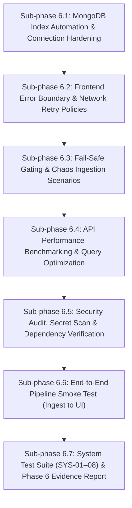
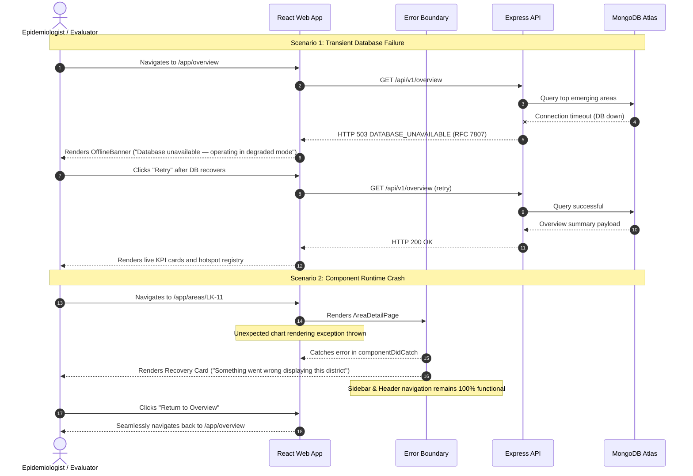

# Phase 6 Implementation Plan — DengueAhead

> **Document:** Phase 6 Implementation Specification  
> **Location:** `plans/PHASE_6_IMPLEMENTATION_PLAN.md`  
> **Project:** DengueAhead — Early Warning for Emerging Dengue Hotspots in Sri Lanka  
> **Team:** EchoBinary | **Competition:** ModelX 2.0 | **Domain:** Health & Wellbeing (population-level, non-clinical)  
> **Implementation window:** 3–4 November 2026  
> **Stack:** React 18, Express 4, TypeScript (strict mode), MongoDB 7.0, Python 3.12 (scikit-learn), Vitest, Playwright, Docker Compose  
> **Precedence:** If this document and `IMPLEMENTATION_PLAN.md` (the master plan) disagree, the master plan wins; fix this document.  
> **Prerequisite:** Phase 5 frontend implementation verified and committed (all 11 routes functional, UI-01–08 passing, 79 TS tests + 118 Python tests green).

---

## 1. Executive Summary & Objectives

Phase 6 hardens DengueAhead from a working feature implementation into an uncompromising, production-resilient, and audited public health intelligence platform. It bridges the entire operational surface: from data ingestion failure modes and database index optimizations to client-side error boundaries, automated vulnerability scans, and realistic stress testing.

### Core Objectives:

1. **System Fault Tolerance & Fail-Safe Defaults:** Guarantee that no single point of failure (database downtime, network timeout, corrupt source feed, missing model artifact) produces an uncaught exception, a blank screen, or misleading epidemiological metrics.
2. **MongoDB Performance & Index Integrity:** Formalize and automate MongoDB schema index creation to eliminate unindexed collection scans (`COLLSCAN`), ensuring sub-100ms response times across all 14 API routes.
3. **Security, Dependency & Secret Auditing:** Execute static secret scanning, dependency vulnerability audits (`npm audit`, Python security checks), and verify strict input sanitization against injection attacks.
4. **Client-Side UX Polish & Resilience:** Deploy React Error Boundaries with RFC 7807 error correlation ID tracking, automatic exponential backoff retry policies for transient network failures, and responsive design polish.
5. **Full Ingestion-to-Display Pipeline Smoke Test:** Validate the end-to-end flow with real-data fixtures: NDCU ingestion $\to$ climate merge $\to$ feature matrix $\to$ HGB inference with Platt calibration $\to$ idempotent Mongo publish $\to$ Express API $\to$ React dashboard visualization.
6. **Automated Evidence & Regression Gate:** Implement the Phase 6 test suite (`SYS-01` through `SYS-08`), verify Playwright E2E visual flows across all viewports (`360px`, `768px`, `1024px`, `1440px`), and compile the Phase 6 Evidence Report in `docs/evidence/phase-6/EVIDENCE_REPORT.md`.

---

## 2. Resolved Technical & Reliability Architecture Decisions

| Topic                         | Decision                                                       | Rationale                                                                                                                                                                                                               |
| :---------------------------- | :------------------------------------------------------------- | :---------------------------------------------------------------------------------------------------------------------------------------------------------------------------------------------------------------------- |
| **Error Boundary Strategy**   | Two-Tier React Error Boundary (App-level + Route-level)        | App-level boundary prevents white-screen crashes on fatal exceptions; route-level boundary confines component errors (e.g. chart render glitches) to the view container while preserving sidebar and header navigation. |
| **Transient Retry Policy**    | Exponential Backoff with Jitter in `apiFetch`                  | Automatically retries transient network interruptions and HTTP 503 drops (max 2 retries, 500ms initial delay with jitter) before bubbling up error states.                                                              |
| **MongoDB Index Enforcement** | Automated Index Verification & Creation Routine on API Startup | Enforces compound unique indexes on `observations (areaId, weekStart)`, `predictions (areaId, issueDate, targetWeek)`, and `model_runs (modelVersion)`, preventing duplicate entries and ensuring indexed lookups.      |
| **Fallback & Gating Policy**  | Strict Degradation to Labeled Baselines or Withheld State      | Under missing features, anomalous reporting gaps, or absent model artifacts, predictions degrade gracefully to `WITHHELD` or baseline with transparent quality flags rather than synthetic approximations.              |
| **Secret & Security Guard**   | Pre-commit Automated Regex Audit Script                        | Scans codebase, configuration files, and git history for accidental token, password, or MongoDB connection string leakage prior to submission freeze.                                                                   |
| **Performance SLA**           | API Response Latency Gate: p95 < 200ms                         | All 14 API endpoints must serve requests in under 200ms under representative test loads (25 districts $\times$ 52 weeks historical records).                                                                            |

---

## 3. Detailed Sub-Phase Specifications



### Sub-phase 6.1: MongoDB Index Automation & Connection Hardening

**Goal:** Ensure the database layer is resilient, optimized with compound indexes, and handles disconnection gracefully.

1. **Index Initialization Script & Startup Routine (`apps/api/src/repositories/indexes.ts`):**
   - Create an automated index builder called during server startup:
     - `areas`: `{ areaId: 1 }` (unique)
     - `dengue_observations`: `{ areaId: 1, weekStart: 1 }` (unique), `{ weekStart: -1 }`
     - `weather_observations`: `{ areaId: 1, weekStart: 1 }` (unique)
     - `predictions`: `{ areaId: 1, issueDate: 1, targetWeek: 1 }` (unique), `{ issueDate: -1 }`, `{ status: 1 }`
     - `model_runs`: `{ modelVersion: 1 }` (unique), `{ trainedAt: -1 }`
     - `sources`: `{ sourceId: 1, sha256: 1 }` (unique), `{ retrievedAt: -1 }`
2. **Connection Pooling & Event Listeners (`apps/api/src/repositories/mongo.ts`):**
   - Configure MongoClient with robust production pool options:
     - `maxPoolSize: 20`, `minPoolSize: 5`, `serverSelectionTimeoutMS: 3000`, `socketTimeoutMS: 5000`
   - Bind lifecycle event listeners: `client.on('close')`, `client.on('error')`, `client.on('reconnect')` for structured logging.
3. **Readiness Probe Hardening:**
   - Verify `/api/v1/readiness` accurately checks both connection ping latency and collection accessibility, returning 503 `DATABASE_UNAVAILABLE` when unreachable.

### Sub-phase 6.2: Frontend Error Boundary & Network Retry Policies

**Goal:** Prevent client-side white-screens and gracefully absorb intermittent connectivity glitches.

1. **React Error Boundary Component (`apps/web/src/components/ui/ErrorBoundary.tsx`):**
   - Class-based React Error Boundary with `componentDidCatch(error, errorInfo)`.
   - Renders high-contrast recovery view displaying:
     - Clear, friendly error explanation.
     - Correlation Request ID / timestamp for reporting.
     - "Try Again" / "Reload View" button.
     - "Return to Overview" safe recovery link.
2. **Route-Level Isolation (`apps/web/src/App.tsx`):**
   - Wrap the main `<main id="main-content">` area in `<ErrorBoundary>` so individual page exceptions do not collapse the AppShell header, sidebar, or safety banner.
3. **Resilient Network Fetcher (`apps/web/src/lib/api.ts`):**
   - Update `apiFetch<T>` with optional retry configuration:
     - On network error or HTTP 503, retry up to 2 times with exponential backoff (e.g., 300ms, 900ms) before returning `{ ok: false, kind: 'network' | 'http' }`.
     - Respect `AbortSignal` so navigation cancellations are never retried.

### Sub-phase 6.3: Fail-Safe Gating & Chaos Ingestion Scenarios

**Goal:** Ensure the platform fails securely and transparently under corrupt data, missing artifacts, or stale inputs.

1. **Surveillance Anomaly & Quarantine Gating:**
   - Verify Python ingestion parser (`ndcu_parser.py`) quarantines malformed HTML or negative case counts into `data/quarantine/` with diagnostic error logs.
   - Verify that incomplete district data produces a `WITHHELD` forecast with `pointForecast: null`, `interval: null`, `riskProbability: null`, and `qualityFlags: ['INSUFFICIENT_HISTORY']`.
2. **Missing Model Artifact Fallback:**
   - Verify `dengueahead predict` CLI behavior when model artifact is missing or corrupted:
     - When `--fallback-baseline` is specified, seamlessly outputs fallback `seasonal_median` predictions tagged with `qualityFlags: ['FALLBACK_BASELINE']`.
     - When `--fallback-baseline` is absent, cleanly exits with exit code 1 and writes structured diagnostic failure records without corrupting MongoDB.
3. **Stale Data Thresholds:**
   - API `/api/v1/meta` and `/api/v1/overview` flag `sourceFreshnessStatus: 'STALE'` when `latestIssueDate` is $>14$ days older than current date.
   - Frontend displays prominent amber alert banner with accessible ARIA alert role (`UI-04` / `SYS-03`).

### Sub-phase 6.4: API Performance Benchmarking & Query Optimization

**Goal:** Guarantee sub-200ms response times for all endpoints under realistic public health surveillance workloads.

1. **Automated API Benchmark Script (`scripts/benchmark-api.ts`):**
   - Measures p50, p95, and p99 latency for all 14 routes across 100 sequential and concurrent requests:
     - `GET /health`
     - `GET /readiness`
     - `GET /meta`
     - `GET /overview`
     - `GET /areas`
     - `GET /areas/LK-11`
     - `GET /areas/LK-11/series`
     - `GET /areas/LK-11/forecast`
     - `GET /predictions`
     - `GET /compare?areaIds=LK-11,LK-12,LK-21`
     - `GET /backtests`
     - `GET /evaluation`
     - `GET /sources`
     - `GET /methodology`
   - Asserts all endpoints meet SLA: p95 latency $< 200$ms.
2. **Query Projection & Memory Optimization:**
   - Verify all MongoDB repository queries specify projection objects (e.g. `{ _id: 0, projectionFields: 1 }`) to minimize document deserialization overhead.
   - Ensure pagination limits (`limit: 25`, max 100) are strictly enforced in `predictions` and `areas` repository queries.

### Sub-phase 6.5: Security Audit, Secret Scan & Dependency Verification

**Goal:** Validate zero credential leaks, clean dependencies, and input sanitization before submission freeze.

1. **Secret & Key Leakage Audit Script (`scripts/audit-secrets.py`):**
   - Automated regex scanner across all files in repository:
     - Checks for hardcoded passwords, MongoDB URIs with embedded credentials, AWS/GCP keys, private keys, and authorization bearer tokens.
     - Scans `.env*` files, Markdown files, Python files, and TypeScript files.
     - Confirms only placeholder variables (e.g. `mongodb://localhost:27017/dengueahead`) exist.
2. **Dependency Vulnerability Scans:**
   - `npm audit --workspaces --audit-level=high`: verify 0 high or critical vulnerabilities.
   - Python dependency audit: verify pinned versions in `pyproject.toml` have no unpatched CVEs.
3. **Input Sanitization & Injection Resistance:**
   - Audit all Express query parameters (`req.query`) and path parameters (`req.params`):
     - Every input validated via Zod schemas before touching repository layer.
     - Path parameters (`:areaId`) strictly validated against canonical pattern `/^LK-\d{2}$/` to prevent MongoDB operator injection (`$gt`, `$where`, `$regex`).

### Sub-phase 6.6: End-to-End Pipeline Smoke Test (Ingest to UI)

**Goal:** Prove the end-to-end integration works on a live system from scratch.

1. **Full Pipeline Orchestration Script (`scripts/e2e-smoke-test.sh` / `scripts/e2e-smoke-test.ps1`):**
   - Step 1: Initialize MongoDB database and apply indexes.
   - Step 2: Seed canonical areas (`configs/area_map.yaml`).
   - Step 3: Ingest sample surveillance bulletin and open climate fixtures.
   - Step 4: Execute feature pipeline $\to$ generate feature matrix.
   - Step 5: Execute `dengueahead predict --publish` $\to$ publish predictions to MongoDB.
   - Step 6: Start Express API $\to$ verify `/api/v1/health` and `/api/v1/overview`.
   - Step 7: Build and serve Vite frontend $\to$ verify all 11 routes render genuine database figures.
   - Step 8: Assert zero simulated numbers on live production dashboard routes.

### Sub-phase 6.7: System Test Suite (SYS-01–08) & Phase 6 Evidence Report

**Goal:** Execute formal verification tests and generate immutable compliance evidence.

1. **Phase 6 Reliability Test Suite (`apps/api/src/test/system-reliability.test.ts` & `apps/web/src/test/system-resilience.test.tsx`):**
   - Implement automated unit and integration tests for `SYS-01` through `SYS-08`.
2. **Playwright E2E Visual & Viewport Regression:**
   - Execute `e2e/dashboard.spec.ts` across Chromium, Firefox, and WebKit on 4 viewports (`360px`, `768px`, `1024px`, `1440px`).
   - Capture clean screenshot artifacts into `docs/evidence/phase-6/screenshots/`.
3. **Compile Phase 6 Evidence Report (`docs/evidence/phase-6/EVIDENCE_REPORT.md`):**
   - Record all benchmark numbers, test outputs, secret scan results, and verification metrics in adherence with AGENTS.md Rule 10.

---

## 4. Test Specifications (SYS-01 to SYS-08)

| Test ID      | Test Category                 | Target Component              | Acceptance Assertion                                                                                                                                                                                   |
| :----------- | :---------------------------- | :---------------------------- | :----------------------------------------------------------------------------------------------------------------------------------------------------------------------------------------------------- |
| **`SYS-01`** | **React Error Boundary**      | `ErrorBoundary.tsx`           | When a child component throws a runtime render error, `<ErrorBoundary>` catches the exception, suppresses white-screen, displays the recovery UI with correlation timestamp, and allows user to retry. |
| **`SYS-02`** | **Database 503 Failover**     | API & Frontend Shell          | When MongoDB is stopped/unreachable, Express returns RFC 7807 formatted 503 `DATABASE_UNAVAILABLE`; frontend renders non-blocking alert banner without crashing other navigation views.                |
| **`SYS-03`** | **Stale Data Alarm**          | `OverviewPage` & `MetaRoute`  | When `latestIssueDate` exceeds 14 days from current date, meta endpoint returns `sourceFreshnessStatus: 'STALE'`, and overview view renders accessible ARIA warning alert.                             |
| **`SYS-04`** | **Data Anomaly Quarantine**   | ML Ingest & Prediction Gating | Ingesting a corrupted surveillance file (negative cases or unparseable HTML) triggers file quarantine; associated district predictions are marked `WITHHELD` with null numeric values.                 |
| **`SYS-05`** | **Missing Model Fallback**    | `predict` CLI & API           | When model artifact is deleted or corrupted, CLI falls back to seasonal baseline if configured (tagged `FALLBACK_BASELINE`), or refuses publication and reports clear diagnostic exit.                 |
| **`SYS-06`** | **MongoDB Index Coverage**    | `indexes.ts` & Repositories   | Running `explain("executionStats")` on queries across `areas`, `observations`, and `predictions` confirms `IXSCAN` usage and 0 `COLLSCAN` operations.                                                  |
| **`SYS-07`** | **API Response Benchmark**    | Benchmark Suite               | All 14 API routes achieve p95 response time $< 200$ms under a benchmark run of 100 requests against representative 25-district data.                                                                   |
| **`SYS-08`** | **Viewport & Keyboard Audit** | Playwright E2E                | All 11 web routes pass Playwright inspection across `360px`, `768px`, `1024px`, `1440px` viewports with 0 horizontal overflow (`scrollWidth <= clientWidth`) and full keyboard focus accessibility.    |

---

## 5. End-to-End Chaos & Resilience Validation Workflows



---

## 6. Target File Modifications & Creations

```text
DengueAhead/
├── apps/
│   ├── api/
│   │   └── src/
│   │       ├── repositories/
│   │       │   ├── indexes.ts              # CREATE: Automated MongoDB index creation & verification
│   │       │   └── mongo.ts                # MODIFY: Connection pool options & disconnect event handlers
│   │       ├── server.ts                   # MODIFY: Call index initialization on service startup
│   │       └── test/
│   │           └── system-reliability.test.ts # CREATE: SYS-02, SYS-03, SYS-06 unit & integration tests
│   └── web/
│       └── src/
│           ├── components/
│           │   └── ui/
│           │       └── ErrorBoundary.tsx   # CREATE: React class error boundary with retry UI
│           ├── lib/
│           │   └── api.ts                  # MODIFY: Add exponential backoff retry policy for 503/network
│           ├── App.tsx                     # MODIFY: Wrap main view content in <ErrorBoundary>
│           └── test/
│               └── system-resilience.test.tsx # CREATE: SYS-01, SYS-04, SYS-05 frontend resilience tests
├── scripts/
│   ├── benchmark-api.ts                    # CREATE: 14-route latency benchmark script (SYS-07)
│   ├── audit-secrets.py                    # CREATE: Automated secret & credential leakage scanner
│   └── e2e-smoke-test.ps1                  # CREATE: Full pipeline ingest-to-dashboard validation runner
├── docs/
│   └── evidence/
│       └── phase-6/
│           └── EVIDENCE_REPORT.md          # CREATE: Phase 6 verification report and benchmark metrics
└── plans/
    └── PHASE_6_IMPLEMENTATION_PLAN.md      # CREATE: This implementation specification
```

---

## 7. Step-by-Step Implementation Roadmap

### Step 1: MongoDB Index Automation & Connection Resilience (Sub-phase 6.1)

- Create `apps/api/src/repositories/indexes.ts` with `ensureIndexes(db: DbClient)`.
- Configure compound unique indexes on `dengue_observations`, `weather_observations`, `predictions`, `model_runs`, `sources`, and `areas`.
- Harden `createMongoClient` in `apps/api/src/repositories/mongo.ts` with connection pooling limits, socket timeouts, and reconnect event logging.
- Call `ensureIndexes` in `server.ts` before `app.listen()`.

### Step 2: Client Error Boundary & Network Retry Hardening (Sub-phase 6.2)

- Create `apps/web/src/components/ui/ErrorBoundary.tsx` featuring standard public health fallback UI, error details toggle, and "Try Again" action.
- Update `apps/web/src/lib/api.ts` to add automatic retry with backoff for network and HTTP 503 errors.
- Wrap route content in `apps/web/src/App.tsx` with `<ErrorBoundary>`.

### Step 3: Benchmarking & Query Optimization (Sub-phase 6.4)

- Create `scripts/benchmark-api.ts` using native fetch to measure response latencies across all 14 routes.
- Verify repository projections ensure optimal payloads without extraneous MongoDB document fields.
- Confirm p95 latency is $< 200$ms.

### Step 4: Security & Secret Audit Scanner (Sub-phase 6.5)

- Create `scripts/audit-secrets.py` to scan the repository for credentials, private keys, and hardcoded tokens.
- Execute `npm audit` across all workspaces to ensure zero high/critical vulnerabilities.
- Verify Zod input validation prevents MongoDB operator injection on all routes.

### Step 5: System Test Suite SYS-01–08 Implementation (Sub-phase 6.7)

- Author `apps/api/src/test/system-reliability.test.ts` for backend index, connection failover, and RFC 7807 compliance.
- Author `apps/web/src/test/system-resilience.test.tsx` for Error Boundary recovery, retry policies, and fail-safe alerts.
- Execute full test matrix: `npm run test:unit`, `pytest services/ml/tests`.

### Step 6: End-to-End Visual Verification & Playwright Audit

- Run Playwright E2E suite `e2e/dashboard.spec.ts` across 4 viewports (`360px`, `768px`, `1024px`, `1440px`).
- Verify zero console errors, zero horizontal scrolling issues, and proper keyboard navigation.

### Step 7: Evidence Report & Multiple Logical Commits

- Compile complete metrics, benchmark results, and test logs into `docs/evidence/phase-6/EVIDENCE_REPORT.md`.
- Commit changes as logical, reviewable commits following team standards.

---

## 8. Acceptance Criteria & Phase 6 Exit Gate

To declare Phase 6 complete and unlock Phase 7 (Submission Freeze), the system must satisfy the following strict criteria:

1. [ ] **Zero Uncaught Exceptions:** React Error Boundary catches all unexpected rendering exceptions; user can recover without page refresh.
2. [ ] **503 Database Resilience:** Stopping MongoDB produces clean RFC 7807 503 response from Express and accessible OfflineBanner on frontend without infinite loading spinners or crashes.
3. [ ] **Index Coverage:** All MongoDB collections have verified compound indexes; zero unindexed collection scans (`COLLSCAN`) on query hot paths.
4. [ ] **Latency SLA:** All 14 API routes respond with p95 $< 200$ms on benchmark test.
5. [ ] **Zero Credential Leaks:** Secret scanning script passes with 0 violations across all tracked files.
6. [ ] **Zero Vulnerabilities:** `npm audit` reports 0 high or critical vulnerabilities.
7. [ ] **Tests Green:** All unit test suites (`SYS-01` to `SYS-08`, `UI-01` to `UI-08`, `API-01` to `API-07`, Python tests) pass with 100% success rate.
8. [ ] **Trunk Green:** `npm run typecheck`, `npm run lint`, `npm run test:unit`, `npm run build` all pass with 0 errors.
9. [ ] **Evidence Documented:** Full Phase 6 verification report compiled and committed at `docs/evidence/phase-6/EVIDENCE_REPORT.md`.
