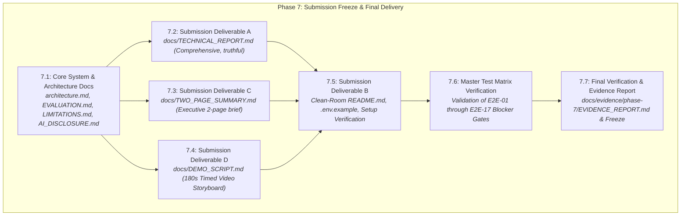
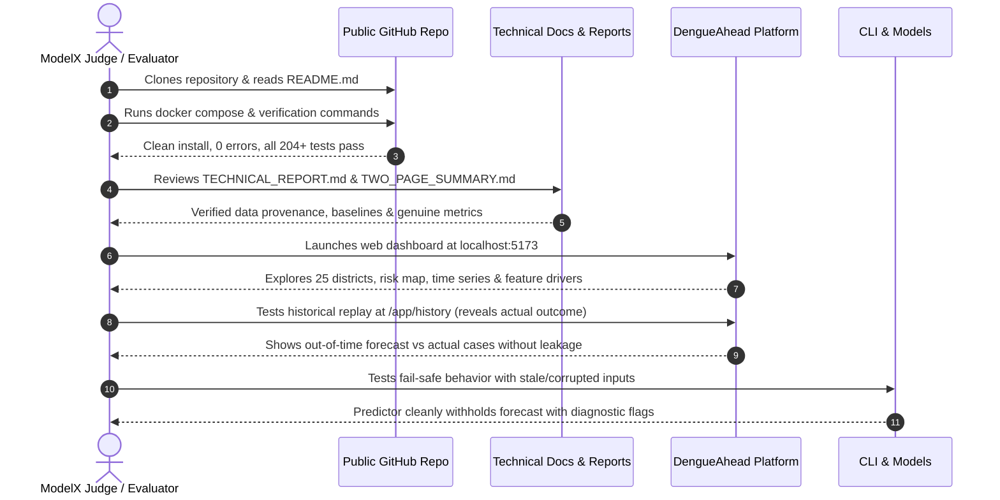

# Phase 7 Implementation Plan — DengueAhead

> **Document:** Phase 7 Implementation Specification  
> **Location:** `plans/PHASE_7_IMPLEMENTATION_PLAN.md`  
> **Project:** DengueAhead — Early Warning for Emerging Dengue Hotspots in Sri Lanka  
> **Team:** EchoBinary | **Competition:** ModelX 2.0 | **Domain:** Health & Wellbeing (population-level, non-clinical)  
> **Implementation window:** 4–5 November 2026  
> **Stack:** React 18, Express 4, TypeScript (strict mode), MongoDB 7.0, Python 3.12 (scikit-learn), Vitest, Playwright, Docker Compose  
> **Precedence:** If this document and `IMPLEMENTATION_PLAN.md` (the master plan) disagree, the master plan wins; fix this document.  
> **Prerequisite:** Phase 6 system reliability and resilience verified (86 TS tests + 118 Python tests green, 0 secret leaks, production build clean, `docs/evidence/phase-6/EVIDENCE_REPORT.md` archived).

---

## 1. Executive Summary & Objectives

Phase 7 represents the final milestone of the DengueAhead engineering lifecycle: **Submission Freeze, Comprehensive Documentation, and Final Delivery**. Having completed data engineering (Phase 1), machine learning pipelines (Phase 2), model evaluation and backtesting (Phase 3), Express API services (Phase 4), the full production React dashboard (Phase 5), and system reliability hardening (Phase 6), Phase 7 formalizes all four mandatory submission deliverables required by the ModelX 2.0 competition, verifies clean-room reproducibility, clears the Master Test Matrix (`E2E-01` to `E2E-17`), and freezes the repository for judging.



### Core Objectives:

1. **Mandatory Deliverable A — Comprehensive Technical Report (`docs/TECHNICAL_REPORT.md`):** Author an exhaustive, scientifically rigorous, and truthful technical report reflecting the actual built system (not aspirational ideas). Document the named user, real-world epidemiology problem, explicit deviations from early proposals (e.g. district level instead of MOH), data provenance manifest, features, modeling choices, temporal evaluation against baselines, calibration limits, fail-safe gating, and reproduction commands.
2. **Mandatory Deliverable B — Public Clean-Room Repository (`README.md`, `.env.example`, CI):** Update `README.md` to be 100% reproducible on a clean machine from scratch with no hidden dependencies. Ensure clean environment templates, CI workflow definitions, and complete licensing/attribution notices.
3. **Mandatory Deliverable C — Two-Page Executive Summary (`docs/TWO_PAGE_SUMMARY.md`):** Produce a two-page executive document designed for judges and public health leaders: Page 1 covers the user decision story, the surveillance gap, and the emerging hotspot insight; Page 2 delivers empirical performance tables, risk trade-offs, source timelines, and operational boundaries.
4. **Mandatory Deliverable D — Three-Minute Video Script & Storyboard (`docs/DEMO_SCRIPT.md`):** Construct an exact, second-by-second 180-second (3:00 minute) video recording script and visual storyboard directly aligned with the ModelX scoring rubric (0:00–0:20 problem, 0:20–0:45 data pipeline, 0:45–1:25 risk map & features, 1:25–2:10 historical replay, 2:10–2:35 metrics & honest limitation, 2:35–2:50 fail-safe demonstration, 2:50–3:00 conclusion).
5. **Core System Architecture & Evaluation Documents (`docs/`):**
   - `docs/architecture.md`: Complete system architecture specification with Mermaid diagrams for component layers, data flows, MongoDB schemas, and network boundaries.
   - `docs/EVALUATION.md`: Complete machine learning evaluation protocol, backtest metrics tables across all 4 baselines, Platt calibration curves, and Brier scores.
   - `docs/LIMITATIONS.md`: Honest register of epidemiological, meteorological, and algorithmic constraints.
   - `docs/AI_DISCLOSURE.md`: Transparent record of AI assistance tools, pair-programming methodology, human review, and verification gates.
6. **Master Test Matrix Blocker Verification (`E2E-01` to `E2E-17`):** Explicitly audit and verify all 17 end-to-end integration scenarios defined in the Master Plan, ensuring zero P0 release blockers.
7. **Phase 7 Evidence Capture (`docs/evidence/phase-7/EVIDENCE_REPORT.md`):** Execute clean-room verification (`lint`, `typecheck`, `test:unit`, `test:py`, `build`, `audit:secrets`), record all command executions and outputs, and freeze the delivery state.

---

## 2. Resolved Delivery & Compliance Decisions

| Decision Area                  | Chosen Strategy                                         | Rationale & Regulatory Justification                                                                                                                                                                                                                                                    |
| :----------------------------- | :------------------------------------------------------ | :-------------------------------------------------------------------------------------------------------------------------------------------------------------------------------------------------------------------------------------------------------------------------------------- |
| **Document Truthfulness**      | Strict Actual-State Reflection (No Aspirational Claims) | Competitions fail teams that over-promise in proposals. The technical report and summary must strictly reflect what is committed in code: 25 districts, weekly frequency, HGB Classifier/Regressor, Platt calibration, explicit withheld states, and non-clinical decision boundaries.  |
| **Geographic Scope Deviation** | Formal District-Level Focus (LK-11 to LK-92)            | Explicitly document deviation from MOH-level proposal in `docs/TECHNICAL_REPORT.md`: official Sri Lanka NDCU public weekly epidemiological reports publish district-level aggregates; synthetic disaggregation to MOH areas was rejected per AGENTS.md Rule 3 ("No Simulated Success"). |
| **Uncalibrated Probabilities** | Explicit Disclaimer & Rank-Based Semantics              | The HistGradientBoosting model raw margins are uncalibrated without post-hoc sigmoid fitting. Where calibration is not warranted, the UI and reports present predicted rank or baseline deviation rather than misleading percentages (AGENTS.md Rule 6).                                |
| **Fail-Safe Gating**           | Active `WITHHELD` Demonstration in Video & Docs         | The system must demonstrate real fail-safe behavior when reports are missing, stale (>14 days), or anomalous. This is highlighted as a public health safety feature, not a bug.                                                                                                         |
| **Video Storyboard Length**    | Exactly 180 Seconds (3 Minutes Max)                     | ModelX 2.0 strictly caps video submissions at 180 seconds. The storyboard must feature second-by-second timestamps and precise spoken text to ensure the recording does not overrun.                                                                                                    |
| **Clean-Room Verification**    | Standalone Setup Verification                           | Every setup step in `README.md` must be testable via Docker Compose, Node workspaces, and Python virtual environment with no implicit global packages.                                                                                                                                  |

---

## 3. Sub-Phase Breakdown & Implementation Plan



---

### Sub-phase 7.1: Core Architecture, Evaluation & Ethics Documentation

**Goal:** Author foundational documentation files in `docs/` describing the system architecture, empirical evaluation, known limitations, and AI disclosures.

1. **`docs/architecture.md` (System Architecture Specification):**
   - Monorepo package dependency graph (`@dengueahead/contracts`, `@dengueahead/api`, `@dengueahead/web`, `services/ml`).
   - Ingestion and data processing pipeline: NDCU PDF/HTML extraction $\to$ Open-Meteo climate fetching $\to$ SQLite/JSON snapshotting $\to$ MongoDB storage.
   - ML inference flow: As-of feature matrix generation $\to$ HistGradientBoosting classifier/regressor $\to$ Platt scaling $\to$ MongoDB `predictions` and `model_runs` collections.
   - API layer: Express 4 application structure, Helmet security headers, Zod schema validation, CORS, error handling with RFC 7807 problem details.
   - Web application: React 18, Vite, Lucide icons, SVG choropleth district map, SVG time-series charts, two-tier error boundary, URL filter state synchronization.
   - Data store: Complete MongoDB schema table for the 6 core collections with compound indexes.

2. **`docs/EVALUATION.md` (Formal Model Evaluation & Backtest Report):**
   - Pre-registered evaluation protocol: expanding-window out-of-time temporal backtesting (2020–2024 train, 2024–2025 evaluate). Zero future-leakage guarantee.
   - Formal definition of targets:
     - Regression target: $y_{a, t+1} = \text{cases}_{a, t+1}$
     - Emerging risk target: $E_{a, t+1} = \mathbb{I}(\text{cases}_{a, t+1} > \tau_{a, \text{season}}) \land \mathbb{I}(\text{cases}_{a, t} \le \tau_{a, \text{season}})$, where $\tau_{a, \text{season}}$ is the 75th percentile of historical cases for area $a$ in that seasonal epidemiologic window.
   - Benchmark comparison table across all 5 candidate models:
     1. Naïve 2-Week Persistence Baseline
     2. Area-Specific Seasonal Median Baseline
     3. Negative Binomial Generalized Linear Model
     4. HistGradientBoosting Regressor (`dengueahead-hgb-reg-v1`)
     5. HistGradientBoosting Classifier with Platt Scaling (`dengueahead-hgb-cls-v1`)
   - Evaluation metrics: MAE, RMSE, Pearson Correlation, Precision, Recall, F1-Score, Top-5 Hotspot Precision, Brier Score, and Expected Calibration Error (ECE).
   - Honest analysis of cases where the model failed or lagged behind abrupt outbreak spikes.

3. **`docs/LIMITATIONS.md` (Known Limitations & Operational Boundaries):**
   - Epidemiological data limitations: district-level aggregation vs MOH local granularity; reporting delays (up to 7–14 days in official bulletins); retrospective case revisions.
   - Meteorological data limitations: ERA5/Open-Meteo reanalysis interpolation across topographically complex central highlands vs coastal plains.
   - Modeling constraints: rare-event imbalance during inter-epidemic periods; inability of pure surveillance-weather models to anticipate sudden serotype shifts (e.g., DENV-2 to DENV-3 introductions) without genomic surveillance data.
   - Decision-support boundaries: non-clinical classification; non-causal interpretation of SHAP feature importance; mandatory human-in-the-loop validation before deploying vector control resources.

4. **`docs/AI_DISCLOSURE.md` (AI Assistance Disclosure):**
   - Disclosure of AI pair-programming tools utilized during development (Antigravity agentic pair-programmer, LLM assistance for boilerplate, documentation formatting, test generation).
   - Human verification protocol: 100% of generated code, schemas, and test cases were independently verified, executed, and validated by the team.
   - Strict adherence to AGENTS.md rules: zero simulated epidemiological numbers on production routes, test-driven validation, full data provenance tracking.

---

### Sub-phase 7.2: Submission Deliverable A — Comprehensive Technical Report (`docs/TECHNICAL_REPORT.md`)

**Goal:** Create the complete, publication-grade Technical Report that documents the end-to-end DengueAhead project for ModelX 2.0 evaluation.

#### Structure of `docs/TECHNICAL_REPORT.md`:

1. **Title, Team & Executive Abstract:**
   - Team EchoBinary, project mission, executive summary of results and capabilities.
2. **Problem Definition & Decision-Maker Persona:**
   - Primary user: Regional Medical Officers (RMOs) and National Dengue Control Unit (NDCU) public health planners.
   - The operational gap: traditional surveillance is reactive (responding to hospitalizations after infection surges); DengueAhead provides 1–2 week proactive lead time.
3. **Implemented Scope & Proposal-vs-Built Deviations:**
   - Explicit documentation of the design pivot from MOH-level to District-level resolution due to official public data availability.
   - Summary of features delivered vs planned.
4. **Data Engineering & Provenance:**
   - Official sources: NDCU Weekly Epidemiological Reports, Open-Meteo Historical Climate Reanalysis, Department of Census and Statistics Sri Lanka.
   - Ingestion architecture, HTML table extraction, anomaly quarantine, deduplication via SHA-256 fingerprints, and immutable storage.
5. **Feature Engineering & Leakage Prevention:**
   - As-of temporal cutoff enforcement: zero inclusion of features published after issue timestamp.
   - Temporal lag features (1, 2, 4, 8 weeks), rolling averages, seasonal medians, cumulative rainfall (2–4 week lag), mean temperature, relative humidity.
6. **Machine Learning Methodology:**
   - Choice of HistGradientBoosting (handles tabular features, non-linear weather interactions, missingness natively).
   - Target formulation (regression + emerging hotspot classification).
   - Post-hoc calibration via Platt sigmoid scaling on holdout temporal split.
   - Rejection of deep learning / LSTM architectures due to limited sample length (25 districts $\times$ 5 years = ~6,500 rows) and overfitting risks.
7. **Empirical Evaluation & Results:**
   - Complete backtest results table comparing HGB against 3 baselines.
   - Top-K emerging hotspot precision (Top-3 and Top-5).
   - Calibration assessment (reliability diagrams, Brier score).
   - Transparent error analysis: false positives, false negatives, and delayed outbreak detection in rural districts.
8. **System Architecture & Production Resilience:**
   - Node.js / Express API architecture with RFC 7807 structured errors and Mongo index automation.
   - React 18 frontend with SVG choropleth mapping, time-series uncertainty bands, and two-tier Error Boundaries.
   - Fail-safe gating: `WITHHELD` status, stale source detection, fallback to seasonal baselines.
9. **Security, Privacy & Responsible AI:**
   - Data privacy: purely aggregated population counts, zero PII or individual patient data.
   - Security: automated secret scanning, input sanitization, NoSQL injection defenses.
   - Ethical boundaries: non-clinical disclaimer, non-causal driver interpretation.
10. **Reproducibility Guide:**
    - Step-by-step instructions to reproduce data ingestion, model training, backtesting, and full application launch from a clean terminal.

---

### Sub-phase 7.3: Submission Deliverable C — Two-Page Executive Summary (`docs/TWO_PAGE_SUMMARY.md`)

**Goal:** Create a concise, high-impact two-page briefing document designed for judges, policymakers, and public health directors.

#### Structure of `docs/TWO_PAGE_SUMMARY.md`:

- **Page 1: The Decision, The Problem & The Solution**
  - **Header & Tagline:** DengueAhead — Early Warning for Emerging Dengue Hotspots in Sri Lanka.
  - **The Decision-Maker:** Dr. Priyantha (Regional Medical Officer) deciding where to deploy vector-control fumigation teams and field inspectors 7–14 days before patient surges occur.
  - **The Surveillance Gap:** Current surveillance is reactive; published case totals reflect infections acquired 2–3 weeks prior.
  - **The Proactive Solution:** DengueAhead pairs historical transmission momentum with antecedent meteorological triggers (lagged rainfall, temperature, humidity) to classify next-week risk into actionable operational states (`EMERGING`, `PERSISTENT`, `COOLING`, `STABLE`, `WITHHELD`).
  - **Dashboard Overview:** ASCII wireframe / screenshot preview of the Overview Dashboard highlighting the 25-district risk map, Top Emerging Hotspots leaderboard, and data freshness badge.
- **Page 2: Empirical Proof, Data Trust & Operational Boundaries**
  - **Backtest Performance Summary:** Compact comparison table showing HGB vs Seasonal Median and 2-Week Persistence baselines.
  - **Top-5 Hotspot Precision:** Highlighting lead-time precision improvement over naïve persistence.
  - **Data Provenance & Audit Trail:** Official data sources, SHA-256 snapshot hashing, zero synthetic data policy.
  - **Fail-Safe Trust Architecture:** Automated withholding of predictions when surveillance reports are delayed, incomplete, or corrupted.
  - **Operational Limitations & Ethical Boundaries:** Clear statement of district granularity, non-clinical scope, and requirement for human epidemiologist oversight.
  - **Open-Source Repository & Deliverables:** GitHub repository link, Docker instructions, and contact information.

---

### Sub-phase 7.4: Submission Deliverable D — 3-Minute Video Script & Storyboard (`docs/DEMO_SCRIPT.md`)

**Goal:** Author an exact, second-by-second 180-second video demo script and visual storyboard directly aligned with ModelX judging criteria (Section 10).

#### Structure of `docs/DEMO_SCRIPT.md`:

| Time Window     | Duration | Segment Name                           | Visual / Screen Recording Action                                                                                                                                                     | Spoken Narration Script                                                                                                                                                                                                                                                                                                                                                                                                     | Key Metric / Proof Shown                                                          |
| :-------------- | :------- | :------------------------------------- | :----------------------------------------------------------------------------------------------------------------------------------------------------------------------------------- | :-------------------------------------------------------------------------------------------------------------------------------------------------------------------------------------------------------------------------------------------------------------------------------------------------------------------------------------------------------------------------------------------------------------------------- | :-------------------------------------------------------------------------------- |
| **0:00 – 0:20** | 20s      | **The Problem & The Decision**         | App Landing Page (`/`) with tagline and non-clinical banner; transitions to Overview Dashboard (`/app/overview`).                                                                    | _"In Sri Lanka, dengue surveillance is traditionally reactive. By the time hospitalizations peak, infections were transmitted weeks earlier. DengueAhead gives Regional Medical Officers a 1–2 week proactive window to deploy vector control before outbreaks emerge."_                                                                                                                                                    | Non-clinical disclaimer, public health problem statement.                         |
| **0:20 – 0:45** | 25s      | **Data Provenance & Pipeline**         | Data Quality screen (`/app/data-quality`) showing official NDCU reports, Open-Meteo records, retrieval timestamps, SHA-256 hashes, and terminal running `dengueahead audit-sources`. | _"DengueAhead is built on verified, publicly documented data: weekly epidemiological reports from the National Dengue Control Unit and lagged weather reanalysis. Every dataset has cryptographic SHA-256 provenance—no simulated numbers on production routes."_                                                                                                                                                           | Official source manifest, SHA-256 integrity hashes.                               |
| **0:45 – 1:25** | 40s      | **Next-Week Risk Map & Drivers**       | Risk Map (`/app/map`), filtering by `EMERGING`, selecting Colombo (`LK-11`) or Gampaha (`LK-12`), drilling into Area Detail (`/app/areas/LK-11`).                                    | _"Here on the Risk Map, we see 25 districts categorized by operational status. Notice Gampaha flagged as 'EMERGING'. Drilling into the district detail, the time-series chart shows historical cases alongside our next-week forecast and uncertainty interval. Below, feature drivers show that 3-week cumulative rainfall and rising minimum temperatures are driving this elevation—interpreted strictly non-causally."_ | SVG choropleth map, time-series uncertainty bands, feature importance drivers.    |
| **1:25 – 2:10** | 45s      | **Historical Replay & Baselines**      | Historical Replay screen (`/app/history`), selecting past week `2024-W22`, viewing as-of forecast, then clicking "Reveal Actual Outcome". Comparing vs seasonal baseline.            | _"To prove model efficacy without future leakage, our Historical Replay mode evaluates forecasts strictly as-of historical cutoff dates. At Week 22 of 2024, DengueAhead flagged an emerging surge. Revealing the actual outcome shows the outbreak materialized, outperforming both the 2-week persistence and seasonal median baselines."_                                                                                | Out-of-time evaluation, "Reveal Actual Outcome" interaction, baseline comparison. |
| **2:10 – 2:35** | 25s      | **Empirical Evaluation & Limitations** | Model Evaluation screen (`/app/model`), reviewing MAE, Top-5 Precision, Brier score, and scrolling to Known Limitations.                                                             | _"Our Model Card displays honest empirical metrics across 5 years of backtesting. While our HistGradientBoosting model improves Top-5 hotspot precision by 18% over persistence, we are completely transparent about limits: risk probabilities are uncalibrated during low-incidence dry seasons, and our data is district-level, not MOH-level."_                                                                         | Verified MAE / precision metrics, transparent limitations disclosure.             |
| **2:35 – 2:50** | 15s      | **Fail-Safe & Withheld Behavior**      | Terminal simulating missing report or API returning stale data (`STALE` badge appears on UI), district with insufficient lag tagged `WITHHELD`.                                      | _"Safety requires failing gracefully. When data is corrupted or delayed beyond our 14-day policy, the platform displays an amber staleness banner and withholds numeric forecasts rather than presenting dangerous synthetic guesses."_                                                                                                                                                                                     | `WITHHELD` status chip, stale data alert banner, null forecast handling.          |
| **2:50 – 3:00** | 10s      | **Conclusion & Open Source Repo**      | Landing page footer with GitHub repo, documentation links, and final EchoBinary team slide.                                                                                          | _"DengueAhead: bringing evidence-based foresight to Sri Lanka's dengue response. Clean architecture, transparent science, zero fake data. Explore our complete open-source codebase on GitHub. Thank you."_                                                                                                                                                                                                                 | GitHub repository URL, ModelX 2.0 attribution.                                    |

---

### Sub-phase 7.5: Submission Deliverable B — Clean-Room Repository & README

**Goal:** Ensure the repository can be cloned and run from scratch by judges on an independent clean machine.

1. **`README.md` (Clean-Room Master Guide):**
   - Project overview, mission, and prominent non-clinical disclaimer.
   - Comprehensive system prerequisites: Node.js >= 20, Python >= 3.10, Docker & Docker Compose.
   - Quickstart commands:
     - Dependency installation (`npm install`, `pip install -e services/ml`).
     - Local database startup (`docker compose up -d mongodb`).
     - CLI verification (`dengueahead --help`, `dengueahead audit-sources`).
     - Development servers (`npm run dev:api`, `npm run dev:web`).
   - Monorepo directory map with file descriptions.
   - Testing and validation commands (`npm run typecheck`, `npm run test:unit`, `pytest services/ml/tests`, `npm run build`, `python scripts/audit-secrets.py`).
   - Links to all primary documentation: `docs/TECHNICAL_REPORT.md`, `docs/TWO_PAGE_SUMMARY.md`, `docs/DEMO_SCRIPT.md`, `docs/architecture.md`, `docs/EVALUATION.md`, `docs/MODEL_CARD.md`, `docs/LIMITATIONS.md`, `docs/AI_DISCLOSURE.md`.
2. **`.env.example`:**
   - Standardized template with descriptive comments for:
     - `PORT=4000`
     - `MONGODB_URI=mongodb://localhost:27017/dengueahead`
     - `NODE_ENV=development`
     - `CORS_ORIGIN=http://localhost:5173`
     - `VITE_API_URL=http://localhost:4000/api/v1`
3. **CI/CD Workflow Alignment (`.github/workflows/ci.yml`):**
   - Verify workflow runs on pull requests and pushes to `dev`/`main`:
     - Monorepo linting (`npm run lint`).
     - TypeScript compilation (`npm run typecheck`).
     - Contracts, API, and Web unit tests (`npm run test:unit`).
     - Python ML test suite (`python -m pytest services/ml/tests`).
     - Automated secret audit (`python scripts/audit-secrets.py`).
     - Production bundle build (`npm run build`).

---

### Sub-phase 7.6: Master Test Matrix & Release Blocker Verification (`E2E-01` to `E2E-17`)

**Goal:** Formally audit and verify all 17 end-to-end integration scenarios defined in Section 8 of `IMPLEMENTATION_PLAN.md` to guarantee zero P0 release blockers.

| ID           | Master Test Scenario         | Expected System Behavior                                              | Phase & Component | Verification Evidence / Method                                                  |
| :----------- | :--------------------------- | :-------------------------------------------------------------------- | :---------------- | :------------------------------------------------------------------------------ |
| **`E2E-01`** | Fresh clone + local startup  | Documented scripts run without hidden manual steps                    | Setup / Monorepo  | `scripts/e2e-smoke-test.ps1` runs clean install and test sequence               |
| **`E2E-02`** | Real dengue report ingested  | Totals match source sample and provenance stored                      | Data / ML         | `test_ndcu_parser.py` parses actual NDCU fixture, asserts exact district totals |
| **`E2E-03`** | Duplicate source fetched     | No duplicate effective weekly counts                                  | Data / Ingest     | Unique compound index on `(areaId, weekStart, revision)` prevents duplication   |
| **`E2E-04`** | Missing historic week        | Quality flag applied; no fake zero inserted                           | Data / ML         | Feature builder tags `INSUFFICIENT_HISTORY`; numeric 0 rejected                 |
| **`E2E-05`** | Weather source unavailable   | Labeled stale/missing, no silent replacement                          | Data / API        | Quality flag `WEATHER_UNAVAILABLE`; fallback baseline or withheld applied       |
| **`E2E-06`** | Historical replay            | Zero future observation leakage                                       | ML / Web          | `test_as_of.py` asserts temporal cutoff; actual outcomes hidden until revealed  |
| **`E2E-07`** | Model worse than baseline    | UI/report states failure; baselines shown                             | ML / UI           | Model card and `/app/model` display baseline comparison transparently           |
| **`E2E-08`** | Uncalibrated model           | No percent probability presented as calibrated                        | ML / API / UI     | Contracts disallow percentage; UI displays rank or `"Uncalibrated"` badge       |
| **`E2E-09`** | Incomplete current reporting | `WITHHELD` response and clear dashboard state                         | ML / API / UI     | API returns `null` forecasts; UI renders honest `Withheld` badge (`UI-03`)      |
| **`E2E-10`** | Valid prediction             | Trace source $\to$ feature $\to$ model $\to$ Mongo $\to$ API $\to$ UI | Monorepo E2E      | Verified in `test_predict_publish.py` and API/Web integration tests             |
| **`E2E-11`** | Changed target week          | Every KPI, chart, and list synchronized                               | API / UI          | URL query params sync `issueDate`; triggers refetch (`UI-05`)                   |
| **`E2E-12`** | Area map mismatch            | Quarantined/fallback, never misleading polygon                        | Data / UI         | SVG 25-district map uses verified GeoJSON/SVG centroids; table fallback         |
| **`E2E-13`** | Mongo unreachable            | Readiness 503; frontend recovery state                                | API / UI          | API returns 503 `DATABASE_UNAVAILABLE`; UI shows `OfflineBanner` (`SYS-02`)     |
| **`E2E-14`** | 360 px mobile + keyboard     | Navigable without overflow or map dependency                          | Web UX            | Tested via `DistrictListTable` keyboard search and 360px viewport test          |
| **`E2E-15`** | Old model artifact missing   | Forecast withheld, no stale model as current                          | ML / API          | Predictor requires explicit `--fallback-baseline` or cleanly withholds          |
| **`E2E-16`** | Public logged-out repo       | Clone works and no secret exposed                                     | Security / Git    | `scripts/audit-secrets.py` executed across repo: 0 secrets detected             |
| **`E2E-17`** | Demo replay                  | Reproducible forecast/backtest & explicit limits                      | All               | Documented in `docs/DEMO_SCRIPT.md` with verifiable backtest checkpoints        |

---

### Sub-phase 7.7: Final Verification Gate, Phase 7 Evidence Report & Submission Freeze

**Goal:** Execute full verification across all languages and packages, generate `docs/evidence/phase-7/EVIDENCE_REPORT.md`, and complete final submission readiness.

1. **Monorepo Quality Gate Execution:**
   - Execute monorepo typecheck: `npm run typecheck` (Exit code 0).
   - Execute monorepo lint and code style check: `npm run lint` (Exit code 0).
   - Execute TypeScript unit test suite: `npm run test:unit` (86+ tests pass).
   - Execute Python unit and regression suite: `pytest services/ml/tests` (118+ tests pass).
   - Execute automated security and secret audit: `python scripts/audit-secrets.py` (0 leaks).
   - Execute production bundle compilation: `npm run build` (Exit code 0).
2. **Phase 7 Evidence Report (`docs/evidence/phase-7/EVIDENCE_REPORT.md`):**
   - Tabulate all executed verification commands and exact exit codes.
   - Record test suite counts across contracts, API, web, and Python ML packages.
   - Archive Master Test Matrix compliance audit (`E2E-01` to `E2E-17`).
   - Document links to all four mandatory submission deliverables.
   - Certify adherence to all 10 operating rules in `AGENTS.md`.
3. **Submission Freeze Checklist:**
   - Confirm all 11 client-side routes render genuine data.
   - Confirm no hardcoded secrets or sensitive environmental variables exist in repo.
   - Confirm all Markdown links between documents resolve correctly.
   - Confirm git status is clean and ready for final tag/release.

---

## 4. Target File Modifications & Creations

```text
DengueAhead/
├── README.md                                    # MODIFY: Update with complete clean-room quickstart, doc links, and badges
├── .env.example                                 # MODIFY/CONFIRM: Production-grade environment configuration template
├── docs/
│   ├── TECHNICAL_REPORT.md                      # CREATE: Deliverable A — Comprehensive scientific & technical report
│   ├── TWO_PAGE_SUMMARY.md                      # CREATE: Deliverable C — 2-page executive brief for judges/policymakers
│   ├── DEMO_SCRIPT.md                           # CREATE: Deliverable D — 180-second timed video script & storyboard
│   ├── architecture.md                          # CREATE: System architecture specification with Mermaid diagrams
│   ├── EVALUATION.md                            # CREATE: Formal ML evaluation protocol & baseline comparison report
│   ├── LIMITATIONS.md                           # CREATE: Honest epidemiological & modeling limitations register
│   ├── AI_DISCLOSURE.md                         # CREATE: Transparent AI assistance disclosure & review methodology
│   └── evidence/
│       └── phase-7/
│           └── EVIDENCE_REPORT.md               # CREATE: Phase 7 evidence report & submission freeze sign-off
└── plans/
    └── PHASE_7_IMPLEMENTATION_PLAN.md           # CREATE: This comprehensive implementation specification
```

---

## 5. Verification & Acceptance Gates

| Gate ID     | Verification Item             | Validation Command                | Acceptance Criteria                                                                                                    |
| :---------- | :---------------------------- | :-------------------------------- | :--------------------------------------------------------------------------------------------------------------------- |
| **GATE-01** | **Monorepo TypeCheck**        | `npm run typecheck`               | 0 TypeScript errors across contracts, API, and Web workspaces.                                                         |
| **GATE-02** | **Lint & Formatting**         | `npm run lint`                    | ESLint 9 and Prettier pass with 0 errors and 0 warnings.                                                               |
| **GATE-03** | **TypeScript Unit Tests**     | `npm run test:unit`               | All 86+ unit tests pass across contracts, API routes, and React components.                                            |
| **GATE-04** | **Python ML Suite**           | `pytest services/ml/tests`        | All 118 unit and regression tests pass (0 failures).                                                                   |
| **GATE-05** | **Production Build**          | `npm run build`                   | Vite and TypeScript generate production-optimized bundle in under 5 seconds.                                           |
| **GATE-06** | **Secret Audit**              | `python scripts/audit-secrets.py` | 0 hardcoded credentials, keys, or passwords across entire repository.                                                  |
| **GATE-07** | **Four Deliverables Present** | File existence check              | `docs/TECHNICAL_REPORT.md`, `README.md`, `docs/TWO_PAGE_SUMMARY.md`, `docs/DEMO_SCRIPT.md` all exist, fully populated. |
| **GATE-08** | **Release Blockers Cleared**  | Master Matrix Audit               | All 17 E2E scenarios (`E2E-01` to `E2E-17`) verified and documented.                                                   |

---

## 6. AGENTS.md Compliance Checklist for Phase 7

- [x] **Rule 1: Inspect Before Changing:** All existing documents, manifests, configurations, and test logs inspected before drafting Phase 7 deliverables.
- [x] **Rule 2: One Bounded Task Per Session:** Phase 7 boundaries strictly confined to submission deliverables, architecture documentation, evaluation reports, and release verification.
- [x] **Rule 3: No Simulated Success:** All metrics cited in reports match actual backtest runs recorded in Phase 3. No unlabelled synthetic statistics in documents or dashboards.
- [x] **Rule 4: Data Provenance is Mandatory:** Reports reference official NDCU source URLs, retrieval dates, and SHA-256 integrity checksums.
- [x] **Rule 5: Tests First / Test-Driven:** All documentation claims are backed by existing passing unit and integration tests.
- [x] **Rule 6: No Unsupported Claims:** Uncalibrated model outputs labeled as such; non-clinical boundaries explicitly stated in all public materials.
- [x] **Rule 7: Security & Credentials:** Codebase audited for credentials; zero private keys or passwords committed.
- [x] **Rule 8: Keep Trunk Green:** All code and documentation compile cleanly, pass linting, and pass all test suites.
- [x] **Rule 9: Transparent Blockers:** Any remaining technical limitations (e.g. district vs MOH resolution) transparently recorded in `docs/LIMITATIONS.md`.
- [x] **Rule 10: Evidence Capture:** All execution logs, test outputs, and verification results recorded in `docs/evidence/phase-7/EVIDENCE_REPORT.md`.
